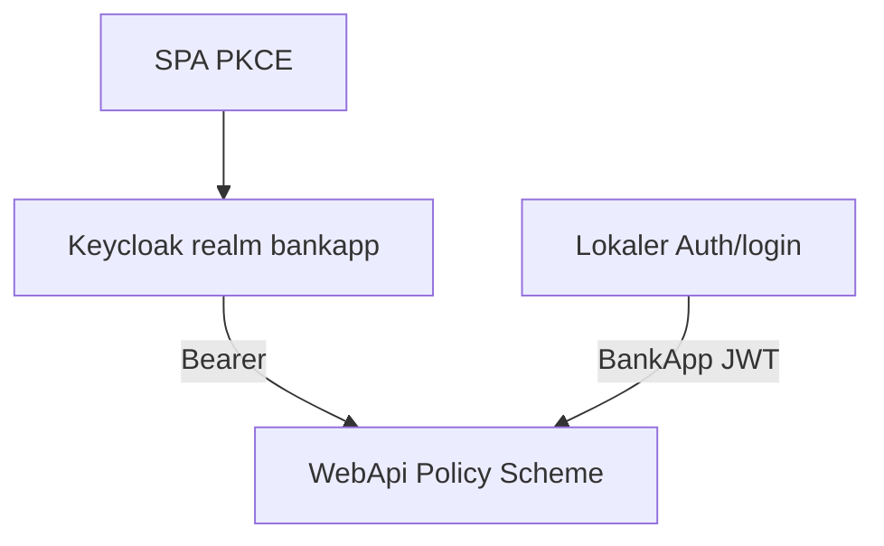
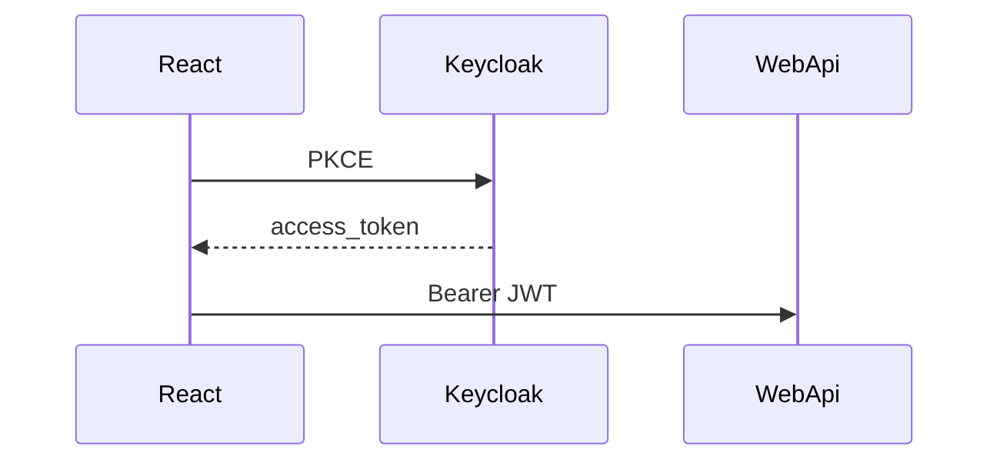

# 33 — Keycloak-Lab (Compose + Dual-JWT)

[← Zurück](32-admin-tailwind-dashboard.md) · [Inhalt](00-index.md) · [Weiter →](34-a11y-portable-kit.md)

Verwandt: [06 JWT / RBAC](06-jwt-rbac.md) · [19 Vault](19-vault-lab.md) · [09 Docker Compose](09-docker-compose.md)

## Was ist das?

**Keycloak** ist ein Open-Source-**IAM**-Server: Benutzer, Rollen, Clients; OpenID Connect liefert **JWT Access Tokens**.



## Rolle in BankApp

**Phase 1 — Compose + Realm**

- Keycloak `http://localhost:8180`
- Realm `bankapp` import (Rollen + Demo-User + `bankapp-api`)
- Password Grant für Token

**Phase 2 — WebApi Dual-JWT (Lab)**

- Bei `Keycloak:Enabled=true` akzeptiert WebApi **lokales** `TokenOptions`-JWT und **Keycloak**-Access-Token
- Issuer mit `/realms/bankapp` → Keycloak-Scheme; sonst lokale Signatur
- `role` → `ClaimTypes.Role`; Anreicherung per E-Mail aus SQL: `NameIdentifier` / `branchId` / `customerId`

**Phase 3 — SPA-Login (PKCE)**

- React: „Mit Keycloak anmelden“ → Authorization Code + PKCE (`oidc-client-ts`)
- Callback: `/login/callback`; Access Token über bestehendes `saveSession` / Bearer / SignalR
- Lokales E-Mail/Passwort-Formular **bleibt** (Dual-Path im Lab)

**Social OAuth (Identity Brokering)**

- Google / GitHub IdP: ohne Secret aus; mit Secret `keycloak-configure-social.sh`
- SPA nutzt dieselbe Keycloak-Schaltfläche; Social-Auswahl auf Keycloak-Login

## Wann hinzugefügt?

Roadmap „Keycloak-Unterstützung“ — Faz 1 Compose; danach Faz 2 Dual-Bearer.

## Grundbegriffe

| Begriff | Bedeutung |
|---------|-----------|
| Realm | Isolierter Mandant (`bankapp`) |
| Client | `bankapp-api` (public + Password Grant + PKCE-SPA) |
| Authority / JWKS | WebApi holt Signaturschlüssel von Keycloak |
| Policy scheme | JwtBearer je Token-Issuer |
| Claim enrich | Statt Keycloak-`sub` BankApp-User-Id |
| PKCE | SPA Code Flow; `code_challenge` S256 |
| start-dev | Lab-Modus (nicht Produktion) |



## Befehle

### Keycloak starten

```powershell
cd infra
docker compose --env-file .env up -d keycloak
```

**Check:** `docker compose ps keycloak` healthy; `http://localhost:8180` (admin/admin).

### Password-Grant-Token

```powershell
curl.exe -s -X POST "http://localhost:8180/realms/bankapp/protocol/openid-connect/token" `
  -H "Content-Type: application/x-www-form-urlencoded" `
  -d "grant_type=password" `
  -d "client_id=bankapp-api" `
  -d "username=staff.tr@bank.local" `
  -d "password=Demo123!"
```

### Geschützte API mit Keycloak-Token (Faz 2)

WebApi in Development oder Compose mit `Keycloak__Enabled=true`.

```powershell
# $TOKEN = access_token einfügen
curl.exe -s "http://localhost:8080/api/Profile" `
  -H "Authorization: Bearer $TOKEN"
```

**Check:** nicht 401; Profil/Personal wenn E-Mail im Seed passt inkl. `branchId`. Lokales Login-Token funktioniert weiter am selben Endpoint.

### SPA Keycloak-Login (Faz 3)

1. Client-Build: `VITE_KEYCLOAK_URL=http://localhost:8180`
2. `http://localhost:3000/login` → **Mit Keycloak anmelden**
3. Keycloak: `staff.tr@bank.local` / `Demo123!` (oder `manager.tr@`, `customer.tr@`, `superadmin@`)
4. Callback `/login/callback` → Dashboard / Anträge

**Check:** API-Requests mit Keycloak-JWT; UI-Rollen aus `role`-Claim.

Screenshots:

- SPA Keycloak-Login: [`Login with Keycloak.png`](../../assets/screenshots/en/Login%20with%20Keycloak.png)
- Admin-Konsole: [`Keycloak Management.png`](../../assets/screenshots/en/Keycloak%20Management.png)

### Realm neu importieren

```powershell
docker compose --env-file .env stop keycloak
docker compose --env-file .env rm -f keycloak
docker compose --env-file .env up -d keycloak
```

### Social IdP (Google / GitHub)

1. OAuth-App anlegen; Redirect:  
   `http://localhost:8180/realms/bankapp/broker/google/endpoint`  
   `http://localhost:8180/realms/bankapp/broker/github/endpoint`
2. Client-ID/Secret in `infra/.env` (oder `-e` in `exec`).
3. Skript:

```powershell
cd infra
docker compose --env-file .env exec `
  -e KEYCLOAK_GOOGLE_CLIENT_ID=... `
  -e KEYCLOAK_GOOGLE_CLIENT_SECRET=... `
  -e KEYCLOAK_GITHUB_CLIENT_ID=... `
  -e KEYCLOAK_GITHUB_CLIENT_SECRET=... `
  keycloak /bin/sh /keycloak-configure-social.sh
```

**Check:** Google/GitHub auf Keycloak-Login; nach first-broker-login User im Realm. Für BankApp-Enrich muss E-Mail zu SQL `Users` passen (Lab: Seed-User bevorzugen).

**Alternativ:** Admin Console → Realm `bankapp` → Identity providers.

## Klassen, Methoden, Pakete

| Name | Rolle |
|------|------|
| `KeycloakOptions` | Enabled, Authority, ValidIssuers |
| `AddBankAppJwtAuthentication` | Lokal + Keycloak JwtBearer + `BankApp` Policy Scheme |
| `KeycloakTokenEnricher` | `role` → Role + SQL-Enrich |
| `infra/keycloak/bankapp-realm.json` | Realm-Import |
| `JwtHelper` / Auth login | Lokale Token-Erzeugung (unverändert) |
| `oidc-client-ts` / `keycloakOidc.ts` | SPA PKCE Redirect + Callback |
| `LoginCallbackPage` | `/login/callback` |

## Wo im Repo?

- `infra/docker-compose.yml` — `keycloak` + WebApi `Keycloak__*` + Client `VITE_KEYCLOAK_*`
- `infra/keycloak/bankapp-realm.json`
- `src/WebApi/Configuration/KeycloakOptions.cs`
- `src/WebApi/Authentication/KeycloakAuthenticationExtensions.cs`
- `src/WebApi/Authentication/KeycloakTokenEnricher.cs`
- `src/WebApi/appsettings*.json`
- `client/src/auth/keycloakOidc.ts`, `LoginPage`, `LoginCallbackPage`

## Mini-Ablauf

1. Keycloak up → Realm-Import
2. SPA Keycloak → PKCE → `access_token` → `saveSession`
3. WebApi Bearer Keycloak → Scheme → JWKS → Enrich
4. MediatR RBAC `ClaimRoles()` sieht BankStaff
5. Parallel: lokales Formular → `POST /api/Auth/login` → BankApp-JWT

## Wo hilft es?

### Gesundheits-Checkliste

- [ ] Admin-UI + Realm `bankapp`
- [ ] Token `role` enthält `BankStaff`
- [ ] Keycloak-Token: `/api/Profile` (oder Staff-Liste) 200
- [ ] SPA-Keycloak-Button → Callback → geschützte Seite
- [ ] Lokales `Auth/login`-Token funktioniert noch
- [ ] Keycloak aus (`Enabled=false`): nur lokales JWT

### Disaster / Recovery

1. `docker compose restart keycloak`
2. Keycloak recreate (Re-Import)
3. WebApi-Log JWKS/Issuer → `ValidIssuers` + `Authority` (Compose: `http://keycloak:8080/...`)
4. Port: `KEYCLOAK_PORT` (8180)

## Einstiegs-Lab

1. `docker compose up -d keycloak` → `:8180` admin/admin.
2. Password-Grant-curl (`staff.tr@bank.local` / `Demo123!`).
3. `Keycloak__Enabled=true` → `GET /api/Profile` mit Bearer 200.
4. SPA PKCE-Login → `/login/callback`.
5. Lokales Formular-Login parallel nutzbar.

## Häufige Fehler

- Issuer intern (`keycloak:8080`) vs Browser-URL — `ValidIssuers` prüfen.
- Keycloak-Token bei `Enabled=false` — nur lokales JWT.
- Social Login ohne SQL-E-Mail-Match — Enrich fehlt.
