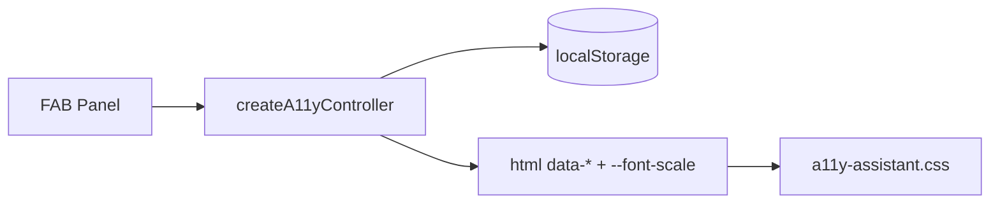
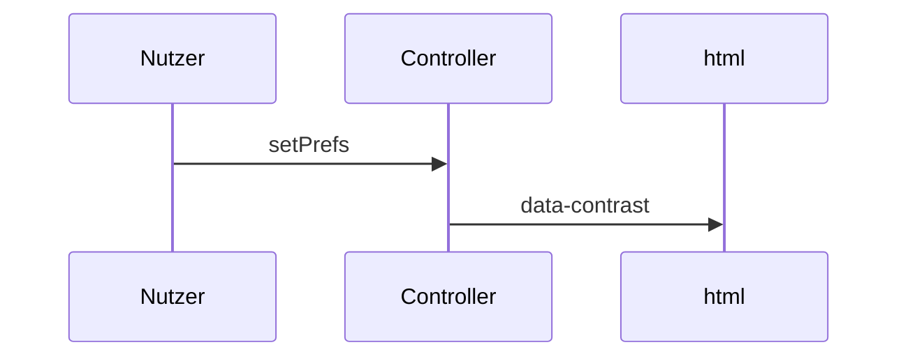

# 34 — Portables Barrierefreiheits-Kit (a11y)

[← Zurück](33-keycloak-lab.md) · [Inhalt](00-index.md)

Verwandt: [12 i18n / UX](12-i18n-ux.md) · Kit-README: [`client/src/a11y/README.md`](../../../client/src/a11y/README.md)

## Was ist das?

Ein **Barrierefreiheits-Assistent** als Overlay: Theme, Schriftgröße, Kontrast, Blaufilter, Bilder ausblenden, Link-Unterstreichung, Bewegung reduzieren, Farbenblind-Profil und einfache Seiten-Vorlesefunktion.

Der Code ist **kein kommerzielles Widget**; ein **Lab-Kit**, das du in einen anderen SPA kopieren kannst.



## Rolle in BankApp

- SPA: FAB unten rechts + vertikales Panel
- Einstellungen in `localStorage` (kompatibel mit älteren `bankapp-*`-Keys)
- `html`: `data-theme` / `data-contrast` / `data-a11y-*` + `--font-scale`
- Labels TR / EN / DE über `react-i18next`

## Wann hinzugefügt?

UX-Lab — nach Keycloak-SPA; Erweiterung der alten einfachen Toolbar zum portablen Kit.

## Grundbegriffe

| Begriff | Bedeutung |
|---------|-----------|
| **Prefs** | Einstellungsobjekt (`A11yPrefs`) |
| **Controller** | `createA11yController` — lesen / schreiben / anwenden |
| **data-\*** | HTML-Attribute für CSS |
| **TTS** | Browser `speechSynthesis` (Lab; ersetzt keinen Screenreader) |
| **Portable kit** | `core.ts` frameworkfrei; React nur UI-Hülle |



## Befehle

Kein eigenes CLI. Panel in der Entwicklung:

```powershell
cd client
npm run dev
```

Im Browser FAB (Personen-Icon) → Panel; Theme / A± / Filter testen → Seite neu laden → Einstellungen bleiben (DevTools → Application → Local Storage).

Checkliste Portierung:

```text
1) Ordner a11y/ kopieren
2) Host-CSS: --font-scale + data-theme / data-contrast
3) main/boot: applyA11yPrefs(readA11yPrefs(...))
4) Root: <AccessibilityAssistant labels={...} />
5) DEFAULT_A11Y_KEYS verwenden (nicht BankApp-Legacy)
```

## Klassen, Methoden, Pakete

| Name | Rolle |
|------|------|
| `createA11yController` | Lebenszyklus der Prefs |
| `applyA11yPrefs` / `readA11yPrefs` | DOM + Storage |
| `speakPageText` / `stopSpeaking` | Lab-TTS |
| `AccessibilityAssistant` | React FAB + Panel |
| `AccessibilityToolbar` | BankApp-i18n-Wrapper |
| `BANKAPP_A11Y_KEYS` / `DEFAULT_A11Y_KEYS` | Storage-Key-Sets |

Kein NuGet/npm-Paket — Ordnerkopie.

## Wo im Repo?

```
client/src/a11y/core.ts
client/src/a11y/a11y-assistant.css
client/src/a11y/AccessibilityAssistant.tsx
client/src/a11y/index.ts
client/src/a11y/README.md
client/src/components/AccessibilityToolbar.tsx
client/src/main.tsx          # Boot
client/src/locales/*/common.json  # a11y.*
```

## Mini-Ablauf

Nutzer tippt FAB → Panel öffnet (`panelOpen`) → „Hoher Kontrast“ → `controller.setPrefs` → `localStorage` + `data-contrast=high` → CSS-Tokens ändern → nach Reload wendet `main.tsx` dieselben Prefs an.

Bildschirm (FAB + Panel — Theme / Schrift / Kontrast):


## Wo hilft es?

### Gesundheit

- [ ] FAB sichtbar (wenn nicht ausgeblendet)
- [ ] Theme / Schrift / Kontrast über Reload hinweg
- [ ] Blaufilter-Overlay blockiert Klicks nicht (`pointer-events: none`)
- [ ] TTS start/stop (unterstützender Browser)

### Lab Disaster / Recovery (weniger zuerst)

1. **Zurücksetzen** im Panel
2. DevTools → Local Storage → `bankapp-theme` / `bankapp-a11y-*` löschen → Reload
3. Assistent ausgeblendet: FAB bleibt; Klick öffnet Panel wieder

## Einstiegs-Lab

1. `cd client` → `npm run dev` → FAB unten rechts.
2. Dunkles Theme + Schrift A+ → Reload → Einstellungen bleiben.
3. Blaufilter — Klicks durch Overlay (`pointer-events: none`).
4. TTS start/stop; Panel Zurücksetzen.

## Häufige Fehler

- TTS als **Screenreader** missverstehen — nur Lab-Demo.
- Portieren ohne `DEFAULT_A11Y_KEYS`.
- `--font-scale` in Host-CSS vergessen.
