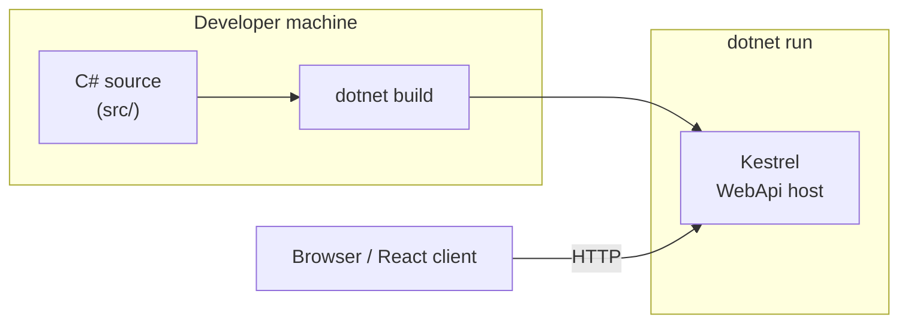
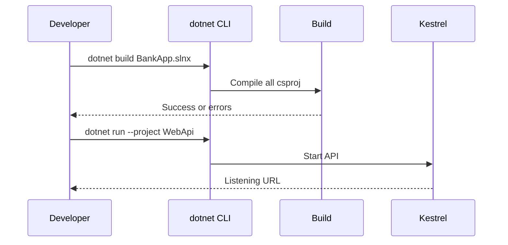

# 01 — .NET and C# fundamentals

[← Contents](00-index.md) · [Next: Clean Architecture →](02-clean-architecture.md)

## What is this?

**.NET** is Microsoft’s application platform (runtime + libraries + SDK).  
**C#** is the language we write on that platform. The BankApp backend is built with **.NET 10** / **C#**.

**Analogy:** `BankApp.slnx` is a **filing cabinet**; each `.csproj` is a drawer. `dotnet build` checks every drawer and produces binaries; `dotnet run` opens the WebApi drawer and starts listening.

“SDK” = the toolset on your machine that lets you run the `dotnet` command.



## Role in BankApp

- The whole API (`WebApi`), business rules (`Application`), domain (`Domain`), and data access (`Persistence`) are C# projects.
- Solution file: `BankApp.slnx` (manages multiple `.csproj` files together).

## When added?

**Phase 1** — from day one of the project.

## Core concepts

| Concept | Meaning |
|--------|--------|
| **Solution (`.sln` / `.slnx`)** | A “solution” that groups multiple projects |
| **Project (`.csproj`)** | A buildable unit (e.g. WebApi) |
| **Namespace** | A name scope that groups classes like folders |
| **Class / Interface** | Type definitions; `interface` is a contract, `class` is an implementation |
| **async / await** | Waiting without blocking the thread during I/O |
| **NuGet** | .NET package manager (`PackageReference`) |
| **TargetFramework** | e.g. `net10.0` — which .NET version to compile for |



## Commands

```powershell
# Show SDK version
dotnet --version

# Build all projects in the solution
dotnet build BankApp.slnx

# Run only WebApi (Development)
dotnet run --project src/WebApi/WebApi.csproj

# Download NuGet packages (restore)
dotnet restore BankApp.slnx

# Run tests
dotnet test BankApp.slnx --configuration Release
```

| Parameter / flag | What it does |
|--------------------|----------------|
| `--project` | Which `.csproj` to run |
| `--configuration Release` | Optimized production build (used in CI) |
| `--no-restore` | Skip restore when CI already restored in a separate step |

## Classes, methods, packages

- Example project file: `src/WebApi/WebApi.csproj` → `<TargetFramework>net10.0</TargetFramework>`
- Entry point: `src/WebApi/Program.cs` — configures the host, registers DI (dependency injection), adds middleware.
- Shared infrastructure: `src/Core` (pipeline, exception, security helpers).

Important package ideas for beginners (details in later chapters):

- `MediatR` — request dispatch  
- `FluentValidation` — validation  
- `Microsoft.EntityFrameworkCore.*` — database  

## Where in the repo?

```
BankApp.slnx
src/WebApi/Program.cs
src/WebApi/WebApi.csproj
src/Application/Application.csproj
src/Domain/Domain.csproj
src/Persistence/Persistence.csproj
src/Core/Core.csproj
```

## Mini flow

1. `dotnet build` → C# source is compiled to IL.  
2. `dotnet run --project src/WebApi` → Kestrel web server starts.  
3. Browser / React client sends HTTP requests to the API at `http://localhost:…`.

Screen (Scalar API docs):


## Beginner lab

1. Run `dotnet --version` — confirm the SDK is installed (project targets `net10.0`).
2. At repo root: `dotnet restore BankApp.slnx`.
3. `dotnet build BankApp.slnx` — expect “Build succeeded”.
4. `dotnet run --project src/WebApi/WebApi.csproj` — note the listening URL.
5. Open `/health` or Scalar/OpenAPI in the browser — 200 / docs load.

## Common mistakes

- Building with an outdated SDK → update SDK or check `global.json`.  
- Running `dotnet run` from the wrong folder → pass `--project` with the full path.  
- Skipping restore → “package not found” on build.  

## Where it helps

- [ ] `dotnet build` succeeds for the whole solution  
- [ ] WebApi runs locally and health responds  
- [ ] You use the same SDK version CI expects for `dotnet test`  
