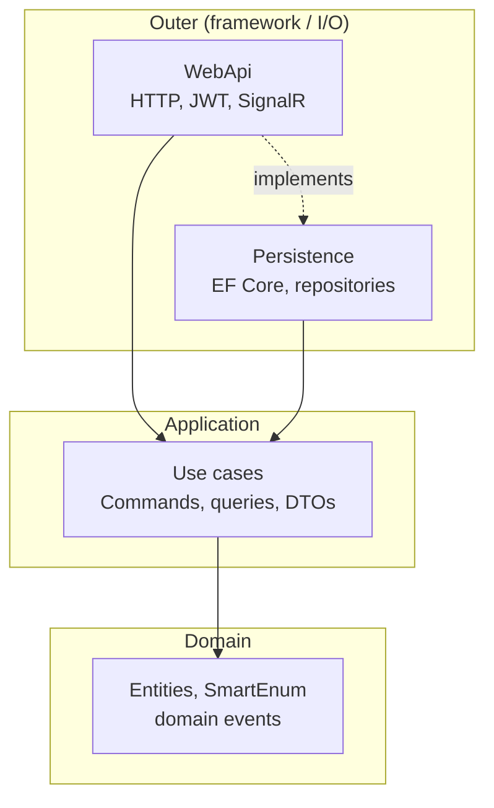

# 02 — Clean Architecture

[← Previous](01-dotnet-csharp.md) · [Contents](00-index.md) · [Next →](03-ef-core-sql.md)

## What is this?

**Clean Architecture** splits code into layers: **business rules** stay near the center, **UI / DB / framework** stay on the outside.  
Dependency arrows point **inward**: outer layers know inner ones; inner layers do not know outer ones.



## Role in BankApp

BankApp layers:

| Layer | Responsibility |
|--------|--------|
| **Domain** | Entity, enum/SmartEnum, domain event — independent of frameworks |
| **Application** | Use cases (command/query handlers), rules, DTOs |
| **Persistence** | EF Core, repository, seed |
| **WebApi** | HTTP, JWT, SignalR, hosted services |
| **Core** | Shared pipeline / exception / security helpers |

## When added?

**Phase 1**.

## Core concepts

| Concept | Meaning |
|--------|--------|
| **Dependency Inversion** | High-level code depends on abstractions (`interface`) |
| **DTO** | Plain data object for API input/output |
| **Business rule** | Domain/application rule such as “Only Pending can be approved” |
| **Repository** | Interface that abstracts data access |

## Commands

Clean Architecture is not a CLI tool; layers are wired with project references:

```xml
<!-- Application references Domain (example idea) -->
<ProjectReference Include="..\Domain\Domain.csproj" />
```

Wrong direction: `Domain` → `WebApi` reference **must not** exist.

## Classes, methods, packages

- Registration: `ApplicationServiceRegistration.cs`, `PersistenceServiceRegistration.cs`
- WebApi `Program.cs` wires layers with `builder.Services.Add…()`.
- Module split (later): `Application/Modules/*`, `WebApi/Modules/*` → [17](17-modular-monolith.md)

## Where in the repo?

```
src/Domain/
src/Application/
src/Persistence/
src/WebApi/
src/Core/
```

## Mini flow

**Approve button** → `WebApi` controller → `Application` handler → `Domain` aggregate method → `Persistence` `SaveChanges` → (later) Outbox / SignalR.
