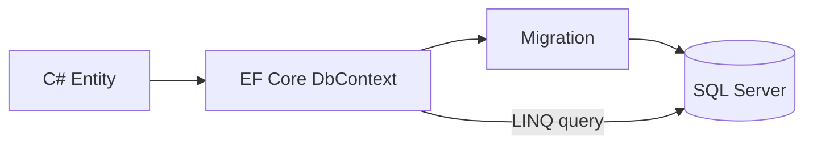

# 03 — EF Core and SQL Server

[← Previous](02-clean-architecture.md) · [Contents](00-index.md) · [Next →](04-cqrs-mediatr.md)

## What is this?

**Entity Framework Core (EF Core)** is an ORM that maps C# objects to SQL tables.  
**SQL Server** is a relational database. In BankApp, main persistence lives here.



## Role in BankApp

- Customers, credit types, applications, outbox, and saga rows are stored in SQL.
- **TPT** (Table Per Type): individual / corporate customers in separate tables with a shared base.
- Migration + seed (Bogus + fixed catalog) produces lab data.

## When added?

**Phase 1** (DB); SQL via Compose in **Phase 3**.

## Core concepts

| Concept | Meaning |
|--------|--------|
| **DbContext** | Session + change tracking |
| **DbSet\<T\>** | A collection of one entity type (like a table) |
| **Migration** | A versioned schema change |
| **Include** | Eager load of related data |
| **Soft delete** | Mark rows with `DeletedDate` etc. instead of deleting |
| **TPT** | Separate tables for inheritance |

## Commands

```powershell
# Add migration (from Persistence project / design-time factory)
dotnet ef migrations add Name --project src/Persistence --startup-project src/WebApi

# Apply migrations to the database
dotnet ef database update --project src/Persistence --startup-project src/WebApi
```

| Flag | Meaning |
|--------|--------|
| `--project` | Project where migrations live |
| `--startup-project` | Host where connection string / DI is read |

In the Docker lab the port is usually `11433` → `1433` inside the container (`infra/docker-compose.yml`).

## Classes, methods, packages

| Package | Role |
|-------|-----|
| `Microsoft.EntityFrameworkCore` | Core API |
| `Microsoft.EntityFrameworkCore.SqlServer` | SQL provider |
| `Microsoft.EntityFrameworkCore.Design` / `Tools` | Migration CLI |

- Context: `Persistence/Contexts/BankingDbContext.cs`
- Config: `Persistence/EntityConfigurations/*`
- Repo: `Persistence/Repositories/*` implementing `Application/Services/Repositories/*`
- Important methods: `GetAsync`, `AddAsync`, `UpdateAsync`, `SaveChangesAsync`

## Where in the repo?

```
src/Persistence/Contexts/BankingDbContext.cs
src/Persistence/EntityConfigurations/
src/Persistence/Repositories/
src/Domain/Entities/
infra/docker-compose.yml   # sqlserver service
```

## Mini flow

Handler calls `ICreditApplicationRepository.GetAsync(...)` → EF generates SQL → row loads into memory → `Approve(...)` → `UpdateAsync` → `SaveChangesAsync` commits the transaction.
