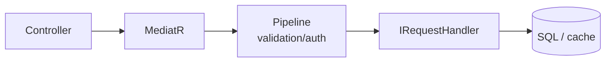

# 04 — CQRS and MediatR

[← Previous](03-ef-core-sql.md) · [Contents](00-index.md) · [Next →](05-validation-smartenum.md)

## What is this?

**CQRS** (Command Query Responsibility Segregation): the idea of separating **writes** (Command) from **reads** (Query).  
**MediatR**: Instead of the controller `new`-ing a handler directly, it hands the request to a mediator (“process this request”).



## Role in BankApp

- `ApproveCreditApplicationRequest` → Handler approves.
- `GetListCreditApplicationRequest` → Handler lists.
- Pipeline: validation, authorization, logging, caching (`IPipelineBehavior`).

## When added?

**Phase 1**.

## Core concepts

| Concept | Meaning |
|--------|--------|
| **IRequest\<TResponse\>** | MediatR request contract |
| **IRequestHandler\<,\>** | Class that handles the request |
| **IPipelineBehavior** | Middleware that runs before/after the handler |
| **Command** | Request that changes state |
| **Query** | Read that does not change state |

## Commands

Adding MediatR (already in the repo; for learning):

```powershell
dotnet add src/Application package MediatR
```

Not a runtime CLI; DI registration:

```csharp
services.AddMediatR(cfg => cfg.RegisterServicesFromAssembly(...));
```

(Similar registration exists in `ApplicationServiceRegistration`.)

## Classes, methods, packages

| Name | Role |
|------|-----|
| `IMediator.Send(request)` | Sends the request to the handler |
| `ApproveCreditApplicationRequest` | Approve command |
| `ApproveCreditApplicationRequestHandler.Handle` | Main work |
| `RequestValidationBehavior` | Runs FluentValidation |
| `AuthorizationBehavior` | Checks `ISecuredRequest` roles |
| `LoggingBehavior` | Duration / error logging |

Package: `MediatR` (Application + Core pipeline).

## Where in the repo?

```
src/Application/Modules/**/Features/**/Commands/
src/Application/Modules/**/Features/**/Queries/
src/Core/Application/Pipelines/
src/WebApi/Modules/**/Controllers/
```

## Mini flow

`POST /api/CreditApplications/{id}/approve`  
→ Controller `mediator.Send(new Approve…Request { … })`  
→ Authorization → Validation → Logging → Handler  
→ Response DTO.
