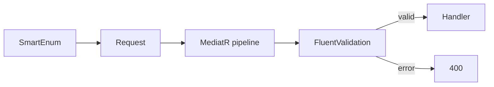
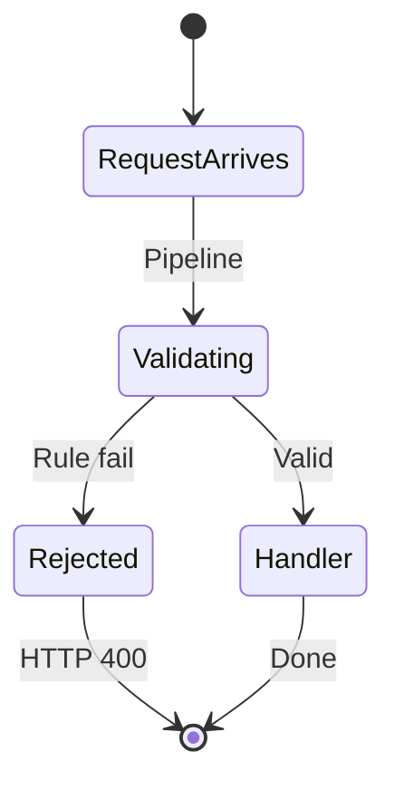

# 05 — FluentValidation and SmartEnum

[← Previous](04-cqrs-mediatr.md) · [Contents](00-index.md) · [Next →](06-jwt-rbac.md)

## What is this?

**FluentValidation**: Fluent rules for request objects (`RuleFor…`).  
**Ardalis SmartEnum**: Named, type-safe enum-like classes instead of magic strings/ints (`Pending`, `Approved`…).

**Analogy:** FluentValidation is **security at the door**; SmartEnum is the official **status label** on the card (cannot typo the value).



## Role in BankApp

- Create/approve/reject validators reject invalid amounts or empty income.
- `CreditApplicationStatus`, `CreditCategory`, `CreditRiskLevel` are SmartEnums (JSON usually uses **name**).

## When added?

**Phase 1**.

## Core concepts

| Concept | Meaning |
|--------|--------|
| **AbstractValidator\<T\>** | Rule set for T |
| **RuleFor** | Rule for one property |
| **When** | Conditional rule |
| **SmartEnum** | Class carrying `Name` + `Value` |
| **TryFromName** | Parse string → SmartEnum |



## Commands

```powershell
dotnet add src/Application package FluentValidation.DependencyInjectionExtensions
dotnet add src/Domain package Ardalis.SmartEnum
```

## Classes, methods, packages

| Example | Role |
|-------|-----|
| `CreateCreditApplicationRequestValidator` | `MonthlyIncome` NotNull / GreaterThan(0) |
| `CreditApplicationStatus.Pending` | Status constant |
| `CreditCategory.TryFromName(...)` | Filter parse |

Packages: `FluentValidation`, `FluentValidation.DependencyInjectionExtensions`, `Ardalis.SmartEnum`, `Ardalis.SmartEnum.SystemTextJson` (WebApi).

## Where in the repo?

```
src/Application/**/**RequestValidator.cs
src/Domain/Enums/
src/WebApi  # SmartEnum JSON converter registration
```

## Mini flow

Request arrives → `RequestValidationBehavior` finds validator → rule fails → `ValidationException` → ProblemDetails 400.  
On success, flow continues to the handler; status is compared with `CreditApplicationStatus.Pending`.

## Beginner lab

1. Open `CreateCreditApplicationRequestValidator` → read `RuleFor` examples.
2. POST invalid body (e.g. `monthlyIncome: 0`) → 400 ProblemDetails.
3. Compare JSON status with `CreditApplicationStatus.Pending.Name`.
4. Test `TryFromName` with unknown string → false / error path.
5. Valid request → handler runs, status stays Pending.

## Common mistakes

- Mixing C# `enum` with SmartEnum → different JSON serialization.  
- Validators not inheriting `AbstractValidator` → pipeline cannot find them.  
- Magic string `"Pending"` → use `CreditApplicationStatus.Pending`.  

## Where it helps

- [ ] Bad input stopped before the handler  
- [ ] Status values live in one place (`Domain/Enums`)  
- [ ] Field-level error messages are readable  
