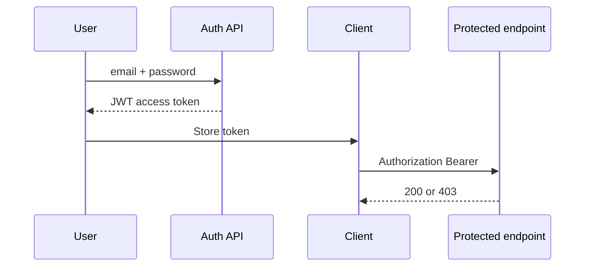

# 06 — JWT and RBAC

[← Previous](05-validation-smartenum.md) · [Contents](00-index.md) · [Next →](07-serilog-seq.md)

## What is this?

**JWT** (JSON Web Token): A signed identity ticket the client sends on every request after login.  
**RBAC** (Role-Based Access Control): Granting access by **role** (`Customer`, `BankStaff`, `BankManager`).

**Analogy:** A JWT is a concert **wristband**; the guard (API) reads the role on the band before letting you on stage (endpoint).


## Role in BankApp

- `POST /api/Auth/login` → access token.
- Customer creates/cancels their own application; Staff approves; Manager manages credit types.
- MediatR `ISecuredRequest` + `Roles` list is checked in the pipeline.

## When added?

**Phase 2** (BankManager expanded later).

## Core concepts

| Concept | Meaning |
|--------|--------|
| **Claim** | Small fact inside the token (sub, role, email) |
| **Bearer** | `Authorization: Bearer <token>` scheme |
| **Access token** | API access ticket (may be short-lived) |
| **Password hash** | Password not stored in plain text |
| **ICurrentUserService** | User context read from the token |



## Commands

JWT is not produced via CLI; for testing:

```powershell
# While API is running (example)
curl -X POST http://localhost:8080/api/Auth/login `
  -H "Content-Type: application/json" `
  -d "{\"email\":\"staff.tr@bank.local\",\"password\":\"Demo123!\"}"
```

Demo accounts: root `README.md` / `README.tr.md`.

## Classes, methods, packages

| Name | Role |
|------|-----|
| `LoginRequestHandler` | Verify password, issue token |
| `ITokenHelper` / JWT settings | Signing + claims |
| `ICurrentUserService` | `UserId`, `IsBankManager`, … |
| `AuthorizationBehavior` | `AuthorizationException` if role missing |
| `GeneralOperationClaims` | Role constants |

Packages: `Microsoft.AspNetCore.Authentication.JwtBearer`, `System.IdentityModel.Tokens.Jwt`.

## Where in the repo?

```
src/Application/Modules/Identity/Features/Auth/
src/WebApi/Modules/Identity/
src/Core/Security/
src/Core/Application/Pipelines/Authorization/
```

## Mini flow

Login → compare hash → write roles into JWT claims → client puts token in header → every MediatR command checks roles.

Screenshot (login): [`Login Page and Privacy.png`](../../assets/screenshots/en/Login%20Page%20and%20Privacy.png)

## Beginner lab

1. `POST /api/Auth/login` with a demo account from README (curl or Scalar).
2. Decode the token at jwt.io → read `role` claims (do not commit tokens).
3. Call approve with staff token → 200.
4. Same call with customer token → expect 403.
5. Login in the client → verify `Bearer` on subsequent requests in Network.

## Common mistakes

- Logging or sharing tokens in query strings → use header only.  
- Retrying with an expired token → login again.  
- Typos in role names → use `GeneralOperationClaims` constants.  

## Where it helps

- [ ] Login returns a token  
- [ ] Wrong role gets 403  
- [ ] `ICurrentUserService` sees the right user  
