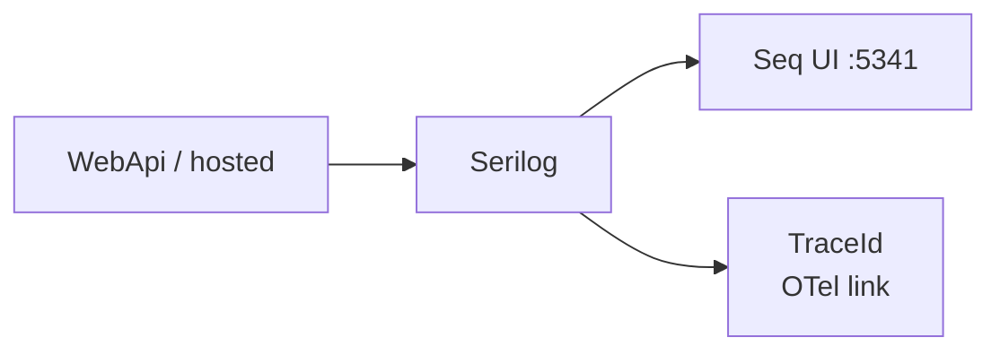
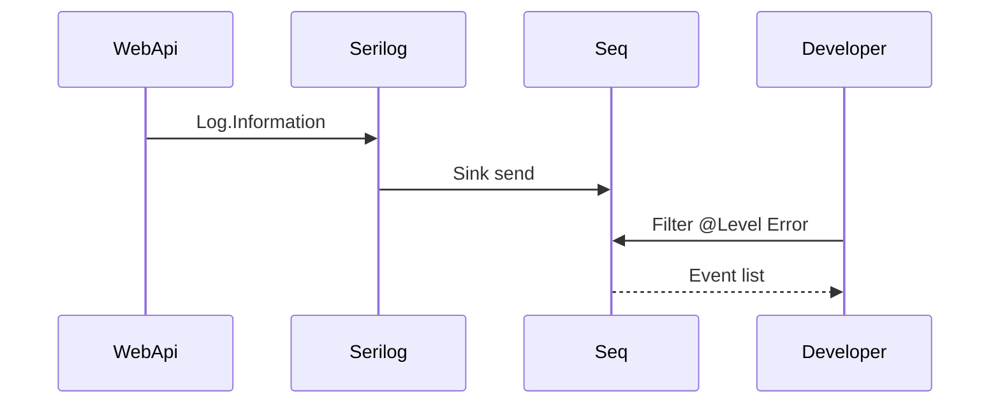

# 07 — Serilog and Seq

[← Previous](06-jwt-rbac.md) · [Contents](00-index.md) · [Next →](08-redis.md)

Related lab summary: [24 — Lab tools](24-lab-tools.md) · Compose recovery: [09](09-docker-compose.md)

## What is this?

**Serilog**: Structured logging library.  
**Seq**: Server that collects those logs and lets you search them in a UI (Docker in the lab).

**Analogy:** Serilog is the kitchen **logbook**; Seq is the **search engine** over those books — “who logged in yesterday?” answers in seconds.



## Role in BankApp

- Request pipeline errors, audit (`IAuditLogger` / `SerilogAuditLogger`), host lifecycle.
- When OTel is on, logs can correlate with TraceId (log ↔ trace).
- Decision letter / email lab messages also land in Seq (no SMTP).

## When added?

**Phase 2**; Seq via Compose in **Phase 3**.

## Core concepts

| Concept | Meaning |
|--------|--------|
| **Sink** | Where logs go (console, Seq, file) |
| **Enricher** | Extra fields such as environment name, machine name |
| **Structured log** | Message with properties like `"{UserId} login"` |
| **Audit** | Business event: “Who did what?” |
| **Signal** | Saved search / alert in Seq (optional in the lab) |



## Commands

```powershell
cd infra

# Start Seq container (not needed if stack is already up)
docker compose --env-file .env up -d seq
# Check: compose ps → seq healthy; browser opens http://localhost:5341 (no login in lab)
```

```powershell
# Is Seq up / writing logs?
docker compose --env-file .env ps seq
docker compose --env-file .env logs --tail=50 seq
# WebApi sink errors:
docker compose --env-file .env logs --tail=80 webapi
```

**Seq UI (http://localhost:5341) — what to check**

1. Events list — after login / CreditTypes GET, do new rows appear?
2. Filter examples (top search box):
   - `@Level = 'Error'` — errors only
   - `Application like '%BankApp%'` — application name
   - `RequestPath like '/api/%'` — API requests
   - `TraceId = '...'` — id copied from Grafana Tempo (when OTel is on)
3. Click an event → property panel (UserId, StatusCode, etc.).

```powershell
# Rough host → UI reachability test (PowerShell)
curl -s -o NUL -w "%{http_code}`n" http://localhost:5341
# Expected: 200 (or Seq redirect code); if no connection, check compose ps
```

### What to verify?

| Check | How | Good sign |
|---------|-------|-------------|
| Seq healthy | `compose ps seq` | healthy |
| UI | `:5341` | Events load |
| Sink working | Login or `/api/...` → Seq Events | New row + timestamp |
| Trace bridge | TraceId in Grafana → Seq filter | Log with same id |

### Disaster / recovery (lab)

| Situation | Path |
|-------|-----|
| UI empty but API works | `logs webapi` — Seq URL/connection error? In Compose use Seq URL `http://seq` |
| Seq restart loop | `logs seq`; reset volume below if corrupted |
| Disk / old lab log clutter | Reset Seq (+ Redis) volume — **destructive** |

```powershell
# Destructive: lab data for Seq (and other compose -v volumes) is removed; external SQL stays
# docker compose --env-file .env down -v
# docker compose --env-file .env up -d --build
```

**Best practice:** Do not log passwords / raw JWT / full PII. In production use Seq auth + retention. In the lab start with Error, then Information.

## Classes, methods, packages

| Package / class | Role |
|---------------|-----|
| `Serilog.AspNetCore` | Host integration |
| `Serilog.Sinks.Seq` | Seq sink |
| `UseSerilogRequestLogging` | HTTP request logging |
| `IAuditLogger.Log(...)` | Auth / Credit audit categories |

## Where in the repo?

```
src/WebApi/Program.cs          # Serilog bootstrap
src/Application/Services/Logging/
infra/docker-compose.yml       # seq service
infra/README.md
```

## Mini flow

Exception → LoggingBehavior / middleware → Serilog → event list in Seq UI.  
With OTel on, the same request’s TraceId matches in Grafana + Seq.

Screen (Seq Events — structured log list):


## Beginner lab

1. `cd infra` → `docker compose --env-file .env up -d seq webapi`.
2. Open `http://localhost:5341` → Events should not stay empty after traffic.
3. Log in via the app → new row in Seq.
4. Filter: `@Level = 'Error'` — may be empty until you trigger an error.
5. `docker compose logs --tail=30 webapi` → any Seq sink errors?

## Common mistakes

- Running WebApi on the host with wrong Seq URL → in Compose use `http://seq`.  
- Plain string concatenation logging → use structured properties.  
- Logging JWT/passwords at Information → mask or use audit categories.  

## Where it helps

- [ ] Event after login in Seq  
- [ ] Error filter works  
- [ ] `compose ps seq` healthy  
