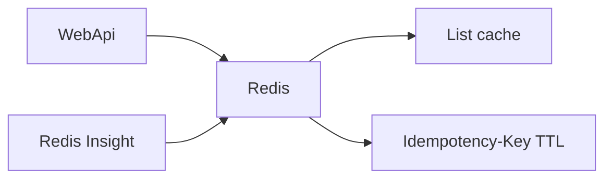

# 08 — Redis (cache and Idempotency)

[← Previous](07-serilog-seq.md) · [Contents](00-index.md) · [Next →](09-docker-compose.md)

## What is this?

**Redis**: Fast in-memory key-value store.  
In BankApp two main jobs: **cache** (lists) and storing **Idempotency-Key** values.



## Role in BankApp

1. Speed up reads such as credit type / sub-type lists (`ICacheRemoverRequest` for invalidation).
2. Safely handle repeated create/approve/reject/cancel with the same `Idempotency-Key` (24-hour TTL).
3. In the lab, browse keys in the browser via **Redis Insight** UI (`http://localhost:5540`).

## When added?

Cache: **Phase 2–3**. Idempotency: **Phase 6**. Redis Insight UI: lab (Compose).

## Core concepts

| Concept | Meaning |
|--------|--------|
| **Key / Value** | Key and value |
| **TTL** | Time until the key is removed automatically |
| **Cache stampede** | Sudden DB load when cache is empty (worth knowing) |
| **Idempotency** | Sending the same request twice yields the same effect / replay |
| **Redis Insight** | Official web UI; Redis has no built-in UI |

## Commands

```powershell
cd infra
docker compose --env-file .env up -d redis redis-insight

# Optional: enter container and inspect keys
docker compose exec redis redis-cli KEYS "*"
```

Browser: `http://localhost:5540` → **Add Redis database** → Host **`redis`**, Port **`6379`**, no password.  
(`localhost` from the Insight container does not reach Redis; use the Compose service name.)

HTTP side:

```http
POST /api/CreditApplications
Idempotency-Key: 3f2c9a...   # client generates (UUID)
```

## Classes, methods, packages

| Name | Role |
|------|-----|
| `Microsoft.Extensions.Caching.StackExchangeRedis` | IDistributedCache |
| Cache pipeline / `ICacheRemoverRequest` | Clear group on write |
| Idempotency middleware / filter (WebApi Credit) | Key + body hash check |

## Where in the repo?

```
src/WebApi/…          # Redis DI, idempotency
src/Core/…            # cache pipeline pieces
infra/docker-compose.yml   # redis + redis-insight
infra/.env.example         # REDIS_INSIGHT_PORT
tests/.../IdempotencyKeyTests.cs
```

## Mini flow (Idempotency)

First POST + Key → operation runs, response written to Redis.  
Same Key + same body → stored response replayed (no second outbox).  
Same Key + different body → **409 Conflict**.
