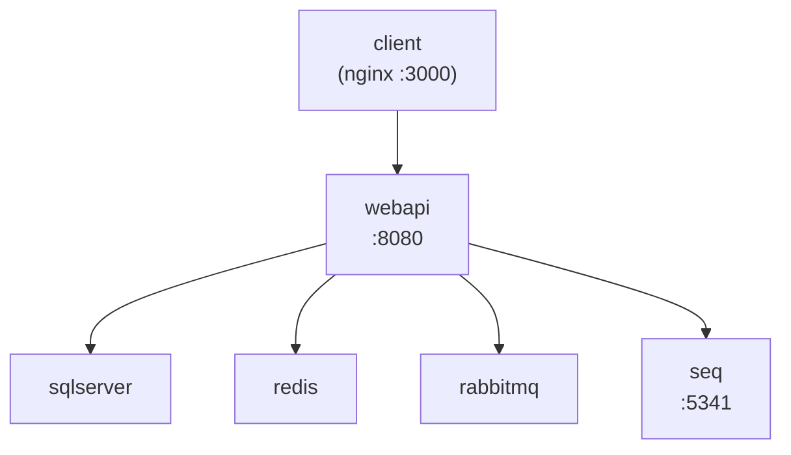
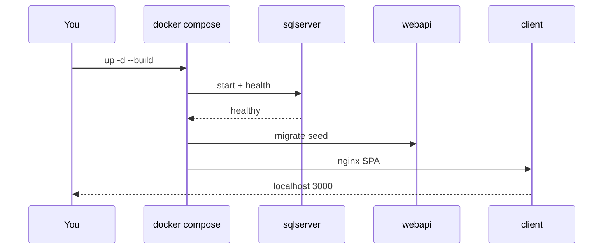

# 09 — Docker Compose

[← Previous](08-redis.md) · [Contents](00-index.md) · [Next →](10-testing.md)

## What is this?

**Docker**: Packages an app in a container.  
**Compose**: Brings up multiple containers (SQL, Redis, Seq, API, client, …) from a single YAML file.

**Analogy:** Compose is the **conductor** — one YAML score tells each musician (container) when to play.



## Role in BankApp

Local “lab prod” stack: DB + cache + logs + queue + Vault + OTel + WebApi + React nginx.

## When added?

**Phase 3**; services grew over time (RabbitMQ, Vault, OTel, Grafana…).

## Core concepts

| Concept | Meaning |
|--------|--------|
| **Image** | Runnable template |
| **Container** | Running instance of an image |
| **Volume** | Persistent disk (SQL data) |
| **Healthcheck** | Is the service ready? |
| **depends_on** | Startup order (strengthened with health) |
| **.env** | Compose variables (do not commit secrets) |



## Commands

Before each block: what it does / what to check afterward.  
Working directory is always `infra` (or from repo root with `-f` / `--env-file`).

### Daily use

```powershell
cd infra

# Create .env from template if missing (secrets here; do not commit)
copy .env.example .env

# Start full lab in background with image build
docker compose --env-file .env up -d --build
# Check: sql/redis/rabbit/webapi healthy in ps; http://localhost:8080/health → 200
```

```powershell
# Which containers are up, health status?
docker compose --env-file .env ps
# Expected: bankapp-sql / redis / rabbitmq / webapi → healthy (starting can take a while)
```

```powershell
# Follow WebApi logs live (migrate/seed/errors show here)
docker compose --env-file .env logs -f webapi
# Ctrl+C only stops following; container keeps running
```

```powershell
# Last N lines (quick peek without dumping to file)
docker compose --env-file .env logs --tail=100 webapi seq
```

```powershell
# Bring up one service only (e.g. after adding Redis Insight)
docker compose --env-file .env up -d redis redis-insight
```

```powershell
# Code changed: rebuild WebApi image without cache + update container
docker compose --env-file .env build --no-cache webapi
docker compose --env-file .env up -d webapi
# Check: logs -f webapi + /health
```

```powershell
# Stop stack; named volumes REMAIN (external SQL volume untouched)
docker compose --env-file .env down
```

| Flag / arg | What it does |
|--------------|----------------|
| `--env-file .env` | Read port/password variables |
| `-d` | Detached — does not block the terminal |
| `--build` | Rebuild image during `up` |
| `--no-cache` | Build without layer cache |
| `logs -f` | Follow — prints new lines as they arrive |
| `logs --tail=N` | Only last N lines |
| `exec …` | Run command inside running container (redis-cli etc.) |

Example URLs: WebApi `:8080`, client `:3000`, Seq `:5341`, Grafana `:3001`, Prometheus `:9090`, Redis Insight `:5540`, RabbitMQ UI `:15672`, Vault `:8200`.

### What to verify? (health checklist)

| Check | Command / URL | Good sign |
|---------|-------------|-------------|
| Containers | `compose ps` | `healthy` / `Up` |
| API alive | `http://localhost:8080/health` | 200, liveness |
| SQL ready | sql healthy in `ps`; SSMS `localhost,11433` | Connection opens |
| Redis | `docker compose exec redis redis-cli ping` | `PONG` |
| Log flow | Seq UI / `logs webapi` | Seed/login lines |
| Queue | RabbitMQ UI `:15672` | Consumer connected |
| Metric scrape | Prometheus Targets | `otel-collector` UP |

### Disaster / recovery paths (lab)

Try the **least destructive** step first; `-v` and volume deletes cannot be undone (lab data is lost).

| Situation | What to do? | Command / note |
|-------|---------|-------------|
| Single service crash loop | Check logs → restart only that service | `logs -f <service>` then `compose up -d --force-recreate <service>` |
| WebApi won’t start | SQL/Redis/Rabbit **healthy**? Seed error? | `ps` → dependencies; `logs webapi` |
| Port busy (3000/8080/…) | Change `CLIENT_PORT` / `WEBAPI_PORT` etc. in `.env` | `up -d` again |
| Redis / Seq “dirty” lab data | Remove stack with volumes (external SQL **stays**) | `compose down -v` — **Seq + Redis (+ Insight) data deleted** |
| Reset SQL too (full lab reset) | Delete external volume manually | `docker volume rm sqlserver-2025-data` then recreate volume and `up` (infra/README) |
| Broken image / odd cache | no-cache rebuild | `build --no-cache` + `up -d` |
| Nothing starts | Docker Desktop running? Disk full? | Restart Desktop; `docker info` |

```powershell
# --- Destructive: also delete Seq/Redis volumes (external SQL excepted) ---
# Confirm first: lab cache/log is lost
docker compose --env-file .env down -v

# --- More destructive: delete SQL data too ---
# docker volume rm sqlserver-2025-data
# Then recreate external volume (infra/README Prerequisites), up -d --build
```

```powershell
# In-container diagnostics (examples)
docker compose --env-file .env exec redis redis-cli ping
docker compose --env-file .env exec webapi printenv ASPNETCORE_ENVIRONMENT
```

Monitoring tools and debug chain: [24 — Lab tools](24-lab-tools.md).

## Classes, methods, packages

No “classes” here; important files:

- `infra/docker-compose.yml`
- `infra/.env.example` → copy to `.env`
- `src/WebApi/Dockerfile`, `client/Dockerfile`
- `DISABLE_HTTPS_REDIRECTION=true` (HTTP lab + Scalar)

## Where in the repo?

```
infra/docker-compose.yml
infra/.env.example
infra/README.md
```

## Mini flow

`compose up` → SQL healthy → WebApi migrate/seed → client nginx → login in the browser.

Screenshot: [`Containers on Docker.png`](../../assets/screenshots/en/Containers%20on%20Docker.png)

## Beginner lab

1. In `infra`, `copy .env.example .env` if missing.
2. `docker compose --env-file .env up -d --build` — first run can take a while.
3. `compose ps` → sql, redis, webapi **healthy**.
4. Open `http://localhost:8080/health` and `http://localhost:3000`.
5. `compose logs --tail=50 webapi` → see seed lines.

## Common mistakes

- Running without `.env` → wrong ports/passwords.  
- Hitting the API before health is ready → connection refused; wait for `healthy`.  
- Panic `down -v` when you only meant to stop containers → try `down` first.  

## Where it helps

- [ ] Full stack up with one command  
- [ ] Health checklist green  
- [ ] Migrate/seed verified in logs  
