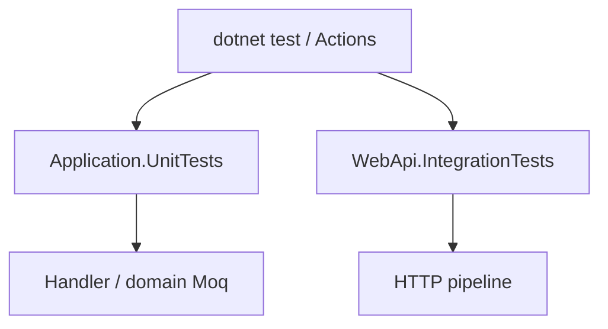

# 10 — Tests (xUnit, Moq, Integration)

[← Previous](09-docker-compose.md) · [Contents](00-index.md) · [Next →](11-react-vite.md)

## What is this?

**Unit test**: Exercises a small unit (handler, rule) in isolation; dependencies are **mocked**.  
**Integration test**: Boots the real WebApi pipeline (`WebApplicationFactory`) and exercises it over HTTP.



## Role in BankApp

- `Application.UnitTests`: domain rules, saga, approve handler, validators…
- `WebApi.IntegrationTests`: login, create→approve, idempotency, customer cancel…
- CI runs these on every push.

## When added?

Unit: **Phase 3**. Integration skeleton → flows: **Phase 5**.

## Core concepts

| Concept | Meaning |
|--------|--------|
| **xUnit** | `[Fact]` / `[Theory]` test framework |
| **Moq** | `Mock<T>`, `Setup`, `Verify` |
| **FluentAssertions** | Readable asserts: `Should().Be(...)` |
| **WebApplicationFactory** | In-process test host |
| **AAA** | Arrange / Act / Assert |

## Commands

```powershell
# All tests
dotnet test BankApp.slnx

# Unit only
dotnet test tests/Application.UnitTests/Application.UnitTests.csproj

# Integration only
dotnet test tests/WebApi.IntegrationTests/WebApi.IntegrationTests.csproj --configuration Release

# Filter
dotnet test --filter "FullyQualifiedName~ApproveCreditApplication"
```

| Flag | Meaning |
|--------|--------|
| `--filter` | Select tests by name pattern |
| `--no-build` | When CI built in a separate step |
| `-v normal` | More verbose output |

## Classes, methods, packages

| Package | Role |
|-------|-----|
| `xunit`, `Microsoft.NET.Test.Sdk` | Runner |
| `Moq` | Mocking |
| `FluentAssertions` | Assertions |
| `Microsoft.AspNetCore.Mvc.Testing` | Integration host |
| `Microsoft.EntityFrameworkCore.InMemory` | Lightweight DB (per factory setup) |

Example: `ApproveCreditApplicationRequestHandlerTests` — mock `ICurrentUserService` + `IApplicationUserRepository` → `DecisionBy` email.

## Where in the repo?

```
tests/Application.UnitTests/
tests/WebApi.IntegrationTests/
tests/WebApi.IntegrationTests/Infrastructure/CustomWebApplicationFactory.cs
.github/workflows/ci.yml
```

## Mini flow

`dotnet restore` → `dotnet build` → unit tests → integration tests → (parallel) client `npm` build.
