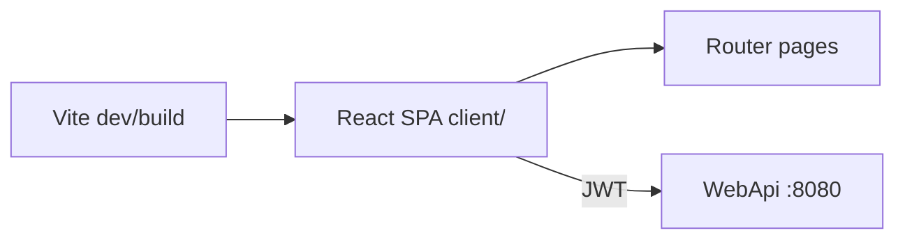

# 11 — React, Vite, and TypeScript

[← Previous](10-testing.md) · [Contents](00-index.md) · [Next →](12-i18n-ux.md)

## What is this?

**React**: Component-based UI library.  
**Vite**: Fast dev server + production bundler.  
**TypeScript**: Typed JavaScript — catches mistakes at compile time.



## Role in BankApp

`client/` SPA: login, dashboard, applications, customers, credit types, staff, profile; talks to the API with JWT.

## When added?

**Phase 4**.

## Core concepts

| Concept | Meaning |
|--------|--------|
| **Component** | `function Foo() { return <div/> }` |
| **Hook** | `useState`, `useEffect`, custom hooks |
| **SPA** | Single page; client-side routing |
| **react-router** | URL → page |
| **Fetch / api module** | HTTP client layer |

## Commands

```powershell
cd client
npm install          # dependencies from package-lock
npm run dev          # dev server
npm run build        # tsc + vite production
npm run preview      # preview build output
```

| Script | What it does |
|--------|-----------|
| `dev` | Local UI with HMR |
| `build` | Produces `dist/` (served by Docker nginx) |

Environment: `VITE_API_BASE_URL` (build-arg in Compose).

## Classes, methods, packages

| Package / file | Role |
|---------------|-----|
| `react`, `react-dom` | UI |
| `react-router-dom` | Routes |
| `@microsoft/signalr` | Live notifications |
| `client/src/api/*` | REST wrappers |
| `AuthContext` | Token / user state |
| `formatMoney` / `currencySymbol` | Money display |

## Where in the repo?

```
client/package.json
client/src/main.tsx
client/src/pages/
client/src/api/
client/Dockerfile
```

## Mini flow

`npm run dev` → Login → token in localStorage/context → ApplicationsPage loads list → SignalR toast.
