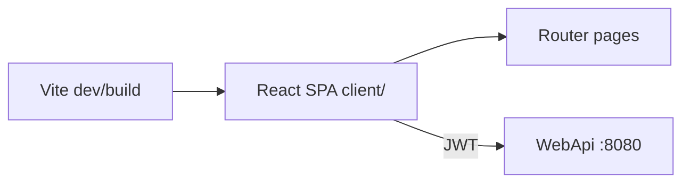
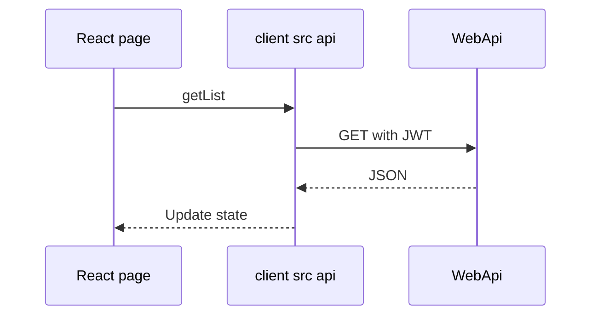

# 11 — React, Vite, and TypeScript

[← Previous](10-testing.md) · [Contents](00-index.md) · [Next →](12-i18n-ux.md)

## What is this?

**React**: Component-based UI library.  
**Vite**: Fast dev server + production bundler.  
**TypeScript**: Typed JavaScript — catches mistakes at compile time.

**Analogy:** React is a **Lego** kit (components); Vite is the fast **workbench**; TypeScript warns about missing pieces before you open the box.



## Role in BankApp

`client/` SPA: login, dashboard, applications, customers, credit types, staff, profile; talks to the API with JWT.

## When added?

**Phase 4**.

## Core concepts

| Concept | Meaning |
|--------|--------|
| **Component** | `function Foo() { return <div/> }` |
| **Hook** | `useState`, `useEffect`, custom hooks |
| **SPA** | Single page; client-side routing |
| **react-router** | URL → page |
| **Fetch / api module** | HTTP client layer |



## Commands

```powershell
cd client
npm install          # dependencies from package-lock
npm run dev          # dev server
npm run build        # tsc + vite production
npm run preview      # preview build output
```

| Script | What it does |
|--------|-----------|
| `dev` | Local UI with HMR |
| `build` | Produces `dist/` (served by Docker nginx) |

Environment: `VITE_API_BASE_URL` (build-arg in Compose).

## Classes, methods, packages

| Package / file | Role |
|---------------|-----|
| `react`, `react-dom` | UI |
| `react-router-dom` | Routes |
| `@microsoft/signalr` | Live notifications |
| `client/src/api/*` | REST wrappers |
| `AuthContext` | Token / user state |
| `formatMoney` / `currencySymbol` | Money display |

## Where in the repo?

```
client/package.json
client/src/main.tsx
client/src/pages/
client/src/api/
client/Dockerfile
```

## Mini flow

`npm run dev` → Login → token in localStorage/context → ApplicationsPage loads list → SignalR toast.

Screen (staff SPA dashboard):


Customer SPA dashboard:


## Beginner lab

1. `cd client` → `npm install` → `npm run dev`.
2. Check `.env` / `VITE_API_BASE_URL` points at the API.
3. Login → DevTools Application → token/context.
4. Under `src/pages`, find Applications → which `api/` module is called?
5. `npm run build` → `dist/` output (same as Docker).

## Common mistakes

- Blaming CORS when the API is down → check `8080/health` first.  
- Disabling TypeScript with `any` → use types in `client/src/api`.  
- Wrong `VITE_*` at production build → rebuild client with Compose `.env`.  

## Where it helps

- [ ] `npm run dev` starts  
- [ ] Protected pages load after login  
- [ ] `npm run build` matches CI  
