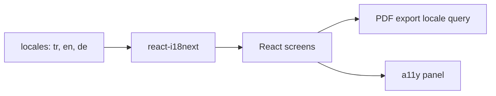
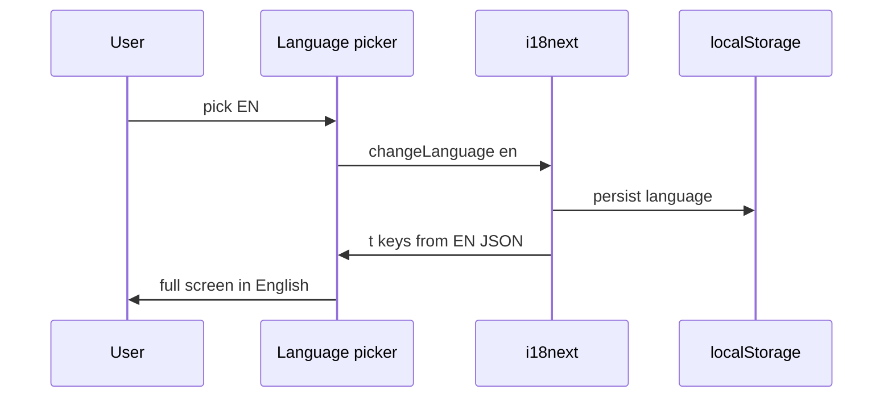

# 12 — i18n and UX (accessibility, privacy)

[← Previous](11-react-vite.md) · [Contents](00-index.md) · [Next →](13-rabbitmq.md)

## What is this?

**i18n** (internationalization): UI strings come from language files instead of hard-coded sentences in components.  
BankApp: **TR / EN / DE** (`react-i18next`).  
Also: accessibility panel, cookie/privacy banner, theme.

**Analogy:** i18n is the hotel **reception card in three languages**; the accessibility panel is the **remote** for light and text size. Same room, different languages and comfort settings.



## Role in BankApp

- Same screens in three languages; staff and customers pick a locale.
- Seeded product names follow locale.
- PDF export sends `locale` query (`tr` / `en` / `de`) to the API.
- Theme / font / contrast stored in the browser (`localStorage`).
- Extended a11y kit: [34 — a11y portable kit](34-a11y-portable-kit.md).

## When added?

i18n: **Phase 4**. Accessibility + privacy: **Phase 5**.

## Core concepts

| Concept | Meaning |
|--------|--------|
| **Locale** | `tr`, `en`, `de` — active language code |
| **Translation key** | `applications.approve` — path in JSON |
| **t('key')** | Translation function in React |
| **Namespace** | Split large JSON files (optional) |
| **Persisted preference** | Language and theme in `localStorage` |
| **Interpolation** | Placeholders like `{{amount}}` |



## Commands

No dedicated CLI. Change language in the UI; during development:

```powershell
cd client
npm run dev
```

Edit JSON translation files → changes appear via HMR (no full reload needed).

Production build — catch missing keys:

```powershell
cd client
npm run build
```

Fix any unknown `t()` keys reported by TypeScript/ESLint during build.

## Classes, methods, packages

| Package / file | Role |
|---------------|-----|
| `i18next`, `react-i18next` | Engine + React hooks |
| `client/src/i18n/` | Init, fallback, detector |
| `client/src/locales/` (or related JSON) | TR/EN/DE strings |
| Accessibility floating panel | Theme / A± / contrast |
| Privacy banner | First-visit consent |

Portable assistant: [34 — a11y portable kit](34-a11y-portable-kit.md).

## Where in the repo?

```
client/src/i18n/
client/src/locales/
client/src/a11y/
client/src/components/AccessibilityToolbar
docs/assets/screenshots/en/Accessiblity Settings.png
```

## Mini flow

User picks EN → `i18n.changeLanguage('en')` → all `t()` from EN JSON → PDF download sends `locale=en` → a11y contrast persists in the same session.

Language switch (same screen, different locale):


Accessibility panel (theme / font / contrast):


## Beginner lab

1. `npm run dev` → http://localhost:3000 — switch to **DE** in the header.
2. Confirm application list button labels are German.
3. Switch back to TR → check DevTools → Application → `localStorage` updated.
4. Open accessibility icon → increase contrast → reload → preference remains.
5. Download PDF for an approved application → inspect `locale=` on the request in Network.

## Common mistakes

- Hard-coding strings in JSX (`"Approve"`) — forgotten when adding another language  
- Adding a key only in one JSON file → fallback or raw key shown  
- Sending fixed `tr` to the API after `changeLanguage` (PDF/export)  
- Global CSS overriding a11y panel styles  

## Where it helps

- [ ] Three languages show consistent copy  
- [ ] Language survives reload  
- [ ] PDF/export uses selected `locale`  
- [ ] Accessibility panel persists contrast/font  
- [ ] Privacy banner on first visit (lab)
