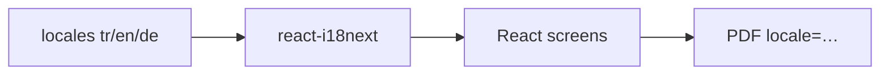

# 12 — i18n and UX (accessibility, privacy)

[← Previous](11-react-vite.md) · [Contents](00-index.md) · [Next →](13-rabbitmq.md)

## What is this?

**i18n** (internationalization): UI strings come from language files.  
BankApp: **TR / EN / DE** (`react-i18next`).  
Also: accessibility panel, cookie/privacy banner, theme.



## Role in BankApp

- Same screens in three languages.
- Seeded product names follow locale.
- PDF export uses locale query (`tr`/`en`/`de`).
- Theme / font / contrast preferences stored in the browser.

## When added?

i18n: **Phase 4**. Accessibility + privacy: **Phase 5**.

## Core concepts

| Concept | Meaning |
|--------|--------|
| **Locale** | `tr`, `en`, `de` |
| **Translation key** | `applications.approve` |
| **t('key')** | Translation function |
| **Persisted preference** | localStorage |

## Commands

No dedicated CLI. Change language in the UI; during development:

```powershell
cd client
npm run dev
```

Edit JSON translation files → see changes immediately via HMR.

## Classes, methods, packages

| Package / file | Role |
|---------------|-----|
| `i18next`, `react-i18next` | Translation engine |
| `client/src/i18n/` or `locales/` | Language JSON files |
| Accessibility floating panel | Theme / A± / contrast (+ extended a11y kit) |
| Privacy banner | First-visit consent |

Portable assistant detail: [34 — a11y portable kit](../tr/34-a11y-portable-kit.md).

## Where in the repo?

```
client/src/  # i18n init, a11y/, components/AccessibilityToolbar, privacy
docs/assets/screenshots/en/Accessiblity Settings.png
```

## Mini flow

User picks EN → `i18n.changeLanguage('en')` → all `t()` keys from EN JSON → PDF download sends `locale=en` to the API.
