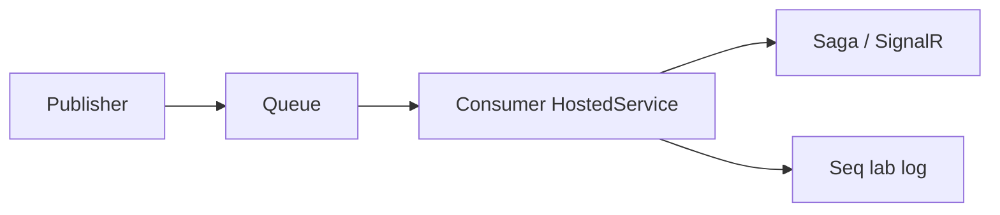

# 13 — RabbitMQ

[← Previous](12-i18n-ux.md) · [Contents](00-index.md) · [Next →](14-outbox-events.md)

Related: [14 Outbox](14-outbox-events.md) · [22 Decision letter](../tr/22-decision-letter-email.md) · [24 Lab tools](../tr/24-lab-tools.md) · [09 Compose](09-docker-compose.md)

## What is this?

**RabbitMQ**: Message broker. A producer drops a message on a queue; a consumer processes it when ready.  
Separates slow work (email simulation, event publishing) from the HTTP request path.



## Role in BankApp

| Queue (lab) | What it carries |
|--------------|-----------|
| `email-confirmation` | Post-registration email verification (no JWT yet) |
| `domain-events` | Outbox → Saga + SignalR |
| `decision-letter` | Approve/reject decision-letter email (logged to Seq; no SMTP) |
| `decision-letter-sms` | Approve/reject SMS lab (logged to Seq; no gateway) |

## When added?

Email queue: **Phase 5**. Domain-events: **Phase 6** (Outbox). Decision-letter: lab notification.

## Core concepts

| Concept | Meaning |
|--------|--------|
| **Producer** | Publishes messages |
| **Consumer** | Reads messages (hosted service) |
| **Queue** | Waiting line |
| **Ready** | Messages not yet delivered (UI) |
| **Unacked** | With consumer, not yet acked |
| **Ack / Nack** | Success / failure marker |
| **At-least-once** | Delivered at least once — consumer should be idempotent |

## Commands

```powershell
cd infra

# Broker + Management UI
docker compose --env-file .env up -d rabbitmq
# Check: compose ps → rabbitmq healthy
# UI: http://localhost:15672  → guest / guest
```

```powershell
# Broker log (connection refused, disk alarm)
docker compose --env-file .env logs --tail=80 rabbitmq

# WebApi consumer / publisher errors often show here
docker compose --env-file .env logs --tail=100 webapi
```

**Management UI — what to inspect**

1. Login: `guest` / `guest`.
2. **Queues** — `email-confirmation`, `domain-events`, `decision-letter`, `decision-letter-sms` (names must match code).
3. Per queue:
   - **Consumers** ≥ 1 → WebApi hosted service connected
   - **Ready** growing → no consumer / slow / error (Seq + `logs webapi`)
   - **Unacked** high for a long time → processing may be stuck
4. **Get messages** from the UI is educational in the lab but can confuse consumers (ack/requeue); read metrics first.

```powershell
# In-container diagnostics (management plugin CLI)
docker compose --env-file .env exec rabbitmq rabbitmq-diagnostics -q ping
# Expected: exit 0 / ok-like output
```

### What to verify?

| Check | How | Good sign |
|---------|-------|-------------|
| Healthy | `compose ps rabbitmq` | healthy |
| UI | `:15672` | login + Queues list |
| Consumer | Queue row Consumers | ≥ 1 (WebApi up) |
| Flow | Register or approve | Ready rises then falls; processed log in Seq |

### Disaster / recovery (lab)

| Situation | Path |
|-------|-----|
| Consumers = 0 | WebApi down / crash → `ps` + `logs webapi`; `up -d webapi` |
| Ready piling up | Consumer exception → Seq Error; fix + restart webapi |
| guest login fail | Lab default only; old credentials in volume? `down -v` lab reset (careful) |
| “Dirty” queue lab | Soft: WebApi recreate. Hard: `compose down -v` (Redis/Seq go too) |

```powershell
# Force-recreate one service (queue defs may stay tied to image/volume)
docker compose --env-file .env up -d --force-recreate rabbitmq webapi
```

**Best practice:** No `guest` in prod; TLS + dedicated user. Deleting / getting messages from the UI in production needs care. Check Consumers + Ready first, then Seq.

## Classes, methods, packages

| Name | Role |
|------|-----|
| `RabbitMQ.Client` | AMQP client |
| Email publisher / consumer (Identity/Notification) | Verification mail (logged in lab) |
| `OutboxDispatcherHostedService` | Outbox → `domain-events` |
| `DomainEventsConsumerHostedService` | Queue → saga + SignalR |
| Decision-letter publisher / consumer | Approve/reject letter lab |

## Where in the repo?

```
src/WebApi/Modules/Notification/Messaging/
infra/docker-compose.yml
docs/assets/screenshots/en/Queues on RabbitMQ.png
docs/learning/tr/22-decision-letter-email.md
```

## Mini flow

Register → generate token → `email-confirmation` → consumer log/Seq → user confirms via link → login.  
Approve/reject → Outbox → `domain-events` (+ `decision-letter`) → SignalR / Seq.
