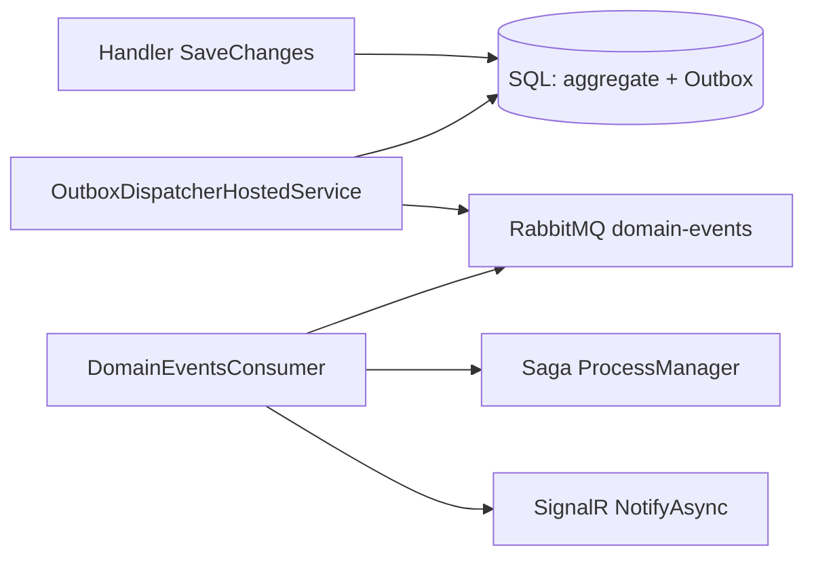

# 14 — Domain Events and Transactional Outbox

[← Previous](13-rabbitmq.md) · [Contents](00-index.md) · [Next →](15-saga.md)

## What is this?

**Domain Event**: Something important happened in the aggregate (`CreditApplicationApproved`).  
**Transactional Outbox**: Write the event in the **same DB transaction** into `OutboxMessages`; a separate worker publishes to RabbitMQ later. That reduces the “DB yes / queue no” race.



## Role in BankApp

Reliable publishing after credit create / approve / reject / cancel → saga update + SignalR toast.

## When added?

**Phase 6**.

## Core concepts

| Concept | Meaning |
|--------|--------|
| **IDomainEvent** | Event contract |
| **Outbox row** | Not-yet-published event record |
| **Dispatcher** | Periodic hosted service that reads and publishes |
| **Dual-write problem** | Two stores getting out of sync |

## Commands

No dedicated CLI. Observe:

```powershell
# Outbox in SQL (lab connection)
# SELECT TOP 20 * FROM OutboxMessages ORDER BY OccurredOnUtc DESC

docker compose logs -f webapi
```

## Classes, methods, packages

| Name | Role |
|------|-----|
| `CreditApplicationApproved` etc. | Domain event types |
| `OutboxMessage` entity | Table row |
| `OutboxDispatcherHostedService` | Publish |
| `DomainEventsConsumerHostedService` | Consume |
| Aggregate `Approve(...)` | Emits event |

## Where in the repo?

```
src/Domain/Events/
src/Persistence/…Outbox…
src/WebApi/…/Outbox…
src/WebApi/Modules/Notification/Messaging/DomainEventsConsumerHostedService.cs
```

## Mini flow

Handler SaveChanges (aggregate + outbox) → Dispatcher publish → RabbitMQ → Consumer → ProcessManager + SignalR `NotifyAsync`.
