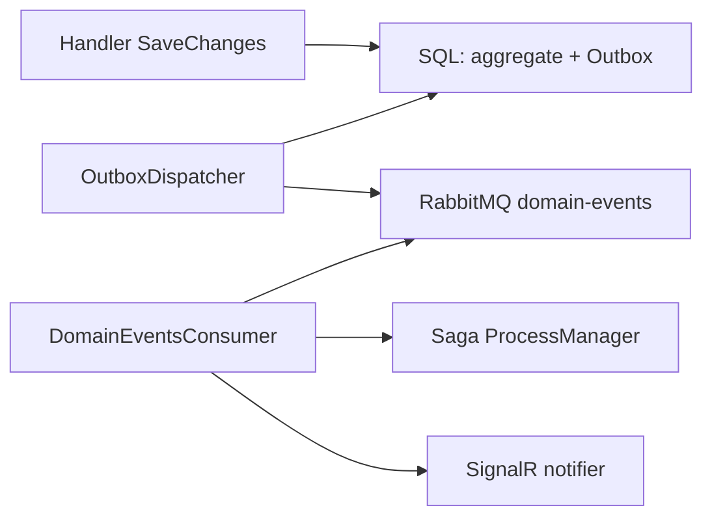
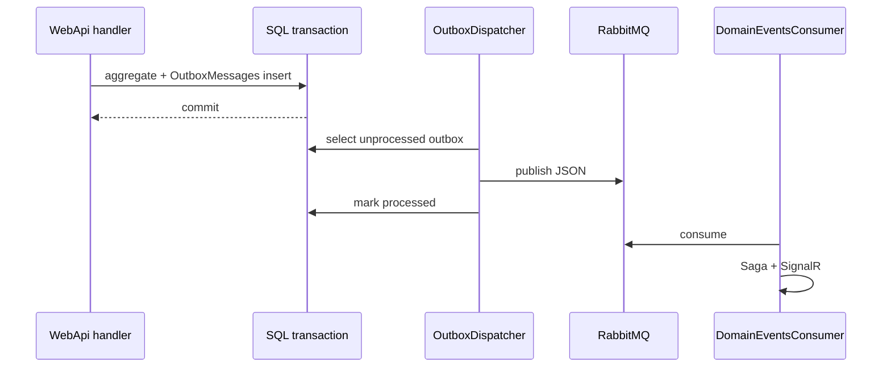

# 14 — Domain Events and Transactional Outbox

[← Previous](13-rabbitmq.md) · [Contents](00-index.md) · [Next →](15-saga.md)

Related: [13 RabbitMQ](13-rabbitmq.md) · [15 Saga](15-saga.md) · [16 SignalR](16-signalr.md)

## What is this?

**Domain Event**: Something important happened in an aggregate (`CreditApplicationApproved`).  
**Transactional Outbox**: Write the event in the **same SQL transaction** as the aggregate into `OutboxMessages`; a separate worker later publishes to RabbitMQ. That reduces the **dual-write** race (“DB committed / queue empty” or the opposite).

**Analogy:** At the branch counter, the customer transaction and the “letter to mail” go in the **same envelope** to the vault; the courier (dispatcher) hands it to the post (RabbitMQ) afterward. Ledger and courier stay in sync.



## Role in BankApp

Reliable publish after credit create / approve / reject / cancel → saga update + SignalR toast + decision-letter triggers.

## When added?

**Phase 6**.

## Core concepts

| Concept | Meaning |
|--------|--------|
| **IDomainEvent** | Event contract (type + payload) |
| **Outbox row** | Unpublished event record |
| **Dispatcher** | Hosted service that polls and publishes |
| **Dual-write problem** | Two stores updated separately → inconsistency |
| **At-least-once** | Queue may deliver twice → idempotent consumer |
| **ProcessedOnUtc** | Marks row as published |



## Commands

No dedicated CLI. Observe:

```powershell
cd infra
docker compose --env-file .env logs -f webapi
```

After approve/reject, search logs for `Outbox` or `DomainEvents`.

SQL (lab connection):

```sql
SELECT TOP 20 Id, Type, ProcessedOnUtc, OccurredOnUtc
FROM OutboxMessages
ORDER BY OccurredOnUtc DESC;
```

**Expected:** `ProcessedOnUtc` fills shortly after the event; lingering `NULL` → dispatcher or RabbitMQ issue.

```powershell
# Queue depth: http://localhost:15672 → domain-events
docker compose --env-file .env exec rabbitmq rabbitmq-diagnostics -q ping
```

### What to verify

| Check | How | Good sign |
|-------|-----|-----------|
| Outbox processed | SQL `ProcessedOnUtc` | filled after approve |
| Queue flow | Rabbit UI `domain-events` | Ready spikes then drops |
| Consumer | Consumers ≥ 1 | WebApi healthy |
| UI feedback | SignalR toast | instant notify |

### Disaster / recovery (lab)

| Situation | Path |
|-----------|------|
| Outbox backlog, NULL `ProcessedOnUtc` | Rabbit down → `up -d rabbitmq webapi` |
| Duplicate saga step | Idempotent handler; run unit tests |
| Bad message shape | `logs webapi`; type name matches JSON |

```powershell
dotnet test tests/Application.UnitTests/Application.UnitTests.csproj --filter "FullyQualifiedName~Outbox"
```

## Classes, methods, packages

| Name | Role |
|------|-----|
| `CreditApplicationApproved` etc. | Domain event types |
| `OutboxMessage` entity | Table row |
| `OutboxDispatcherHostedService` | Publish loop |
| `DomainEventsConsumerHostedService` | Consume → saga + SignalR |
| Aggregate `Approve(...)` | Raises event + outbox row |

## Where in the repo?

```
src/Domain/Events/
src/Persistence/…Outbox…
src/WebApi/…/Outbox…
src/WebApi/Modules/Notification/Messaging/DomainEventsConsumerHostedService.cs
```

## Mini flow

Handler SaveChanges (aggregate + outbox) → Dispatcher publish → RabbitMQ `domain-events` → Consumer → ProcessManager + SignalR `NotifyAsync` (+ decision-letter branch).

Screen (RabbitMQ queues):


## Beginner lab

1. `docker compose up -d sqlserver rabbitmq webapi client`
2. Approve or reject an application as staff.
3. RabbitMQ UI → `domain-events` → Ready should drop quickly.
4. SQL: latest outbox row has `ProcessedOnUtc`.
5. Customer browser shows toast (SignalR — chapter 16).

## Common mistakes

- Publishing only to RabbitMQ **after** SQL commit without outbox → loss on crash  
- Publishing without marking outbox → duplicate messages  
- Renaming event type without consumer alignment  
- Debugging Hub only when dispatcher never ran  

## Where it helps

- [ ] Outbox processed after approve/reject  
- [ ] `domain-events` queue not stuck  
- [ ] Saga table updates with events  
- [ ] SignalR toast at end of outbox chain
