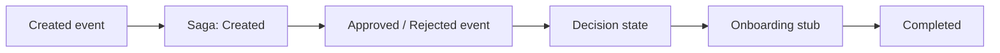

# 15 — Saga / Process Manager

[← Previous](14-outbox-events.md) · [Contents](00-index.md) · [Next →](16-signalr.md)

## What is this?

**Saga / Process Manager**: State machine for a long-running process.  
Tracks steps that do not finish in one transaction (created → decision → onboarding stub).



## Role in BankApp

`CreditApplicationSagas` table + `CreditApplicationProcessManager`: orchestrates the credit application lifecycle (including teaching stubs).

## When added?

**Phase 6**.

## Core concepts

| Concept | Meaning |
|--------|--------|
| **Orchestration** | Central manager drives steps |
| **State** | Current step of the process |
| **Compensation** | (Advanced) rollback; here stub-focused |
| **Idempotent handler** | Same event twice does not break state |

## Commands

No CLI; verify with unit tests:

```powershell
dotnet test --filter "FullyQualifiedName~Saga"
```

## Classes, methods, packages

| Name | Role |
|------|-----|
| `CreditApplicationProcessManager` | State transitions from events |
| `CreditApplicationSaga` entity | Persisted process state |
| Called from consumer | After outbox event |

## Where in the repo?

```
src/Application/Modules/Credit/Sagas/
src/Domain/… (saga entity / states)
tests/Application.UnitTests/…Saga…
```

## Mini flow

Created event → saga “Created” → Approved event → decision state → onboarding stub → Completed (happy path fixed by tests).
