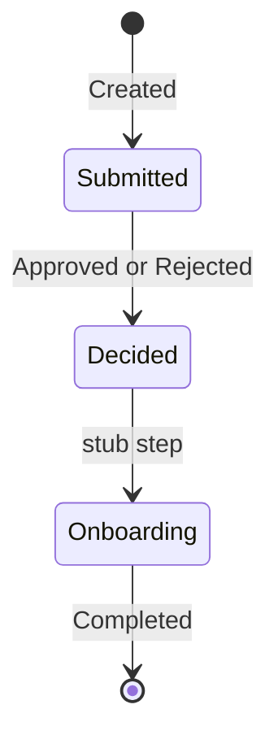
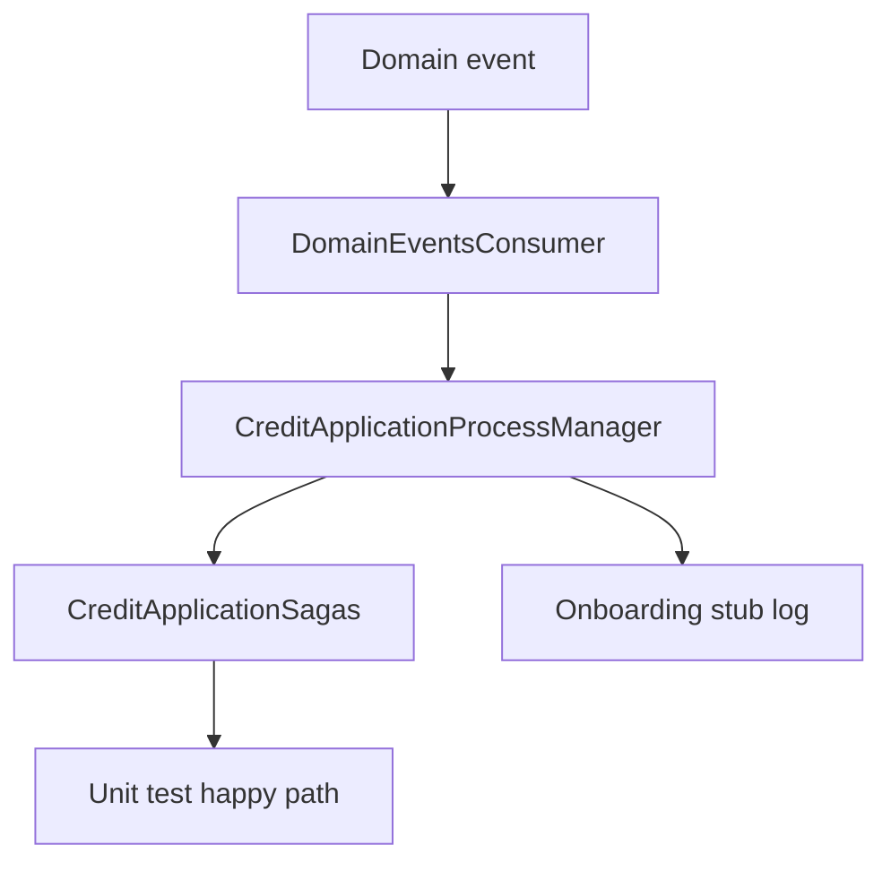

# 15 — Saga / Process Manager

[← Previous](14-outbox-events.md) · [Contents](00-index.md) · [Next →](16-signalr.md)

Related: [14 Outbox](14-outbox-events.md) · [16 SignalR](16-signalr.md)

## What is this?

**Saga / Process Manager**: A **state machine** for long-running processes. Steps that do not fit one transaction (created → decision → onboarding stub) are tracked; each domain event answers “which step are we on?”.

**Analogy:** Passport processing — form received, review done, card printed; each stage gets a stamp. In BankApp stamps live in `CreditApplicationSagas`.



## Role in BankApp

`CreditApplicationSagas` + `CreditApplicationProcessManager`: credit application lifecycle orchestration (including education stubs). Outbox consumer invokes the process manager on relevant events.

## When added?

**Phase 6**.

## Core concepts

| Concept | Meaning |
|--------|--------|
| **Orchestration** | Central manager drives steps |
| **State** | Current step (`Submitted`, `Decided`, …) |
| **Compensation** | (Advanced) rollback; lab focuses on stubs |
| **Idempotent handler** | Same event twice does not corrupt state |
| **Correlation** | Saga row tied to `CreditApplicationId` |



## Commands

No CLI; verify with tests:

```powershell
dotnet test tests/Application.UnitTests/Application.UnitTests.csproj --filter "FullyQualifiedName~Saga"
```

```powershell
dotnet test tests/WebApi.IntegrationTests/WebApi.IntegrationTests.csproj --filter "FullyQualifiedName~Credit"
```

Lab SQL:

```sql
SELECT TOP 10 CreditApplicationId, State, UpdatedOnUtc
FROM CreditApplicationSagas
ORDER BY UpdatedOnUtc DESC;
```

## Classes, methods, packages

| Name | Role |
|------|-----|
| `CreditApplicationProcessManager` | State transitions per event |
| `CreditApplicationSaga` entity | Persisted process state |
| Consumer invocation | After outbox event |
| Unit tests | Happy path + idempotency |

## Where in the repo?

```
src/Application/Modules/Credit/Sagas/
src/Domain/… (saga entity / states)
tests/Application.UnitTests/…Saga…
```

## Mini flow

Created → `Submitted` → Approved → `Decided` → onboarding stub → `Completed`. Reject also reaches `Decided` (not approved).

Screen (approve trigger):


## Beginner lab

1. Create application → SQL saga row `Submitted`.
2. Staff approves → state moves to `Decided` or next stub.
3. Read unit test that simulates duplicate approve — state must not double-advance.
4. Run `dotnet test --filter Saga` — all green.
5. Search Seq for onboarding stub log if present.

## Common mistakes

- State transitions in HTTP handler skipping outbox consumer  
- Counters without idempotency on duplicate events  
- Manually editing saga table and confusing tests  
- Same final state name for approve and reject  

## Where it helps

- [ ] Saga row on new application  
- [ ] State updates on approve/reject  
- [ ] Saga unit tests green  
- [ ] Duplicate event scenario safe
