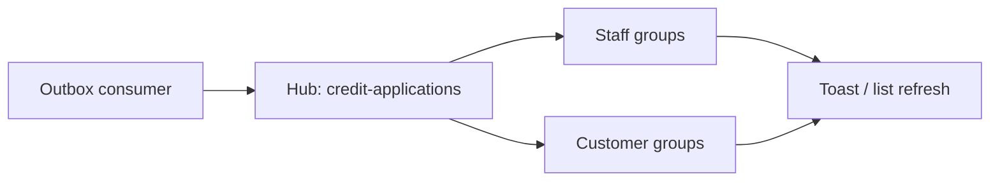
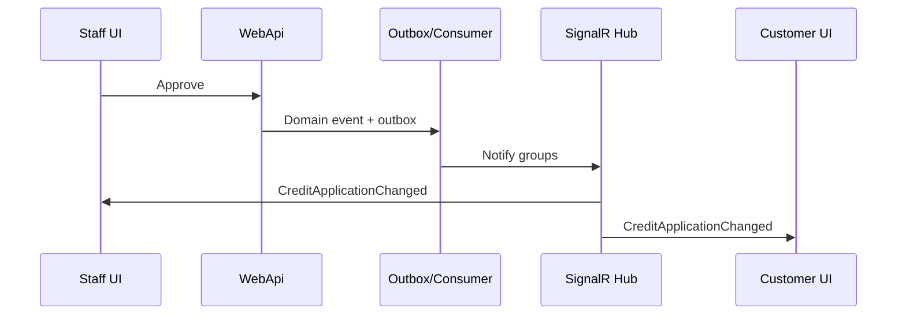

# 16 — SignalR

[← Previous](15-saga.md) · [Contents](00-index.md) · [Next →](17-modular-monolith.md)

## What is this?

**SignalR** lets the server send messages to the browser **instantly** (mostly via WebSocket).  
You can show toasts, badges, or refresh lists without reloading the page.

**Analogy:** Classic HTTP is like question-and-answer mail; SignalR is an open **phone line** — the bank (API) can call the customer (browser) whenever it needs to.



## Role in BankApp

- Hub path: `/hubs/credit-applications`
- When the outbox consumer handles an event, it pushes `CreditApplicationChanged` to staff and the relevant customer groups
- Payload includes amount + **currencyCode** → UI shows the correct symbol via `formatMoney`

Screen example (staff toast / live update): [bank-employee screenshots](../../screenshots/bank-employee.en.md)

## When added?

**Phase 6** (implemented before the Modular Monolith narrative).

## Core concepts

| Concept | Meaning |
|--------|--------|
| **Hub** | Client–server contract point (which methods to subscribe to / which events arrive) |
| **Group** | Broadcast set such as “staff at this branch” |
| **access_token** | JWT when connecting WebSocket (query or header) |
| **Reconnect** | Automatic reconnect after the line drops |



## Commands

```powershell
# Client SignalR package
cd client
npm install @microsoft/signalr
```

Verify: Browser DevTools → **Network** → **WS** filter → `credit-applications` hub frames.

## Classes, methods, packages

| Name | Role |
|------|------|
| Credit applications hub (WebApi) | Connection / groups |
| `ICreditApplicationRealtimeNotifier` | Publish abstraction |
| `CreditApplicationChangedMessage` | Payload (Amount, CurrencyCode) |
| `useCreditApplicationRealtime` | React hook + toast |

Packages: ASP.NET Core SignalR (server), `@microsoft/signalr` (client).

## Where in the repo?

```
src/WebApi/Modules/Notification/Realtime/
client/src/realtime/
```

## Mini flow

Staff approves → Outbox → Consumer → Hub groups → customer browser shows success toast + `formatMoney(currencyCode)`.

Screen (approve/reject UI — toast trigger):


Customer credit list (live-update target):


## Beginner lab

1. Start API + client with Compose.
2. Two browsers: one staff, one customer (accounts that can see the same application).
3. Staff approves or rejects the application.
4. On the customer tab, see the toast arrive (no F5).
5. DevTools → WS: inspect the message.

## Common mistakes

- Connecting to the hub without JWT → 401 / connection drops  
- Watching only HTTP and missing WS  
- Ignoring `currencyCode` and showing the amount with the wrong symbol  

## Where it helps

- [ ] Toast appears after approve/reject  
- [ ] WS connection visible in DevTools  
- [ ] Customer + staff groups receive updates correctly  
