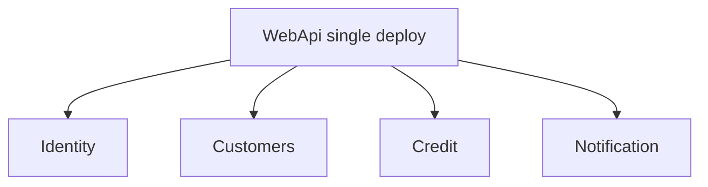

# 17 — Modular Monolith

[← Previous](16-signalr.md) · [Contents](00-index.md) · [Next →](18-otel-observability.md)

## What is this?

**Modular Monolith**: Single deploy / usually single DB; code split by **module boundaries**. Bounded-context discipline without microservice overhead.



## Role in BankApp

Modules: **Identity**, **Customers**, **Credit**, **Notification** — in both `Application/Modules` and `WebApi/Modules`.

## When added?

**Phase 6**.

## Core concepts

| Concept | Meaning |
|--------|--------|
| **Bounded context** | Boundary of one business language |
| **Module** | Folder + registration + controller group |
| **Shared kernel** | Thin core shared by modules (Domain/Core) |

## Commands

Structural pattern; CLI:

```powershell
dotnet build BankApp.slnx
```

When adding a feature, put it in the right module folder (`Credit` vs `Identity`?).

## Classes, methods, packages

| Name | Role |
|------|-----|
| `AddApplicationModules()` | Module DI registration |
| `WebApi/Modules/*/Controllers` | HTTP endpoints |
| Notification hosted services | Messaging / realtime |

## Where in the repo?

```
src/Application/Modules/
src/WebApi/Modules/
docs/architecture-notes.en.md
```

## Mini flow

New “branch” feature → which context? (Customers vs Credit) → CQRS files under that module’s Features → WebApi controller in the same module.
