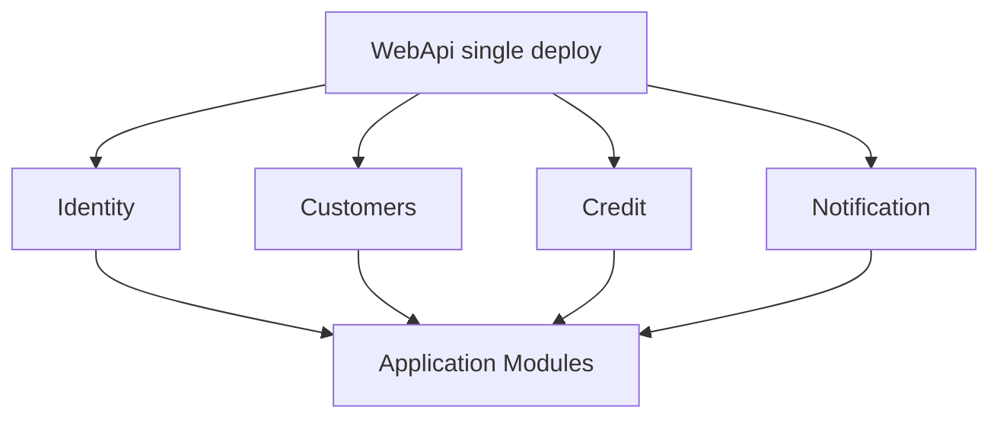
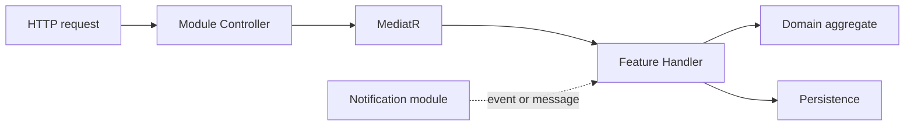

# 17 — Modular Monolith

[← Previous](16-signalr.md) · [Contents](00-index.md) · [Next →](18-otel-observability.md)

## What is this?

**Modular Monolith**: Single deploy / usually one database; code split by **module boundaries** (Identity, Credit, …). No microservice mesh or distributed transactions; you keep bounded-context discipline.

**Analogy:** One building, different **floor plans** — each floor (module) has its own rules, a shared stairwell (Domain/Core), but you do not punch a door straight into the neighbor’s apartment; you use the corridor (Application interfaces).



## Role in BankApp

Modules: **Identity**, **Customers**, **Credit**, **Notification** — under both `Application/Modules` and `WebApi/Modules`. New features start with “which business language?” to pick a folder.

## When added?

**Phase 6**.

## Core concepts

| Concept | Meaning |
|--------|--------|
| **Bounded context** | Boundary of a business language |
| **Module** | Folder + DI registration + controller group |
| **Shared kernel** | Thin core shared by modules (`Domain`, cross-cutting `Application`) |
| **Feature slice** | CQRS handler + validator + controller together |
| **Host module** | WebApi registration for module hosted services |



## Commands

Structural pattern; verify:

```powershell
dotnet build BankApp.slnx
```

Architecture notes: `docs/architecture-notes.tr.md` (design decisions).

```powershell
dotnet build BankApp.slnx --warnaserror
```

## Classes, methods, packages

| Name | Role |
|------|-----|
| `AddApplicationModules()` | Module DI registration |
| `WebApi/Modules/*/Controllers` | HTTP endpoints |
| `Application/Modules/*/Features` | CQRS use cases |
| Notification hosted services | Messaging / realtime |

## Where in the repo?

```
src/Application/Modules/
src/WebApi/Modules/
docs/architecture-notes.tr.md
```

## Mini flow

New branch feature → which context? → CQRS under that module’s `Features` → controller in same module → tests beside the module.

Screen (modules in one Compose stack):


## Beginner lab

1. Browse four folders under `src/Application/Modules/`.
2. Open a controller under `src/WebApi/Modules/Credit/` — which MediatR commands it sends.
3. Find `NotificationHostModule` hosted service registrations.
4. Search for direct cross-module `DbSet` misuse in handlers.
5. `dotnet build` — solution compiles across module references.

## Common mistakes

- Dumping logic in `WebApi` only — empty Application layer  
- Direct concrete calls across modules — prefer interfaces/events  
- Business rules in controllers — move to MediatR handlers  
- “One DB” = “one table everywhere” — respect aggregates  

## Where it helps

- [ ] New feature under `Modules/{Name}/Features`  
- [ ] `dotnet build BankApp.slnx` clean  
- [ ] Thin controllers, thick handlers  
- [ ] Notification messaging decoupled from Credit
