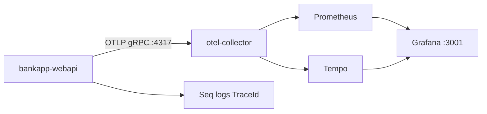

# 18 — OpenTelemetry, Prometheus, Grafana

[← Previous](17-modular-monolith.md) · [Contents](00-index.md) · [Next →](19-vault-lab.md)

## What is this?

**OpenTelemetry (OTel)**: Standard for collecting **traces / metrics / (log bridges)** from the app.  
**Prometheus**: Metric scrape and storage.  
**Grafana**: Dashboard UI. In the lab **Tempo** is the trace backend.  
**Seq** remains for logs (separate chapter).



## Role in BankApp

WebApi sends OTLP to the collector → Prometheus / Tempo → inspect in Grafana at `:3001`.

## When added?

**Phase 6** (OTel slice).

## Core concepts

| Concept | Meaning |
|--------|--------|
| **Trace / Span** | Request journey and steps |
| **Metric** | Counter / histogram (HTTP duration, etc.) |
| **OTLP** | OTel export protocol |
| **Collector** | Middle tier (receive, process, fan-out) |

## Commands

```powershell
cd infra
docker compose --env-file .env up -d otel-collector prometheus grafana tempo

# Grafana http://localhost:3001  → admin / admin
# Prometheus http://localhost:9090
# OTLP (app → collector) localhost:4317

docker compose --env-file .env ps otel-collector tempo prometheus grafana
curl -s http://localhost:9090/-/ready
curl -s -o NUL -w "%{http_code}`n" http://localhost:3001/api/health
```

Quick tour in Grafana:

1. Send a few API requests (Scalar / client; `/health` is usually outside tracing).
2. **Dashboards → BankApp → BankApp HTTP (OTel)**.
3. **Explore → Tempo** → service `bankapp-webapi`.
4. **Explore → Prometheus** → e.g. `up` or HTTP duration metrics.
5. In Seq, check `TraceId` for the same request.

Detailed lab tools notes: [24 — Lab tools](24-lab-tools.md).

## Classes, methods, packages

| Package | Role |
|-------|-----|
| `OpenTelemetry.Extensions.Hosting` | Host integration |
| `OpenTelemetry.Instrumentation.AspNetCore` / `Http` / `Runtime` | Automatic span/metric |
| `OpenTelemetry.Exporter.OpenTelemetryProtocol` | OTLP export |

Registration: WebApi DI / `Program` or extension methods.

## Where in the repo?

```
src/WebApi/… OpenTelemetry setup
infra/docker-compose.yml
infra/otel/ (collector config if present)
docs/assets/screenshots/en/Metrics on Grafana.png
```

## Mini flow

HTTP request → AspNetCore instrumentation span → OTLP collector → Tempo/Prometheus → charts in Grafana.
