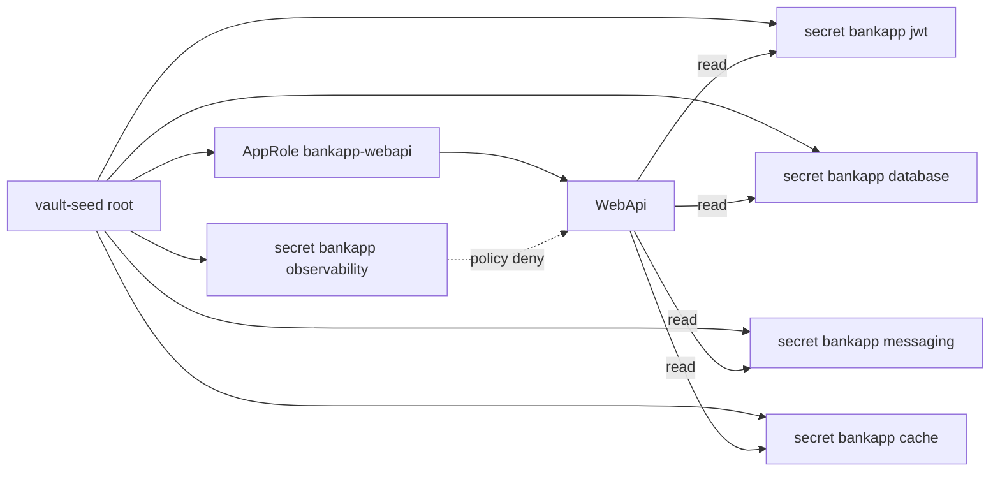
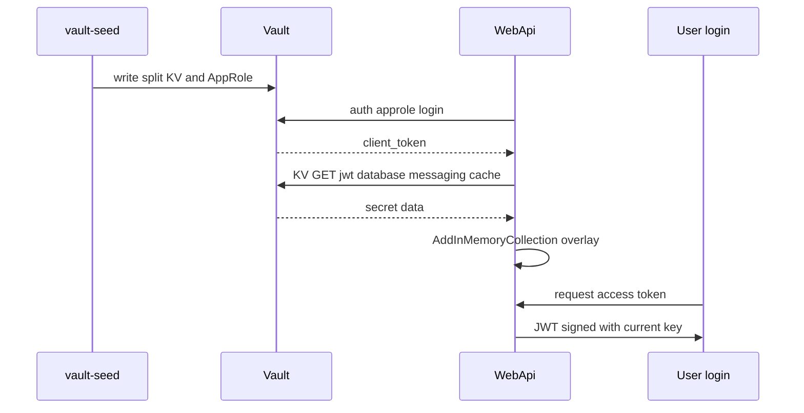

# 19 — HashiCorp Vault (lab) + WebApi overlay

[← Previous](18-otel-observability.md) · [Contents](00-index.md) · [Next →](20-pdf-export.md)

Related: [06 JWT](06-jwt-rbac.md) · [24 Lab tools](24-lab-tools.md) · [09 Compose](09-docker-compose.md)

## What is this?

**Vault**: Secret storage. In the BankApp lab, Compose **dev-mode** Vault + `vault-seed` writes **split KV paths** and mints **AppRole** credentials.  
WebApi does **not** use the root token; it logs in with AppRole and overlays JWT + SQL password + RabbitMQ + Redis credentials (`FailClosed=true` aborts startup on Vault failure).

**Analogy:** Vault is the **safe room**; AppRole is a **limited badge** (only certain lockers); root token is the master key (seed/UI only); observability path is the camera cabinet (badge denied).



## Role in BankApp

- Path-separated secrets visible in the lab UI.
- Compose AppRole + `FailClosed=true`: overlay JWT, SQL `Password`, RabbitMQ user/password, Redis password from Vault.
- Observability admin secrets live in Vault; WebApi policy **cannot** read them.
- SQL/Rabbit/Grafana/Keycloak **containers** still bootstrap from Compose `.env` (Vault Agent out of scope).

## When added?

Compose lab + JWT overlay earlier; **AppRole + split paths + FailClosed** in the security hardening slice.

## Core concepts

| Concept | Meaning |
|--------|--------|
| **KV v2** | `secret/data/{path}` HTTP API |
| **AppRole** | `role_id` + `secret_id` → short-lived client token |
| **Policy** | Which paths may be read/written — least privilege |
| **FailClosed** | App will not start if Vault/AppRole fails |
| **Overlay** | Overwrite config via `AddInMemoryCollection` |
| **Dev mode** | Not production; no unseal/raft; ephemeral data |
| **Root token** | Bootstrap only — never injected into WebApi |



## Commands

```powershell
cd infra

# Vault + seed job (seed writes secrets once)
docker compose --env-file .env up -d vault
docker compose --env-file .env up vault-seed
# Check: vault healthy; UI http://localhost:8200
# Token: VAULT_DEV_ROOT_TOKEN_ID in .env (e.g. bankapp-vault-root-token)
```

**Vault UI**

1. Method: **Token** → paste `VAULT_DEV_ROOT_TOKEN_ID` (operators only).
2. Secrets → KV → `secret` → `bankapp` → `jwt` / `database` / `messaging` / `cache` / `observability`.
3. Under `jwt`, read `jwt_security_key` (do not screenshot the value).

```powershell
docker compose --env-file .env exec vault vault kv get secret/bankapp/jwt
docker compose --env-file .env exec vault vault kv get secret/bankapp/database
docker compose --env-file .env exec vault vault kv get secret/bankapp/messaging
docker compose --env-file .env exec vault vault kv get secret/bankapp/cache
docker compose --env-file .env exec vault vault kv get secret/bankapp/observability
```

```powershell
docker compose --env-file .env exec vault vault status

docker compose --env-file .env logs webapi | Select-String -Pattern "Vault"
# Expected: "Vault overlay applied via AppRole"
```

### What to verify

| Check | How | Good sign |
|---------|-------|-------------|
| Vault up | `compose ps vault` | healthy / Up |
| Seed paths | `kv get` jwt/database/messaging/cache/observability | populated |
| AppRole files | WebApi `/vault-approle` | role_id + secret_id |
| Overlay | `logs webapi` | AppRole overlay applied |
| FailClosed | Vault down + WebApi recreate | WebApi does not stay healthy |

### Disaster / recovery (lab)

| Situation | Path |
|-------|-----|
| UI “sealed” / empty (dev reset) | Recreate Vault → **seed** → **webapi recreate** (new secret_id) |
| kv get not found | `logs vault-seed`; path `secret/bankapp/jwt` etc. |
| WebApi FailClosed loop | Did seed finish? Approle volume mounted? |
| JWT / signature | `TOKEN_SECURITY_KEY` ≥ 64 bytes; jwt path populated |
| Forgot root token | `infra/.env` → `VAULT_DEV_ROOT_TOKEN_ID` |

```powershell
docker compose --env-file .env up vault-seed
docker compose --env-file .env up -d --force-recreate --no-deps webapi

docker compose --env-file .env up -d --force-recreate vault
docker compose --env-file .env up vault-seed
docker compose --env-file .env up -d --force-recreate --no-deps webapi
```

**Note / best practice:** Dev mode ≠ prod (Raft, TLS, audit). Never put root token on WebApi. Containers still bootstrap from Compose `.env`.

## Secret rotation (lab dual-key) and Raft HA (optional Compose)

The daily BankApp stack uses **dev-mode** Vault (`:8200`). **JWT dual-key** lives on this stack. **Raft HA** is a separate file: `docker-compose.vault-raft.yml` (ports **8210/8211/8212** — no conflict).

| Topic | Lab | Production |
|------|--------------|----------|
| **JWT rotation** | `secret/bankapp/jwt` dual-key; signs=current, validates=both | Key id, short dual-key window, rolling restart |
| **Auth** | AppRole + narrow policy (Compose) | K8s Auth / AppRole / JWT auth + CSI / Agent |
| **Raft / HA** | Optional 3-node Compose overlay | ≥3 node Raft, unseal, audit, TLS |

### Dual-key rotate (recommended lab)

```powershell
cd infra

# Updates only secret/bankapp/jwt (database/messaging untouched)
docker compose --env-file .env exec `
  -e VAULT_TOKEN=bankapp-vault-root-token `
  vault /bin/sh /vault-rotate-jwt.sh

docker compose --env-file .env up -d --force-recreate --no-deps webapi
```

**Check:** `vault kv get secret/bankapp/jwt` → both key fields; logs show `SecurityKey + Previous`.  
Old (previous-signed) access tokens should still validate; new logins sign with current.  
`vault-seed` keeps existing jwt/database/messaging; observability may refresh from env each seed.

Optional custom key:

```powershell
docker compose --env-file .env exec `
  -e VAULT_TOKEN=bankapp-vault-root-token `
  -e NEW_JWT_KEY="BankApp-Rotated-Jwt-Key-Replace-Me-With-At-Least-64-Characters-ABCDEF" `
  vault /bin/sh /vault-rotate-jwt.sh
```

### More destructive (legacy path)

```powershell
docker compose --env-file .env up -d --force-recreate vault
docker compose --env-file .env up vault-seed
docker compose --env-file .env up -d --force-recreate webapi
```

### Raft HA lab (optional — does not break daily stack)

```powershell
cd infra

# 3 nodes (UI: http://localhost:8210 )
docker compose -f docker-compose.vault-raft.yml up -d

# Leader init + unseal (root token / unseal in output)
docker compose -f docker-compose.vault-raft.yml exec vault-raft-1 /bin/sh /vault-raft-init.sh
```

Peer join (node 2 / 3 — leader must be unsealed first):

```powershell
docker compose -f docker-compose.vault-raft.yml exec vault-raft-2 `
  vault operator raft join http://vault-raft-1:8200
docker compose -f docker-compose.vault-raft.yml exec vault-raft-2 `
  vault operator unseal <UNSEAL>
# same for vault-raft-3
docker compose -f docker-compose.vault-raft.yml exec -e VAULT_TOKEN=<ROOT> vault-raft-1 `
  vault operator raft list-peers
```

**Check:** `list-peers` shows 3 rows (leader + 2 followers); UI Token login on `:8210`.  
**Note:** Default WebApi still uses `vault:8200` (dev). Wiring BankApp to Raft is a separate experiment (`Vault__Address=http://host.docker.internal:8210`) — not required for daily lab.  
**Lab note:** Raft data under `/tmp/vault-raft-data` (ephemeral container — recreate = re-init). Use persistent volumes + TLS in prod.  
**Destructive:** `docker compose -f docker-compose.vault-raft.yml down` (tmp data lost).

## Classes, methods, packages

| Name | Role |
|------|-----|
| `VaultOptions` | Enabled, AppRole files, paths, FailClosed |
| `ApplyVaultSecretsAsync` | AppRole login → KV jwt/database/messaging/cache → overlay |
| `VaultFailClosedException` | Abort startup when FailClosed=true |
| `TokenOptions.SecurityKeyPrevious` | Dual-key validation window |
| `TokenSigningKeyFactory` | Sign: current; validate: current + previous |
| `vault-seed.sh` | Split KV + policy + AppRole credential files |
| `vault-rotate-jwt.sh` | Dual-key rotate for `secret/bankapp/jwt` only |
| `vault-raft-init.sh` | Raft leader init/unseal (optional HA) |
| `Program.cs` | `await builder.Configuration.ApplyVaultSecretsAsync()` before DI |

Package: no Vault SDK — `HttpClient` + JSON.

## Where in the repo?

```
src/WebApi/Configuration/VaultOptions.cs
src/WebApi/Configuration/VaultConfigurationExtensions.cs
src/WebApi/Program.cs
src/WebApi/appsettings.json          # Vault:Enabled=false (local)
infra/docker-compose.yml             # Vault__Enabled=true (dev)
infra/docker-compose.vault-raft.yml  # optional 3-node Raft
infra/vault-raft/config-node*.hcl
infra/scripts/vault-seed.sh
infra/scripts/vault-rotate-jwt.sh
infra/scripts/vault-raft-init.sh
infra/.env.example
```

## Mini flow

vault-seed writes split paths + AppRole → WebApi AppRole login → JWT/SQL/Rabbit/Redis overlay → JWT signed with current key.  
Rotate → jwt path only → WebApi recreate → old token validates with previous.

Screen (Vault UI — secrets; do not share tokens/values):


## Beginner lab

0. (Daily) `powershell -File infra/scripts/lab-daily-check.ps1` — includes AppRole observability deny smoke.
1. `docker compose up -d vault` → `up vault-seed` → UI :8200 with root token.
2. `kv get secret/bankapp/jwt` (+ database/messaging/cache/observability) — do not share values.
3. Find `Vault overlay applied via AppRole` in WebApi logs.
4. Log in → obtain a valid JWT.
5. Run `vault-rotate-jwt.sh` → recreate WebApi → test dual-key window.
6. (Advanced) Try reading `observability` with AppRole token → expect policy deny.

## Common mistakes

- Putting root token on WebApi env — Compose uses AppRole  
- Not recreating WebApi after seed — stale/missing `secret_id`  
- Mixing dev Vault with prod Raft — daily stack `:8200` is dev mode  
- JWT key under 64 bytes  
- Changing RabbitMQ password in `.env` without recreating `rabbitmq-data` volume  

## Where it helps

- [ ] Four KV paths populated  
- [ ] WebApi AppRole overlay log  
- [ ] Login JWT valid  
- [ ] Observability outside WebApi policy  
- [ ] Dual-key after rotate tested
