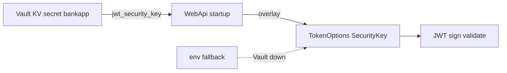
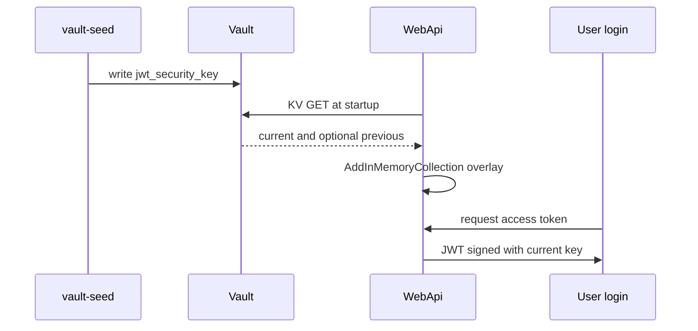

# 19 — HashiCorp Vault (lab) + WebApi overlay

[← Previous](18-otel-observability.md) · [Contents](00-index.md) · [Next →](20-pdf-export.md)

Related: [06 JWT](06-jwt-rbac.md) · [24 Lab tools](24-lab-tools.md) · [09 Compose](09-docker-compose.md)

## What is this?

**Vault**: Secret storage. In the BankApp lab, Compose runs **dev-mode** Vault plus `vault-seed` → KV path `secret/bankapp`.  
On WebApi startup, optionally reads the **JWT signing key** from Vault and overlays `TokenOptions:SecurityKey`.

**Analogy:** Vault is the **safe room**; overlay is swapping the desk copy with the key from the safe; `.env` fallback is the drawer spare (lab only).



## Role in BankApp

- Educational visibility of secrets in the lab UI.
- With `Vault__Enabled=true` in Compose, the JWT key comes from Vault; if Vault is down, fallback is `.env` / `TokenOptions__SecurityKey`.
- SQL connection string still comes from Compose env (kept simple); can be extended in a later slice.

## When added?

Compose lab earlier; **WebApi JWT overlay** in the security slice.

## Core concepts

| Concept | Meaning |
|--------|--------|
| **KV v2** | `secret/data/{path}` HTTP API |
| **X-Vault-Token** | Token on the request header |
| **Overlay** | Overwrite config via `AddInMemoryCollection` |
| **Dev mode** | Not production; no unseal/raft; ephemeral data |
| **Root token** | Full access in the lab — anti-pattern in prod |



## Commands

```powershell
cd infra

# Vault + seed job (seed writes secrets once)
docker compose --env-file .env up -d vault
docker compose --env-file .env up vault-seed
# Check: vault healthy; UI http://localhost:8200
# Token: VAULT_DEV_ROOT_TOKEN_ID in .env (e.g. bankapp-vault-root-token)
```

**Vault UI**

1. Method: **Token** → paste `VAULT_DEV_ROOT_TOKEN_ID`.
2. Secrets → KV → `secret` → `bankapp` (or the seed path).
3. Read `jwt_security_key` (do not put the value in screenshots).

```powershell
# Same secret via CLI (vault binary in container)
docker compose --env-file .env exec vault vault kv get secret/bankapp
# Expected: jwt_security_key row; error → seed did not run or wrong path
```

```powershell
# Vault status (seal info in dev mode)
docker compose --env-file .env exec vault vault status

# Was WebApi overlay applied?
docker compose --env-file .env logs webapi | Select-String -Pattern "Vault"
# Expected: "Vault overlay applied" or fallback warning
```

```powershell
# Quick host check of UI / API
curl -s -o NUL -w "%{http_code}`n" http://localhost:8200/ui/
curl -s -H "X-Vault-Token: bankapp-vault-root-token" http://localhost:8200/v1/secret/data/bankapp
# Replace token with your .env value; expect 200 + JSON data
```

### What to verify

| Check | How | Good sign |
|---------|-------|-------------|
| Vault up | `compose ps vault` | healthy / Up |
| Seed | `vault kv get secret/bankapp` | key populated |
| Overlay | `logs webapi` + Vault | overlay applied |
| Fallback | Stop Vault and restart WebApi | stays up with `.env` key (lab) |

### Disaster / recovery (lab)

| Situation | Path |
|-------|-----|
| UI “sealed” / empty (dev reset) | Restart dev Vault → **run seed again** (`up vault-seed`) |
| kv get not found | Seed exit code / `logs vault-seed`; path `secret/bankapp` |
| WebApi 500 JWT / signature | No overlay + wrong key length; `.env` `TOKEN_SECURITY_KEY` ≥ 64 bytes |
| Forgot token | `infra/.env` → `VAULT_DEV_ROOT_TOKEN_ID` (also in example file) |

```powershell
# Re-run seed (while Vault is up)
docker compose --env-file .env up vault-seed

# Recreate Vault + seed (lab secrets refreshed)
docker compose --env-file .env up -d --force-recreate vault
docker compose --env-file .env up vault-seed
docker compose --env-file .env up -d --force-recreate webapi
```

**Note / best practice:** Dev mode ≠ prod (Raft, policy, rotation). Do not paste root token into public issues. SQL/Rabbit still use Compose env — intentional simplification.

## Secret rotation (lab dual-key) and Raft HA (optional Compose)

The daily BankApp stack uses **dev-mode** Vault (`:8200`). **JWT dual-key** lives on this stack. **Raft HA** is a separate file: `docker-compose.vault-raft.yml` (ports **8210/8211/8212** — no conflict).

| Topic | Lab | Production |
|------|--------------|----------|
| **JWT rotation** | `jwt_security_key` + `jwt_security_key_previous`; WebApi signs=current, validates=both | Key id, short dual-key window, rolling restart |
| **Raft / HA** | Optional 3-node Compose overlay | ≥3 node Raft, unseal, audit, TLS |
| **Policy** | Root token | AppRole + narrow policy |

### Dual-key rotate (recommended lab)

```powershell
cd infra

# Active key → previous; write new active key (keep mssql/rabbit fields)
docker compose --env-file .env exec `
  -e VAULT_TOKEN=bankapp-vault-root-token `
  vault /bin/sh /vault-rotate-jwt.sh

# WebApi re-reads Vault overlay (--no-deps: do not re-run vault-seed overwrite)
docker compose --env-file .env up -d --force-recreate --no-deps webapi
```

**Check:** `vault kv get secret/bankapp` → `jwt_security_key` and `jwt_security_key_previous`; logs show `SecurityKey + Previous`.  
Old (previous-signed) access tokens should still validate; new logins sign with current.  
`vault-seed` no longer overwrites if secret exists (preserves rotation); still use `--no-deps` on recreate as a safe habit.

Optional custom key:

```powershell
docker compose --env-file .env exec `
  -e VAULT_TOKEN=bankapp-vault-root-token `
  -e NEW_JWT_KEY="BankApp-Rotated-Jwt-Key-Replace-Me-With-At-Least-64-Characters-ABCDEF" `
  vault /bin/sh /vault-rotate-jwt.sh
```

### More destructive (legacy path)

```powershell
docker compose --env-file .env up -d --force-recreate vault
docker compose --env-file .env up vault-seed
docker compose --env-file .env up -d --force-recreate webapi
```

### Raft HA lab (optional — does not break daily stack)

```powershell
cd infra

# 3 nodes (UI: http://localhost:8210 )
docker compose -f docker-compose.vault-raft.yml up -d

# Leader init + unseal (root token / unseal in output)
docker compose -f docker-compose.vault-raft.yml exec vault-raft-1 /bin/sh /vault-raft-init.sh
```

Peer join (node 2 / 3 — leader must be unsealed first):

```powershell
docker compose -f docker-compose.vault-raft.yml exec vault-raft-2 `
  vault operator raft join http://vault-raft-1:8200
docker compose -f docker-compose.vault-raft.yml exec vault-raft-2 `
  vault operator unseal <UNSEAL>
# same for vault-raft-3
docker compose -f docker-compose.vault-raft.yml exec -e VAULT_TOKEN=<ROOT> vault-raft-1 `
  vault operator raft list-peers
```

**Check:** `list-peers` shows 3 rows (leader + 2 followers); UI Token login on `:8210`.  
**Note:** Default WebApi still uses `vault:8200` (dev). Wiring BankApp to Raft is a separate experiment (`Vault__Address=http://host.docker.internal:8210`) — not required for daily lab.  
**Lab note:** Raft data under `/tmp/vault-raft-data` (ephemeral container — recreate = re-init). Use persistent volumes + TLS in prod.  
**Destructive:** `docker compose -f docker-compose.vault-raft.yml down` (tmp data lost).

## Classes, methods, packages

| Name | Role |
|------|-----|
| `VaultOptions` | Enabled, Address, Token, MountPath, SecretPath |
| `ApplyVaultSecretsAsync` | HTTP GET KV → `jwt_security_key` (+ optional previous) → config overlay |
| `TokenOptions.SecurityKeyPrevious` | Dual-key validation window |
| `TokenSigningKeyFactory` | Sign: current; validate: current + previous |
| `vault-rotate-jwt.sh` | KV rotate (previous ← current) |
| `vault-raft-init.sh` | Raft leader init/unseal (optional HA) |
| `Program.cs` | `await builder.Configuration.ApplyVaultSecretsAsync()` before DI |

Package: no Vault SDK — `HttpClient` + JSON.

## Where in the repo?

```
src/WebApi/Configuration/VaultOptions.cs
src/WebApi/Configuration/VaultConfigurationExtensions.cs
src/WebApi/Program.cs
src/WebApi/appsettings.json          # Vault:Enabled=false (local)
infra/docker-compose.yml             # Vault__Enabled=true (dev)
infra/docker-compose.vault-raft.yml  # optional 3-node Raft
infra/vault-raft/config-node*.hcl
infra/scripts/vault-seed.sh
infra/scripts/vault-rotate-jwt.sh
infra/scripts/vault-raft-init.sh
infra/.env.example
```

## Mini flow

vault-seed writes `jwt_security_key` → WebApi starts → overlay → JWT signed with current key.  
Rotate script → previous + new current → WebApi recreate → old token validates with previous, new login with current.

## Beginner lab

1. `docker compose up -d vault` then `docker compose up vault-seed` — UI :8200 with token.
2. `vault kv get secret/bankapp` — see `jwt_security_key` (do not share).
3. Start WebApi — log `Vault overlay applied`.
4. Login — valid JWT.
5. Run rotate script, recreate WebApi — test old and new tokens.

## Common mistakes

- Mixing dev Vault with prod Raft  
- Overwriting rotate with careless `vault-seed`  
- JWT key under 64 bytes  
- Root token in screenshots  

## Where it helps

- [ ] Vault healthy + seed path populated  
- [ ] WebApi overlay or fallback log  
- [ ] Login JWT valid  
- [ ] Dual-key after rotate tested  
- [ ] Commands tables when UI empty or JWT fails
