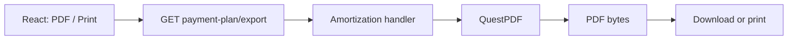
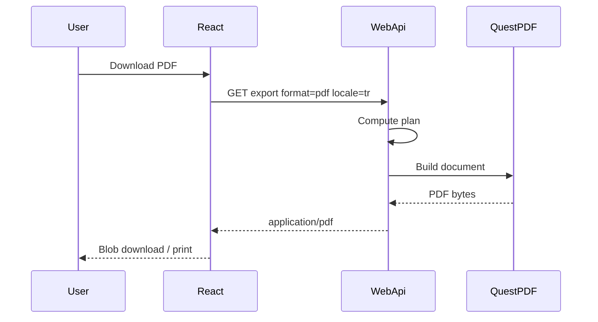

# 20 — QuestPDF and payment plan export

[← Previous](19-vault-lab.md) · [Contents](00-index.md) · [Next →](21-ci-github-actions.md)

## What is this?

**QuestPDF** is a C# library that builds PDFs from code (you lay out pages without depending on HTML).  
In BankApp it is used to download and print the credit **amortization / payment plan** as PDF.

**Analogy:** Like “Save as PDF” from an Excel table — but layout and labels are produced on the server according to locale.



## Role in BankApp

- API: `payment-plan/export?format=pdf&locale=…`
- Pluggable exporter (`IPaymentPlanDocumentExporter`) — CSV/XLSX can be added later
- Labels and currency symbols by locale (₺ $ €)

Screen: [Bank Manager — Print & PDF](../../screenshots/bank-manager.en.md)

## When added?

PDF/print UX: feature slice after Phase 6 (README Features + screenshots).

## Core concepts

| Concept | Meaning |
|--------|--------|
| **Exporter** | Document → bytes / file |
| **Locale** | Language of PDF text (`tr` / `en` / `de`) |
| **Amortization** | Table of installments, interest, remaining principal |



## Commands

```powershell
dotnet add src/Application package QuestPDF
```

HTTP (with Bearer token):

```http
GET /api/CreditApplications/{id}/payment-plan/export?format=pdf&locale=tr
```

(Confirm the real route in the repo via `applicationsApi` / controller; query includes `locale` and plan parameters if needed.)

## Classes, methods, packages

| Name | Role |
|------|------|
| `QuestPDF` | PDF engine |
| `PaymentPlanPdfExporter` | `IPaymentPlanDocumentExporter` |
| `PaymentPlanPdfLabels.For(locale)` | TR/EN/DE labels |
| `PaymentPlanMoneyFormatter` | Amounts with symbols |
| `exportPaymentPlan` (client) | Blob download + print |

## Where in the repo?

```
src/Application/Services/Amortization/Export/
client/src/api/applicationsApi.ts
client/src/pages/ApplicationDetailPage.tsx
docs/screenshots/bank-manager.en.md
```

## Mini flow

UI “PDF” → `locale` + plan → handler computes → QuestPDF document → file download / print dialog.

Screen (payment schedule Print & PDF):


Payment schedule (detail):


## Beginner lab

1. Open an approved application detail (payment plan visible).
2. Download PDF — confirm the file opens.
3. Switch language to EN/DE and download again — check headline language changes.
4. Try Print (browser print dialog).

## Common mistakes

- Omitting locale → default language / wrong labels  
- Treating PDF as JSON and calling `response.json()` → corrupt; use blob  
- Writing nested square brackets like `byte[]` in Mermaid/docs breaks diagrams  

## Where it helps

- [ ] PDF downloads and opens  
- [ ] TR/EN/DE labels match locale  
- [ ] Print path works  
