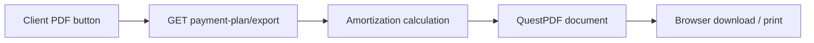

# 20 — QuestPDF and payment plan export

[← Previous](19-vault-lab.md) · [Contents](00-index.md) · [Next →](21-ci-github-actions.md)

## What is this?

**QuestPDF**: C# library for building PDF documents.  
In BankApp it exports the amortization **payment plan** for download / print.



## Role in BankApp

- API: `payment-plan/export?format=pdf&locale=…`
- Pluggable exporter (`IPaymentPlanDocumentExporter`) — future CSV/XLSX.
- Labels and currency symbols by locale (₺ $ €).

## When added?

PDF/print UX: post–Phase 6 feature slice (README Features + screenshots).

## Core concepts

| Concept | Meaning |
|--------|--------|
| **Exporter** | Document → byte[] / file |
| **Locale** | Language of PDF text |
| **Amortization** | Installment / interest / remaining principal table |

## Commands

```powershell
dotnet add src/Application package QuestPDF
```

HTTP (with token):

```http
GET /api/CreditApplications/payment-plan/export?format=pdf&amount=50000&termMonths=24&locale=tr
```

## Classes, methods, packages

| Name | Role |
|------|-----|
| `QuestPDF` | PDF engine |
| `PaymentPlanPdfExporter` | `IPaymentPlanDocumentExporter` |
| `PaymentPlanPdfLabels.For(locale)` | TR/EN/DE labels |
| `PaymentPlanMoneyFormatter` | Amounts with symbols |
| `exportPaymentPlan` (client) | Blob download + print |

## Where in the repo?

```
src/Application/Services/Amortization/Export/
client/src/api/applicationsApi.ts
client/src/pages/ApplicationDetailPage.tsx
docs/screenshots/bank-manager.en.md  # Print&Pdf
```

## Mini flow

UI “PDF” → `locale` + plan parameters → handler computes plan → QuestPDF document → file download / print dialog.
