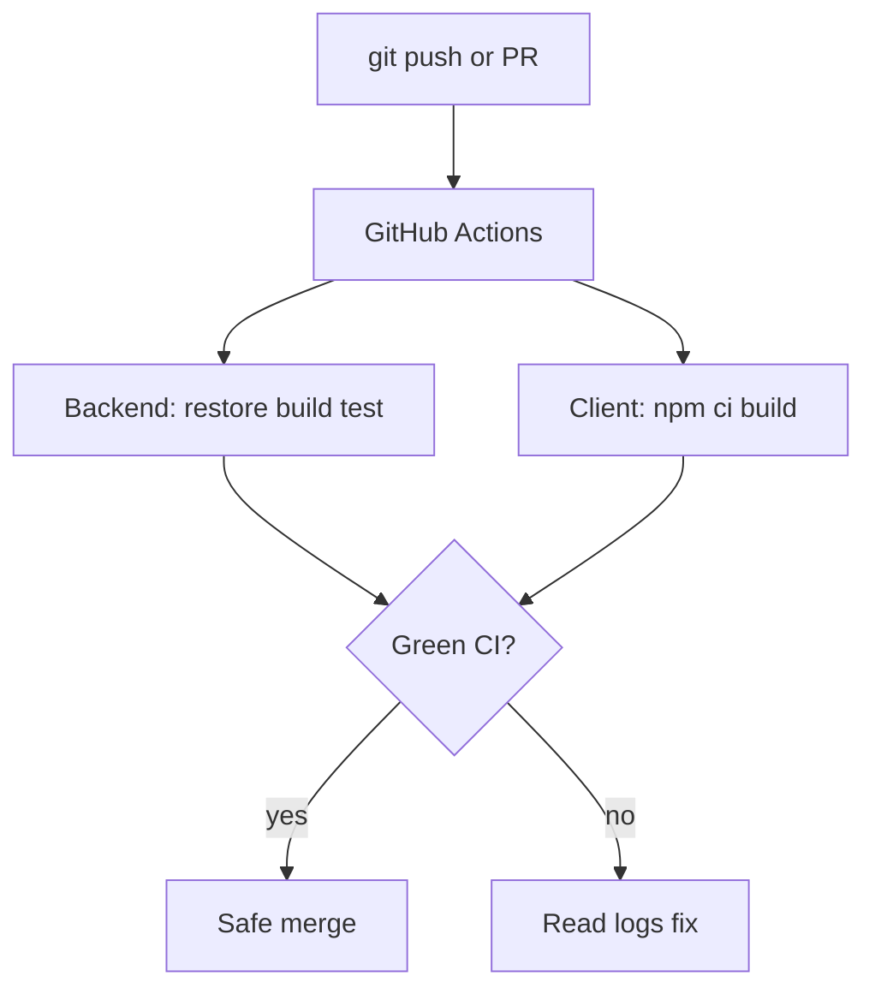
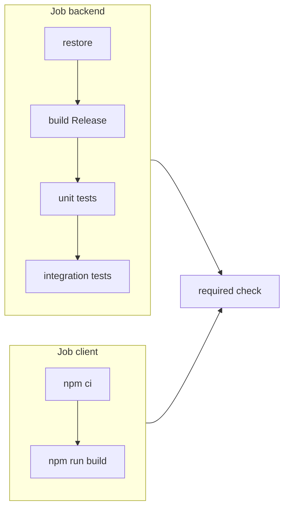

# 21 — GitHub Actions CI

[← Previous](20-pdf-export.md) · [Contents](00-index.md) · [Next →](22-decision-letter-email.md)

## What is this?

**CI** (Continuous Integration): Automatic build + test on every push or PR.  
**GitHub Actions** runs YAML workflows on GitHub-hosted runners — no green check, no confidence in `main`.

**Analogy:** A **factory quality belt** on every commit — code rides the belt; failures drop into the red bin; you do not rely on remembering `dotnet test` manually.



## Role in BankApp

`.github/workflows/ci.yml`:

1. Backend: restore → build → unit → integration  
2. Client: Node setup → `npm ci` / build  

Green CI = safe merge. NuGet and npm caches shorten runner time.

## When added?

Around **Phase 5**; later expanded (ubuntu pin, cache v5, nullable cleanup).

## Core concepts

| Concept | Meaning |
|--------|--------|
| **Workflow** | YAML file (triggers + jobs) |
| **Job** | Parallel work unit (backend / client) |
| **Step** | Step inside a job |
| **Runner** | `ubuntu-24.04` VM |
| **Badge / check** | Pass/fail on the PR |
| **Cache** | npm via `setup-node`; NuGet via `actions/cache` |



## Commands

Local CI mimic:

```powershell
dotnet restore BankApp.slnx
dotnet build BankApp.slnx --configuration Release --no-restore
dotnet test tests/Application.UnitTests/Application.UnitTests.csproj -c Release --no-build
dotnet test tests/WebApi.IntegrationTests/WebApi.IntegrationTests.csproj -c Release --no-build

cd client
npm ci
npm run build
```

GitHub CLI:

```powershell
gh run list --limit 5
gh run view <id> --log-failed
```

### Disaster / recovery (developer)

| Situation | Path |
|-----------|------|
| Client only red | local `npm ci` + `npm run build` |
| NU1605 | fix csproj / package versions |
| Integration fail | run integration project alone |
| Suspect cache | verify local Release chain matches CI |

## Classes, methods, packages

- `actions/checkout@v5`
- `actions/setup-dotnet@v5`
- `actions/setup-node@v5` (`cache: npm`)
- `actions/cache@v5`
- Runner: `ubuntu-24.04`

## Where in the repo?

```
.github/workflows/ci.yml
```

## Mini flow

`git push` → Actions runs → fail → `gh run view --log-failed` → fix → green.

Screen (API docs — same contract CI builds):


## Beginner lab

1. Branch → tiny change → push → open Actions tab.
2. Note duration and two jobs.
3. Introduce temporary client syntax error → push → client job red.
4. Revert → green.
5. Run local `dotnet test` + `npm ci` once — match CI.

## Common mistakes

- Only `npm run dev`, never `npm run build`  
- `package.json` changed without `package-lock.json` → `npm ci` fails  
- Skipping integration tests locally before PR  
- Downgrading Actions and bringing back Node 20 warnings  

## Where it helps

- [ ] CI runs on push/PR  
- [ ] Backend + client jobs green  
- [ ] Local Release build matches CI  
- [ ] `gh run view --log-failed` shows actionable errors
