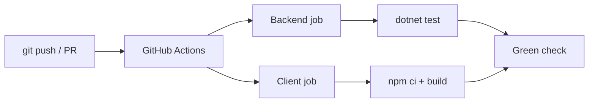

# 21 — GitHub Actions CI

[← Previous](20-pdf-export.md) · [Contents](00-index.md) · [Next →](22-decision-letter-email.md)

## What is this?

**CI** (Continuous Integration): Automatic build + test on every push/PR.  
**GitHub Actions**: YAML workflows in the repo run on hosted runners.



## Role in BankApp

`.github/workflows/ci.yml`:

1. Backend: restore → build → unit → integration  
2. Client: Node setup → `npm ci` / build  

Green CI = confidence for `main`.

## When added?

Around **Phase 5**; extended later.

## Core concepts

| Concept | Meaning |
|--------|--------|
| **Workflow** | YAML file |
| **Job** | Parallel work unit (backend / client) |
| **Step** | Step inside a job |
| **Runner** | `ubuntu-24.04` VM |
| **Badge / check** | Pass/fail on the PR |
| **Cache** | Client: `setup-node` `cache: npm`; Backend: `actions/cache` → `~/.nuget/packages` |

## Commands

Mimic CI locally:

```powershell
dotnet restore BankApp.slnx
dotnet build BankApp.slnx --configuration Release --no-restore
dotnet test tests/Application.UnitTests/Application.UnitTests.csproj -c Release --no-build
dotnet test tests/WebApi.IntegrationTests/WebApi.IntegrationTests.csproj -c Release --no-build

cd client
npm ci
npm run build
```

GitHub CLI:

```powershell
gh run list --limit 5
gh run view <id> --log-failed
```

## Classes, methods, packages

Actions (Node 24 runtime — clears v4 Node 20 deprecation warning):

- `actions/checkout@v5`
- `actions/setup-dotnet@v5`
- `actions/setup-node@v5` (`cache: npm`)
- `actions/cache@v5` (NuGet `~/.nuget/packages`, key = csproj/slnx hash; Node 24)
- Runner: `ubuntu-24.04`

## Where in the repo?

```
.github/workflows/ci.yml
```

## Mini flow

`git push` → Actions runs → NU1605 / test fail → red → fix → green again.
