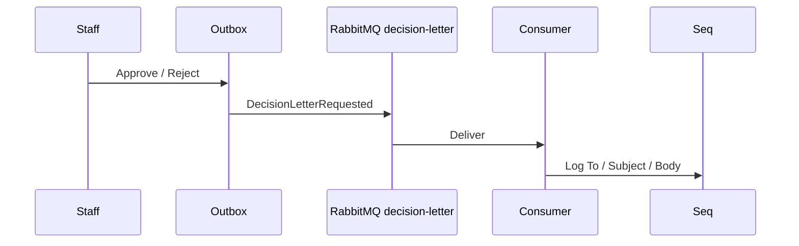

# 22 — Decision letter e-mail (lab)

[← Previous](21-ci-github-actions.md) · [Contents](00-index.md) · [Next →](23-rate-limiting.md)

Related: [25 SMS lab](25-decision-letter-sms.md)

## What is this?

When staff **approve or reject** a credit application, the customer receives a “decision letter” notification.  
In the BankApp lab there is no real SMTP: the message is written to **RabbitMQ**, and a consumer **logs to Seq/Serilog** (same teaching model as e-mail verification).



## Role in BankApp

- UI approve/reject **notes** templates are sent to the customer (body).
- Tied to Outbox → `domain-events` flow; fires after SignalR toast.
- Queue name: `decision-letter`.

## When added?

Roadmap “Later” item — e-mail lab slice; SMS is a separate chapter ([25](25-decision-letter-sms.md)).

## Core concepts

| Concept | Meaning |
|--------|--------|
| **Decision letter** | Text to the customer after approve/reject |
| **Publisher** | Service that enqueues the message |
| **Consumer** | Hosted service that simulates “send” |
| **Lab delivery** | Log stands in for e-mail (training) |

## Commands

```powershell
cd infra
docker compose up -d rabbitmq webapi
# RabbitMQ UI → Queues → decision-letter
# Seq → "Decision letter consumed"
```

If the broker is down, the publisher logs a warning but still writes the body (registration/approve flow does not break).

## Classes, methods, packages

| Name | Role |
|------|-----|
| `DecisionLetterRequested` | Message record (ToEmail, Subject, Body, Decision, …) |
| `IDecisionLetterPublisher` | Abstraction |
| `RabbitMqDecisionLetterPublisher` | Publish to queue / disabled fallback log |
| `DecisionLetterConsumerHostedService` | Consume + Seq log |
| `DomainEventsConsumerHostedService.TryPublishDecisionLetterAsync` | Publish after Approve/Reject |
| `RabbitMqOptions.DecisionLetterQueue` | Default `decision-letter` |

Package: `RabbitMQ.Client` (existing Notification host).

## Where in the repo?

```
src/Application/Services/Messaging/DecisionLetterRequested.cs
src/Application/Services/Messaging/IDecisionLetterPublisher.cs
src/WebApi/Modules/Notification/Messaging/RabbitMqDecisionLetterPublisher.cs
src/WebApi/Modules/Notification/Messaging/DecisionLetterConsumerHostedService.cs
src/WebApi/Modules/Notification/Messaging/DomainEventsConsumerHostedService.cs
src/WebApi/Modules/Notification/NotificationHostModule.cs
tests/Application.UnitTests/Services/Messaging/DecisionLetterRequestedTests.cs
```

## Mini flow

Staff approves → Outbox → `domain-events` → Saga + SignalR → customer e-mail resolved → `DecisionLetterRequested` → `decision-letter` queue → consumer writes `To` / `Subject` / `Body` to Seq.
