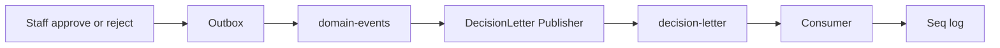
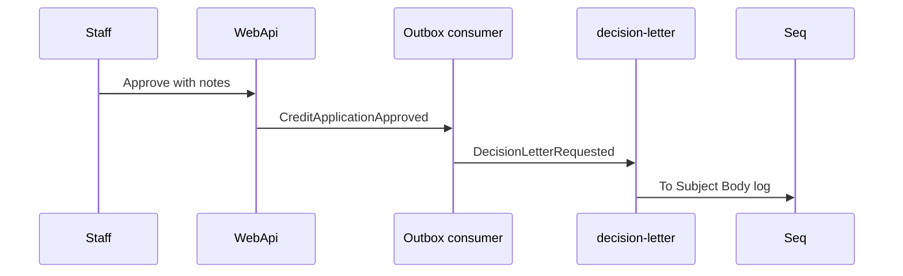

# 22 — Decision letter email (lab)

[← Previous](21-ci-github-actions.md) · [Contents](00-index.md) · [Next →](25-decision-letter-sms.md)

Related: [13 RabbitMQ](13-rabbitmq.md) · [14 Outbox](14-outbox-events.md) · [25 SMS lab](25-decision-letter-sms.md)

## What is this?

When staff **approve or reject** a credit application, the customer should receive a “decision letter” notification.  
In the BankApp lab there is no real SMTP: the message goes to **RabbitMQ**, and the consumer logs to **Seq/Serilog** (same education model as email confirmation).

**Analogy:** A **fax simulation** — content is real, no mail carrier; you see lines in Seq instead of an inbox.



## Role in BankApp

- Approve/reject **notes** from the UI become the message body.
- Tied to Outbox → `domain-events`; runs after SignalR toast path.
- Queue name: `decision-letter`.

## When added?

Roadmap “later” item — email lab slice; SMS in [25](25-decision-letter-sms.md).

## Core concepts

| Concept | Meaning |
|--------|--------|
| **Decision letter** | Customer text after approve/reject |
| **Publisher** | `IDecisionLetterPublisher` |
| **Consumer** | `DecisionLetterConsumerHostedService` |
| **Lab delivery** | Log stands in for email |
| **Broker down** | Warning log; approve HTTP path continues |



## Commands

```powershell
cd infra
docker compose --env-file .env up -d rabbitmq webapi seq
```

RabbitMQ UI → `decision-letter`. Seq → search “Decision letter” or `ToEmail`.

```powershell
docker compose --env-file .env logs --tail=50 webapi | Select-String -Pattern "Decision"
```

```powershell
dotnet test tests/Application.UnitTests/Application.UnitTests.csproj --filter "DecisionLetter"
```

## Classes, methods, packages

| Name | Role |
|------|-----|
| `DecisionLetterRequested` | Message DTO |
| `IDecisionLetterPublisher` | Abstraction |
| `RabbitMqDecisionLetterPublisher` | Publish / fallback log |
| `DecisionLetterConsumerHostedService` | Consume + Seq |
| `DomainEventsConsumerHostedService.TryPublishDecisionLetterAsync` | After approve/reject |
| `RabbitMqOptions.DecisionLetterQueue` | Default `decision-letter` |

## Where in the repo?

```
src/Application/Services/Messaging/DecisionLetterRequested.cs
src/Application/Services/Messaging/IDecisionLetterPublisher.cs
src/WebApi/Modules/Notification/Messaging/RabbitMqDecisionLetterPublisher.cs
src/WebApi/Modules/Notification/Messaging/DecisionLetterConsumerHostedService.cs
src/WebApi/Modules/Notification/Messaging/DomainEventsConsumerHostedService.cs
src/WebApi/Modules/Notification/NotificationHostModule.cs
tests/Application.UnitTests/Services/Messaging/DecisionLetterRequestedTests.cs
```

## Mini flow

Staff approves → Outbox → `domain-events` → saga + SignalR → customer email resolved → `DecisionLetterRequested` → queue → Seq logs `To` / `Subject` / `Body`.

## Beginner lab

1. Stack: rabbitmq, webapi, seq.
2. Approve with a distinctive note sentence.
3. Watch `decision-letter` Ready in RabbitMQ.
4. Find the sentence in Seq `Body`.
5. `docker compose stop rabbitmq` → approve again → check warning log and HTTP still 200.

## Common mistakes

- “Email did not send” without checking Seq — lab delivery is Seq  
- Forgetting decision-letter consumer while outbox works  
- Empty `ToEmail` on seed accounts  
- Deleting messages in Rabbit UI then wondering why they never reappear  

## Where it helps

- [ ] Queue processes after approve/reject  
- [ ] Seq shows To/Subject/Body  
- [ ] DecisionLetter unit tests pass  
- [ ] Broker down does not break approve HTTP flow
