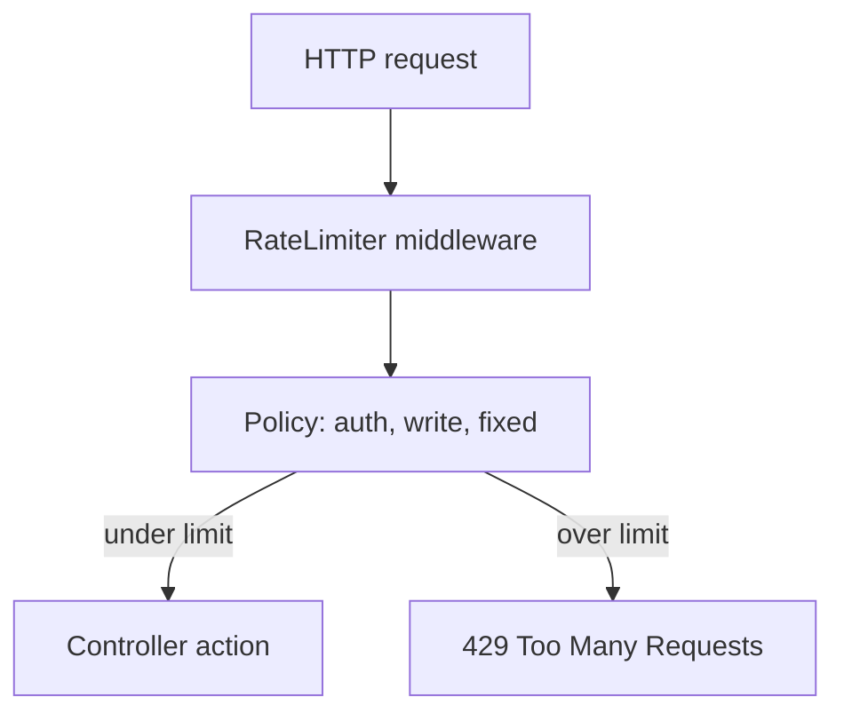
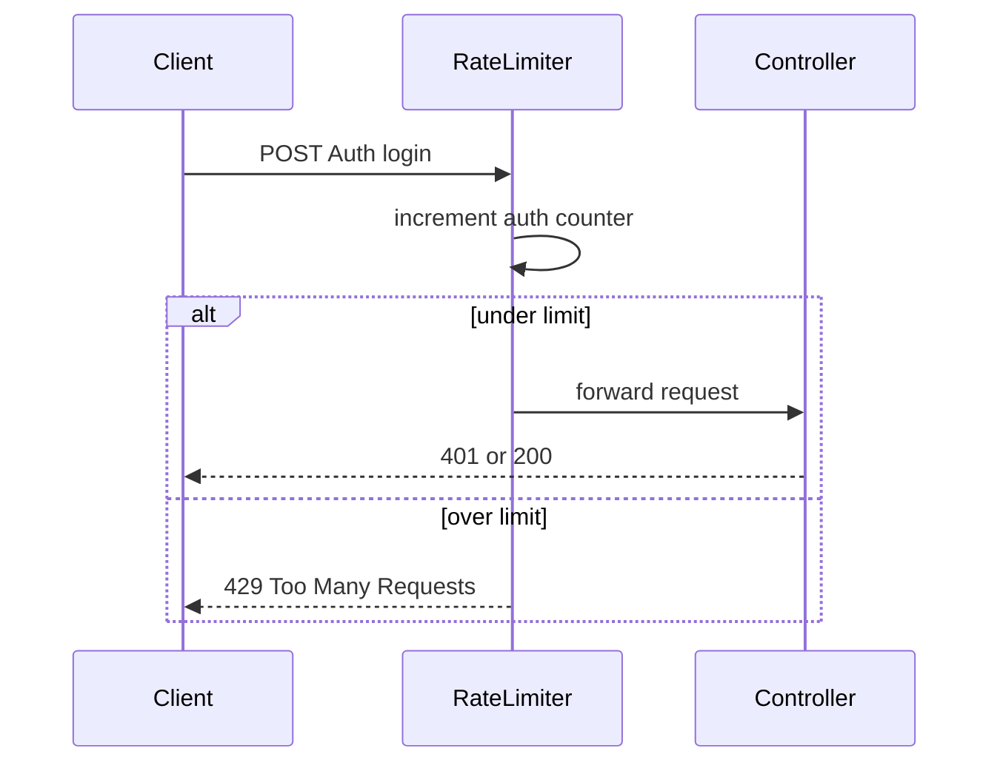

# 23 — Rate limiting (ASP.NET Core)

[← Previous](22-decision-letter-email.md) · [Contents](00-index.md) · [Next →](24-lab-tools.md)

Related: [19 — Vault lab](19-vault-lab.md)

## What is this?

**Rate limiting**: Caps how many requests a client / IP can send in a time window. Over the limit → HTTP **429 Too Many Requests**.

**Analogy:** Like a bank turnstile: at most N card taps per minute; extra attempts are refused (429). Login (`auth`), credit writes (`write`), and everything else (`fixed`) each have their own counter.



## Role in BankApp

Limits brute-force login and credit write spam. Three policies; **different limits per environment**:

| Policy | Development (lab) | Production-like (`appsettings.json`) | Where |
|--------|-------------------|------------------------------------------|--------|
| `auth` | 20 / 60s | 10 / 60s | `AuthController` |
| `write` | 60 / 60s | 30 / 60s | CreditApplications create/approve/reject/cancel/update/delete |
| `fixed` | 100 / 60s | 60 / 60s | Other controllers |

Compose default `ASPNETCORE_ENVIRONMENT=Development` → lab uses relaxed limits.  
`/health` and the SignalR hub are exempt.

## When added?

Basic `fixed` existed earlier; **auth / write** policies added in the security slice.  
**Environment split** (strict base + relaxed Development) in the hardening lab slice (2026-10-28).

## Core concepts

| Concept | Meaning |
|--------|--------|
| **Fixed window** | N requests in a fixed time window |
| **PermitLimit** | Permits per window |
| **QueueLimit** | Queue when limited (0 = immediate 429) |
| **EnableRateLimiting** | Controller/action attribute |
| **Environment layering** | `appsettings.json` + `appsettings.{Environment}.json` merge |



## Commands

Production-like base (`appsettings.json`) — strict defaults:

```json
"RateLimiting": {
  "Fixed": { "PermitLimit": 60, "WindowSeconds": 60 },
  "Auth": { "PermitLimit": 10, "WindowSeconds": 60 },
  "Write": { "PermitLimit": 30, "WindowSeconds": 60 }
}
```

Lab overlay (`appsettings.Development.json`) — local / Compose Development:

```json
"RateLimiting": {
  "Fixed": { "PermitLimit": 100, "WindowSeconds": 60 },
  "Auth": { "PermitLimit": 20, "WindowSeconds": 60 },
  "Write": { "PermitLimit": 60, "WindowSeconds": 60 }
}
```

Check which environment loads (lab expects `Development`):

```powershell
docker compose -f infra/docker-compose.yml --env-file infra/.env exec webapi printenv ASPNETCORE_ENVIRONMENT
# Expected: Development → relaxed Auth 20/60s
```

Quick test (login spam → 429). In Development ~21st request → 429; with Production config ~11th:

```powershell
1..30 | ForEach-Object {
  curl -s -o NUL -w "%{http_code}`n" -X POST http://localhost:8080/api/Auth/login `
    -H "Content-Type: application/json" `
    -d '{"email":"x","password":"y"}'
}
# First ~20 lines 401/400; then 429. After 60s window, permits reopen.
```

Try strict limits in Compose (lab only; not permanent):

```powershell
# Temporary: set ASPNETCORE_ENVIRONMENT=Production in infra/.env and recreate webapi
# Revert to Development after — otherwise UI/tests may hit 429
docker compose -f infra/docker-compose.yml --env-file infra/.env up -d --force-recreate webapi
```

## Classes, methods, packages

| Name | Role |
|------|-----|
| `RateLimitPolicies` | `Fixed` / `Auth` / `Write` constants |
| `AddRateLimitingConfiguration` | `AddFixedWindowLimiter` registration |
| `UseRateLimiter()` | Middleware |
| `Microsoft.AspNetCore.RateLimiting` | Framework API |

## Where in the repo?

```
src/WebApi/Constants/RateLimitPolicies.cs
src/WebApi/Extensions/ServiceCollectionExtensions.cs
src/WebApi/Extensions/ApplicationBuilderExtensions.cs
src/WebApi/Modules/Identity/Controllers/AuthController.cs
src/WebApi/Modules/Credit/Controllers/CreditApplicationsController.cs
src/WebApi/appsettings.json                 # strict (prod-like) base
src/WebApi/appsettings.Development.json    # relaxed lab overlay
```

## Mini flow

Request → RateLimiter middleware → policy (auth/write/fixed) counter (from environment config) → permit → action; else 429.

Screen (auth — login):


## Beginner lab

1. Stack up under `infra`; confirm `printenv ASPNETCORE_ENVIRONMENT` → `Development`.
2. Run the 30× login loop; expect 401/400 first, then **429**.
3. Wait 60s; single login again → counter window reset.
4. Call `/health` five times → always **200** (exempt).

## Common mistakes

- Running lab scripts under **Production** → 429 too early; demo UI locks up.
- Treating **429** as CORS or **401** → read status and body.
- Expecting different counters per browser tab on the same machine — partition is usually **client IP**.
- Unquoted `auth / write` in Mermaid node labels → broken diagram; use quotes or commas.

## Where it helps

### Health checklist

| Check | How | Good sign |
|---------|-------|-------------|
| Environment | `printenv ASPNETCORE_ENVIRONMENT` | Lab: `Development` |
| Auth 429 | 30× login loop above | Dev: 429 around request 21 |
| Health exempt | Repeat `curl http://localhost:8080/health` | Always 200 (no limit) |
| Write | Many create/approve from same IP | 429 after limit |

### Disaster / recovery (lab)

| Situation | Path |
|-------|-----|
| UI constantly 429 | Wait 60s **or** recreate WebApi (resets counters) |
| Tests / demo spam 429 | Confirm `ASPNETCORE_ENVIRONMENT=Development`; revert if you tried Production |
| Limit never triggers | Wrong host/port; different IP partition; missing policy attribute |
| Health 429 | Should not happen — check middleware exemption |
