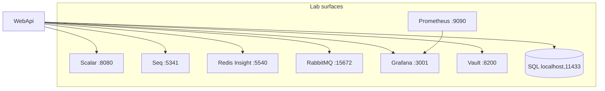
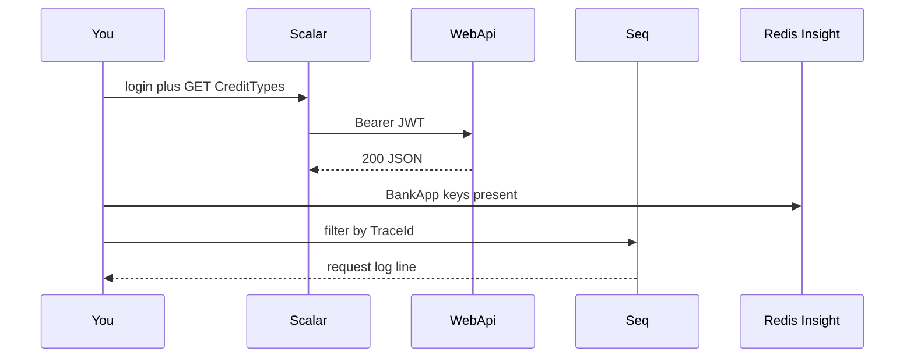
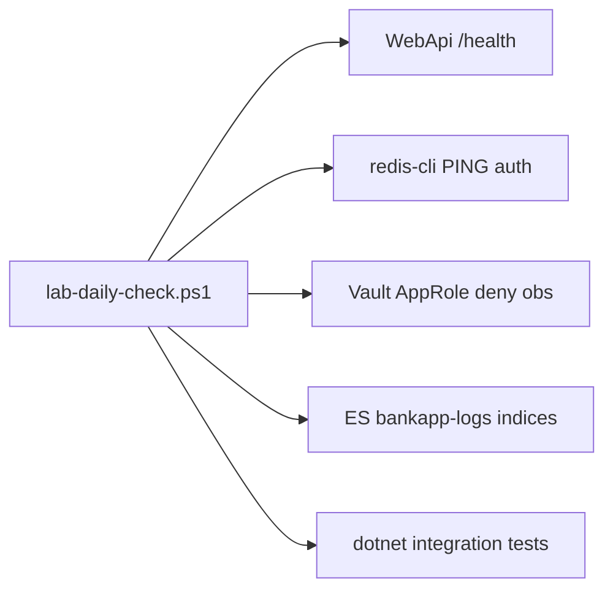

# 24 — Lab tools (observability and inspection)

[← Previous](23-rate-limiting.md) · [Contents](00-index.md) · [Next →](25-decision-letter-sms.md)

Related: [07 Seq](07-serilog-seq.md) · [08 Redis](08-redis.md) · [09 Compose](09-docker-compose.md) · [13 RabbitMQ](13-rabbitmq.md) · [18 OTel/Grafana](18-otel-observability.md) · [19 Vault](19-vault-lab.md)

## What is this?

**Lab tools**: UIs and CLIs used to **observe and debug** the BankApp stack (API, cache, queue, logs, metrics, secrets, DB). Many servers (including Redis) have no built-in “pretty UI”; Insight, Grafana, Scalar, etc. fill that gap.

Doc style: above/beside frequent commands — **what it does**, **what to check next**, and when possible **disaster / recovery** (e.g. [09 Compose](09-docker-compose.md)).

**Analogy:** Like a hospital ward — the patient (WebApi) is in bed; monitors (Grafana), charts (Seq), pharmacy inventory (Redis Insight), and courier queue (RabbitMQ) each answer a different diagnostic question.



## Role in BankApp

When the Compose lab is up, most tools are reachable by URL. Goal: answer on one machine — “I sent a request — did cache fill? What hit the log? Messages in the queue? Where did the trace break?”

| Tool | URL / endpoint | What you watch |
|------|----------|-----------|
| **Scalar** | http://localhost:8080/scalar/v1 | HTTP API (JWT, header, body) |
| **Seq** | http://localhost:5341 | Structured application logs |
| **Redis Insight** | http://localhost:5540 | Redis keys / TTL / content |
| **RabbitMQ Management** | http://localhost:15672 | Queues, messages, consumers |
| **Grafana** | http://localhost:3001 | Metrics + trace UI |
| **Prometheus** | http://localhost:9090 | Raw metrics / scrape |
| **Vault UI** | http://localhost:8200 | Lab secrets (KV) |
| **SQL client** *(host)* | `localhost,11433` | Database (no UI in Compose) |
| **Docker Desktop / CLI** | — | Container health / logs |

## When added?

Services arrived across Phases 2–6; **Redis Insight** and this combined “lab tools” guide in a training slice.

## Core concepts

| Concept | Meaning |
|--------|--------|
| **Observability** | See inside the system via log + metric + trace |
| **Compose DNS** | Containers reach each other by **service name** (`redis`, `webapi`); `localhost` inside a container means something else |
| **Host port** | `localhost:PORT` in the browser (Compose `ports:`) |
| **Lab credential** | Training passwords — **not for production**; rotate / Vault / secret manager required |
| **Liveness vs data UI** | `/health` = “alive?”; Insight/Grafana = “what’s inside?” |



---

## Daily lab smoke (`lab-daily-check.ps1`)

Repeatable **~10 min** check while the stack is up: health, Redis auth, Vault overlay/policy, ELK indices, integration tests (`Vault:Enabled=false` — same as CI).

**Analogy:** Pre-flight checklist — same steps daily to catch small regressions early.



From repo root (PowerShell 5+ or `pwsh`):

```powershell
powershell -NoProfile -File infra/scripts/lab-daily-check.ps1
```

| Step | Expected |
|------|----------|
| `compose ps` (vault, sql, redis, elasticsearch, webapi) | Up / healthy |
| `GET /health` | HTTP 200 |
| `redis-cli -a $REDIS_PASSWORD ping` | `PONG` |
| WebApi log | `Vault overlay … Redis=True` (increase log `--tail` if stack ran for days) |
| AppRole `kv get …/observability` | **403 / permission denied** |
| `/_cat/indices/bankapp-logs*` | At least one daily index (warning OK on cold stack) |
| `WebApi.IntegrationTests` | All green |

After Vault recreate: run `vault-seed` → recreate `webapi`. Details: `infra/README.md` → **Daily lab checklist**.

---

## Tool by tool: setup, use, cautions, best practice

### 1) Scalar (API trials)

**Setup:** Shipped with WebApi in Dev; no extra install.  
**Use:**

1. `POST /api/Auth/login` → token (demo accounts in README).
2. Request header: Key = **`Authorization`**, Value = `Bearer <token>` (not `Auth`).
3. Credit **writes** (create/approve/reject/cancel): also header **`Idempotency-Key`** (UUID).

**Cautions:**

- Expired token → 401; login again.
- Missing role → 403 (e.g. manager-only endpoint).
- Over limit → **429** ([23](23-rate-limiting.md)).

**Best practice:** Keep scenarios repeatable (fixed Idempotency-Key for replay / 409). Do not leave OpenAPI public in production; Scalar is Dev-only in the lab.

---

### 2) Seq (logs)

Filters, checklist, recovery: **[07 — Serilog/Seq](07-serilog-seq.md)**.

**Setup:** Compose `seq`; lab usually **no login** → http://localhost:5341.

```powershell
cd infra
docker compose --env-file .env up -d seq
# Check: ps → healthy; UI Events; filter e.g. @Level = 'Error'
docker compose --env-file .env logs --tail=50 webapi   # if sink cannot connect
```

**Cautions:** Volume grows; lab reset `down -v` ([09](09-docker-compose.md)). Prod needs auth + retention.

**Best practice:** Avoid PII/JWT in logs. Start from errors; bridge to Grafana with TraceId.

---

### 3) Redis Insight

**Setup:** Compose `redis-insight` (`REDIS_INSIGHT_PORT`, default `5540`).  
**First connection (critical):**

```text
redis://redis:6379
```

Insight runs **inside a container**, so host **`redis`** (Compose service name). `127.0.0.1` / `localhost` is Insight itself → connection fails.

**Example keys in this project:**

- `BankApp:CreditTypeList(...)` / `CreditSubTypeList(...)` — query cache  
- `BankApp:CacheGroup:CreditTypes` / `CreditSubTypes` — group index  
- Idempotency records — after write endpoints  

**Cautions:** `FLUSHDB` / deleting keys in Insight can break the lab (cache miss is normal; deleting idempotency risks duplicate processing). Do not expose prod Redis Insight to the internet.

**Best practice:** Read in Browser first; check TTL and type before delete. Watch cache invalidation via app command (CreditType update) for learning.

---

### 4) RabbitMQ Management

Queue table + disaster: **[13 — RabbitMQ](13-rabbitmq.md)**.

**Setup:** UI http://localhost:15672 → **`guest` / `guest`**.

```powershell
cd infra
docker compose --env-file .env up -d rabbitmq
docker compose --env-file .env exec rabbitmq rabbitmq-diagnostics -q ping
# UI: Queues → Consumers ≥ 1, Ready should not pile up
# decision-letter + decision-letter-sms (approve/reject lab)
```

**Cautions:** `guest` = lab only. Getting messages from UI can disturb consumers.

**Best practice:** Check Consumers + Ready first; if backlog grows → Seq + `logs webapi`.

---

### 5) Grafana + Prometheus (+ Tempo)

**Setup:** Compose OTel stack; Grafana `:3001` → **`admin` / `admin`** (`GRAFANA_ADMIN_*`). Prometheus `:9090` usually no login in lab.  
**Use:** Provisioned datasources in Grafana; Explore for metrics/traces. Note password-change prompt in lab; must change in prod.

**Commands / steps**

```powershell
cd infra
# Start OTel + UI (skip if full stack already up)
docker compose --env-file .env up -d otel-collector tempo prometheus grafana

# Status
docker compose --env-file .env ps otel-collector tempo prometheus grafana
docker compose --env-file .env logs -f grafana

# Quick health from host
curl -s -o NUL -w "%{http_code}" http://localhost:3001/api/health   # Grafana
curl -s http://localhost:9090/-/ready                                 # Prometheus
```

Grafana UI (http://localhost:3001):

1. Login: `admin` / `admin`.
2. **Dashboards → BankApp → BankApp HTTP (OTel)** — ready-made lab panel.
3. Left **Explore**:
   - Datasource **Prometheus** — e.g. `http_server_request_duration_seconds_count` or `up` (scrape alive).
   - Datasource **Tempo** — Search / service name: `bankapp-webapi` (after a few API requests).
4. Open trace → span durations; filter same `TraceId` in Seq.

Prometheus UI (http://localhost:9090): **Status → Targets** → `otel-collector:8889` **UP**. **Graph** → try `up{job="otel-collector"}`.

**Cautions:** Port clash: client `:3000`, Grafana `:3001`. No traces → OTel enabled on WebApi (`OpenTelemetry__Enabled`), collector healthy, enough requests (`/health` may be outside tracing) — [18](18-otel-observability.md).

**Best practice:** “Slow endpoint” → Grafana Tempo → span → Seq same `TraceId`. Validate metrics in Explore / Prometheus before dashboards. Never leave lab passwords in prod.

---

### 6) Vault UI

CLI, overlay logs, recovery: **[19 — Vault lab](19-vault-lab.md)**.

**Setup:** http://localhost:8200 → Method **Token** = `VAULT_DEV_ROOT_TOKEN_ID` (operators only) → KV `secret/bankapp` paths `jwt` / `database` / `messaging` / `cache` / `observability`.

```powershell
cd infra
docker compose --env-file .env up -d vault
docker compose --env-file .env up vault-seed
docker compose --env-file .env exec vault vault kv get secret/bankapp/jwt
# WebApi: logs | Select-String Vault  → overlay applied; Redis=True
# Policy smoke: infra/scripts/lab-daily-check.ps1 (AppRole observability deny)
```

**Cautions:** Dev mode ≠ prod. Do not screenshot root token.

**Best practice:** Read secret in UI/CLI; refresh with seed + WebApi recreate.

---

### 7) SQL Server client (host tool)

**Setup (outside Compose):** [Azure Data Studio](https://learn.microsoft.com/sql/azure-data-studio/) or SSMS / VS Code MSSQL extension.  
**Connection:** Server `localhost,11433` (comma!), Login `sa`, password from `infra/.env` → `MSSQL_SA_PASSWORD`.

**Cautions:** Port **11433** (avoids host 1433 clash). `Encrypt` / trust server certificate: lab needs ADS “Trust server certificate”. Do not keep prod password same as `.env.example`.

**Best practice:** Read-only queries first. Leave seed/migrate to app flow; ad-hoc schema edits are risky outside training.

---

### 8) Docker Desktop / Compose CLI

Flags, checklist, disaster table: **[09 — Docker Compose](09-docker-compose.md)**. Summary:

```powershell
cd infra

# What is up / healthy? (first place to look)
docker compose --env-file .env ps

# Why won't WebApi start / what did seed say?
docker compose --env-file .env logs -f webapi

# Refresh only cache UI
docker compose --env-file .env up -d redis redis-insight

# Stop stack (volumes remain — soft shutdown)
docker compose --env-file .env down

# Reset lab Seq/Redis data (destructive; SQL external volume not removed)
# docker compose --env-file .env down -v
```

**Cautions:** `down -v` → Seq/Redis/(Insight) data gone. SQL: separate `docker volume rm sqlserver-2025-data`. On port clash, change ports in `.env`.

**Best practice / recovery order:** `ps` → relevant `logs` → dependency healthy? → `--force-recreate` one service → if needed `down -v` → SQL volume last.

---

### 9) Client side (bonus)

| Tool | For |
|------|---------|
| Browser DevTools → Network | React → API calls, 401/429 |
| React DevTools | Component state (optional extension) |
| Postman / Bruno | Scalar alternative; share collections |

**Best practice:** For CORS / cookie issues use Network + Seq together. Do not paste tokens into Git / public issues.

---

## General lab best practices

1. **Bring the stack up first**, then open tools (`compose ps` green/healthy).  
2. **URL = host port**; container→container = **service name** (Insight→Redis example).  
3. Align credentials with README / `.env.example`; do not commit your `.env`.  
4. Validate an event three ways: **HTTP (Scalar)** → **log (Seq)** → **side effect (Redis / Rabbit / SQL / Grafana)**.  
5. Lab passwords are for training; prod checklist: auth on UIs, TLS, no weak defaults, retention, network policy.  
6. Before destructive actions in Insight / SQL UI, know what you delete.

## Commands (quick reminder)

```powershell
# Stack
cd infra
copy .env.example .env   # once
docker compose --env-file .env up -d --build

# Redis CLI (requirepass — .env REDIS_PASSWORD)
docker compose --env-file .env exec redis redis-cli -a change-me-redis ping
docker compose --env-file .env exec redis redis-cli -a change-me-redis KEYS "BankApp:*"
```

| Service | Lab credential |
|--------|------------|
| Grafana | `admin` / `admin` |
| RabbitMQ | `guest` / `guest` |
| Vault | Token `bankapp-vault-root-token` (or `.env`) |
| SQL | `sa` / `MSSQL_SA_PASSWORD` |
| Redis | `REDIS_PASSWORD` (`.env` / Vault `cache`) |
| Seq / Prometheus | Usually no auth in lab |

## Classes, methods, packages

Mostly **ops / DX**. Code links:

| Name | Role |
|------|-----|
| `AddStackExchangeRedisCache` | Redis cache + idempotency |
| Serilog → Seq sink | Logs |
| OTLP exporter | Trace/metric → collector |
| `IdempotencyKeyFilter` | Write response in Redis |

## Where in the repo?

```
infra/docker-compose.yml
infra/.env.example
infra/README.md
infra/scripts/lab-daily-check.ps1
README*.md                 # API summary / URL table
docs/learning/en/07…19, 23    # Per-service depth
docs/learning/en/08-redis.md  # Insight connection note
```

## Mini flow (suggested debug chain)

1. Scalar: login → `GET /api/CreditTypes` (`Authorization: Bearer …`).  
2. Redis Insight: did `BankApp:CreditTypeList…` appear?  
3. Seq: matching request log lines.  
4. CreditType update → was CacheGroup cleared?  
5. (Optional) Grafana HTTP duration / trace.

Repeat with approve + `Idempotency-Key` → Redis idempotency record + RabbitMQ `decision-letter` / domain event queue.

Screens (lab tool slice):


## Beginner lab

0. (Daily) `powershell -File infra/scripts/lab-daily-check.ps1` → health + Redis + Vault deny + tests green.
1. `cd infra` → `docker compose --env-file .env up -d --build` → check `ps` healthy.
2. Scalar login → `GET /api/CreditTypes` → 200.
3. Redis Insight connect `redis://redis:6379` → see `BankApp:` keys.
4. Seq: last 5 minutes Errors → empty or known lab warnings.
5. (Optional) Grafana Explore → Tempo service `bankapp-webapi`.

## Common mistakes

- Insight **`localhost:6379`** — wrong inside the container; use host **`redis`**.
- Header key **`Auth`** — must be **`Authorization: Bearer …`**.
- Looking for Grafana on **3000** — client is 3000; Grafana lab is **3001**.
- `down -v` as quick fix — wipes Seq/Redis data; mind SQL volumes ([09](09-docker-compose.md)).
- Unquoted `:` in Mermaid node labels — wrap labels in quotes.

## Where it helps

### Health checklist

| Check | How | Good sign |
|---------|-------|-------------|
| Stack | `docker compose ps` | webapi, redis, rabbitmq healthy |
| Scalar | Login + protected GET | 200 / 403 by role |
| Insight | `redis://redis:6379` | Connected |
| RabbitMQ | Queue consumers | ≥ 1 |

### Disaster / recovery (lab)

| Situation | Path |
|-------|-----|
| UI 404 / refused | `ps` + `.env` ports |
| Empty Seq | webapi logs; sink URL |
| No traces | OTel on + send requests |
