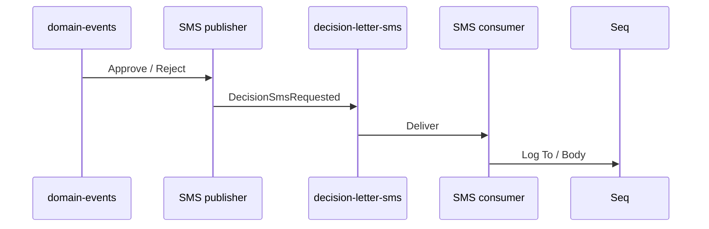

# 25 — Decision letter SMS (lab)

[← Previous](24-lab-tools.md) · [Contents](00-index.md) · [Next →](26-credit-application-documents.md)

Related: [22 E-mail lab](22-decision-letter-email.md) · [13 RabbitMQ](13-rabbitmq.md) · [07 Seq](07-serilog-seq.md)

## What is this?

**SMS** notification to the customer after approve/reject.  
No real SMS gateway (Twilio, etc.): message goes to **RabbitMQ** → consumer **logs to Seq** (same teaching model as the e-mail lab).



## Role in BankApp

- Fires **together with** the e-mail decision letter (approve/reject domain event).
- Phone from `Customer.PhoneNumber`; if missing → skip + warning (flow continues).
- Queue: `decision-letter-sms`.
- Short body (lab max ~320 chars; from notes when present).

## When added?

Roadmap “Send decision letter via SMS” — easy slice after e-mail lab.

## Core concepts

| Concept | Meaning |
|--------|--------|
| **Decision SMS** | Short approve/reject text (phone) |
| **Lab delivery** | Seq log stands in for SMS |
| **Skip** | No publish when phone missing |

## Commands

```powershell
cd infra
docker compose --env-file .env up -d rabbitmq webapi
# Check: RabbitMQ UI → Queues → decision-letter-sms (Consumers ≥ 1)
```

```powershell
# After approve/reject
# Seq: "Decision SMS consumed"  (To= phone, Body=…)
docker compose --env-file .env logs --tail=50 webapi
```

If the broker is down, the publisher logs a warning but still writes the body (registration/approve does not break).

### What to verify

| Check | Good sign |
|---------|-------------|
| Queue `decision-letter-sms` | Consumers ≥ 1 |
| Approve/reject | Seq shows e-mail + SMS lines |
| Customer with empty phone | Warning skip; e-mail may still go |

## Classes, methods, packages

| Name | Role |
|------|-----|
| `DecisionSmsRequested` | ToPhone, Body, Decision, … |
| `IDecisionSmsPublisher` / `RabbitMqDecisionSmsPublisher` | Publish to queue |
| `DecisionSmsConsumerHostedService` | Consume → Seq |
| `TryPublishDecisionSmsAsync` | Inside domain events consumer |
| `RabbitMqOptions.DecisionSmsQueue` | Default `decision-letter-sms` |

## Where in the repo?

```
src/Application/Services/Messaging/DecisionSmsRequested.cs
src/Application/Services/Messaging/IDecisionSmsPublisher.cs
src/WebApi/Modules/Notification/Messaging/RabbitMqDecisionSmsPublisher.cs
src/WebApi/Modules/Notification/Messaging/DecisionSmsConsumerHostedService.cs
src/WebApi/Modules/Notification/Messaging/DomainEventsConsumerHostedService.cs
src/WebApi/Modules/Notification/NotificationHostModule.cs
tests/.../DecisionSmsRequestedTests.cs
```

## Mini flow

Staff approves → Outbox → `domain-events` → SignalR + decision-letter e-mail + **decision-letter-sms** → consumer writes `To` / `Body` to Seq.
