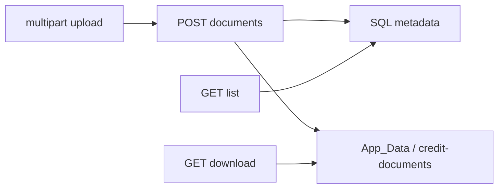
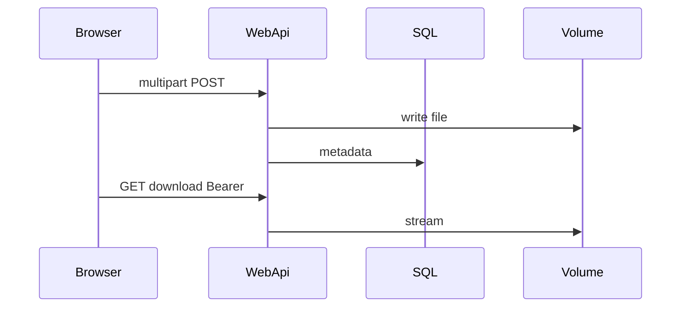

# 26 — Credit application document upload (lab)

[← Previous](25-decision-letter-sms.md) · [Contents](00-index.md) · [Next →](27-branch-model.md)

Related: [03 EF Core](03-ef-core-sql.md) · [06 JWT / RBAC](06-jwt-rbac.md) · profile avatar (same multipart pattern)

## What is this?

Attach **identity / income / other** files to an application.  
Files live on disk (`App_Data`, not wwwroot); metadata in SQL. Download via **JWT-protected API** — not public StaticFiles.

**Analogy:** Card index in SQL, original in a locked cabinet (volume); copy only with ID (JWT download).



## Role in BankApp

- Customer or staff upload on **Pending** applications (lab; not yet mandatory for approval).
- Types: `IdentityDocument`, `IncomeProof`, `Other` (SmartEnum).
- Limits: ≤ 5 MB; PDF / JPEG / PNG; max 10 files per application.
- While Pending: **preview / download / remove** (soft-delete + disk delete); remove asks for confirm (i18n).
- Compose volume: `credit-document-uploads` → `/app/App_Data/credit-documents`.

## When added?

Roadmap “document upload” slice (2026-10-28); pattern derived from avatar upload.

## Core concepts

| Concept | Meaning |
|--------|--------|
| **Multipart / IFormFile** | Browser `FormData` → API file field |
| **Metadata vs blob** | SQL row + disk path |
| **App_Data** | Outside wwwroot; no static serve |
| **Magic bytes** | Content-Type matches real content |
| **Path traversal protection** | Storage path cannot escape root |



## Commands

Migration (already in repo; WebApi runs migrate on new environments):

```powershell
dotnet ef migrations add AddCreditApplicationDocuments `
  --project src/Persistence/Persistence.csproj `
  --startup-project src/WebApi/WebApi.csproj
# Then: WebApi startup runs MigrateAsync to create the table
```

Compose volume + WebApi recreate (files persist in volume):

```powershell
cd infra
docker compose --env-file .env up -d --build webapi client
docker compose --env-file .env ps
# Expected: webapi healthy; volume bankapp-credit-document-uploads
```

Upload via Scalar / curl (Pending application + JWT):

```powershell
curl -X POST "http://localhost:8080/api/CreditApplications/<APP_ID>/documents" `
  -H "Authorization: Bearer <TOKEN>" `
  -F "documentType=IdentityDocument" `
  -F "file=@C:\temp\kimlik.pdf;type=application/pdf"
# Expected: 200 + id / originalFileName
```

List + download:

```powershell
curl -s -H "Authorization: Bearer <TOKEN>" `
  "http://localhost:8080/api/CreditApplications/<APP_ID>/documents"

curl -L -H "Authorization: Bearer <TOKEN>" `
  -o indirilen.pdf `
  "http://localhost:8080/api/CreditApplications/<APP_ID>/documents/<DOC_ID>/download"
```

## Classes, methods, packages

| Name | Role |
|------|-----|
| `CreditApplicationDocument` | Entity |
| `CreditDocumentType` | SmartEnum |
| `ICreditDocumentStorage` / `LocalCreditDocumentStorage` | Disk I/O |
| `UploadCreditApplicationDocumentRequest` | MediatR upload |
| `DeleteCreditApplicationDocumentRequest` | MediatR delete (Pending) |
| `CreditApplicationDocumentBusinessRules` | Size / type / Pending / limit |

## Where in the repo?

```
src/Domain/Entities/CreditApplicationDocument.cs
src/Domain/Enums/CreditDocumentType.cs
src/Application/Modules/Credit/Features/CreditApplicationDocuments/
src/WebApi/Services/LocalCreditDocumentStorage.cs
src/WebApi/Modules/Credit/Controllers/CreditApplicationsController.cs  # …/documents*
infra/docker-compose.yml  # credit-document-uploads
client/src/pages/ApplicationDetailPage.tsx
```

## Mini flow

1. Customer picks optional files on **new application** → save → `POST` create → then `POST …/documents` → redirect to detail.  
2. Or on existing **Pending** detail: Documents panel → upload / list / preview / download / remove.

## Beginner lab

1. Customer token → Pending application.
2. Upload small PDF on detail → appears in list.
3. Preview (modal) and Download → file opens.
4. Remove → confirm dialog → disappears; missing-docs badge may return.
5. Download without token → 401.
6. `docker volume ls` → `bankapp-credit-document-uploads`.

## Common mistakes

- Looking under **wwwroot** — files are in `App_Data`.
- Upload on **Approved** — UI hidden; business rules apply.
- Trusting spoofed `Content-Type` — server checks magic bytes.
- SQL only after volume wipe — blob is on disk.
- `POST .../documents` with ellipsis in Mermaid — use quoted labels.

## Where it helps

### Health checklist

| Check | How | Good sign |
|---------|-------|-------------|
| Table | SQL `CreditApplicationDocuments` | Exists after migration |
| Volume | `docker volume ls` | `bankapp-credit-document-uploads` |
| Upload UI | Pending detail | Form visible; not on Approved |
| Auth | Download without token | 401 |
| Type | `.gif` / 6 MB | 400 business message |

### Disaster / recovery (lab)

| Situation | Path |
|-------|-----|
| Metadata exists, file missing | Volume removed / wrong mount; re-upload |
| Volume wipe | `docker volume rm bankapp-credit-document-uploads` (**destructive**) → recreate webapi |
| Disk full | Delete old lab files or recreate volume |
| No migration | WebApi log + `MigrateAsync`; or `dotnet ef database update` |
