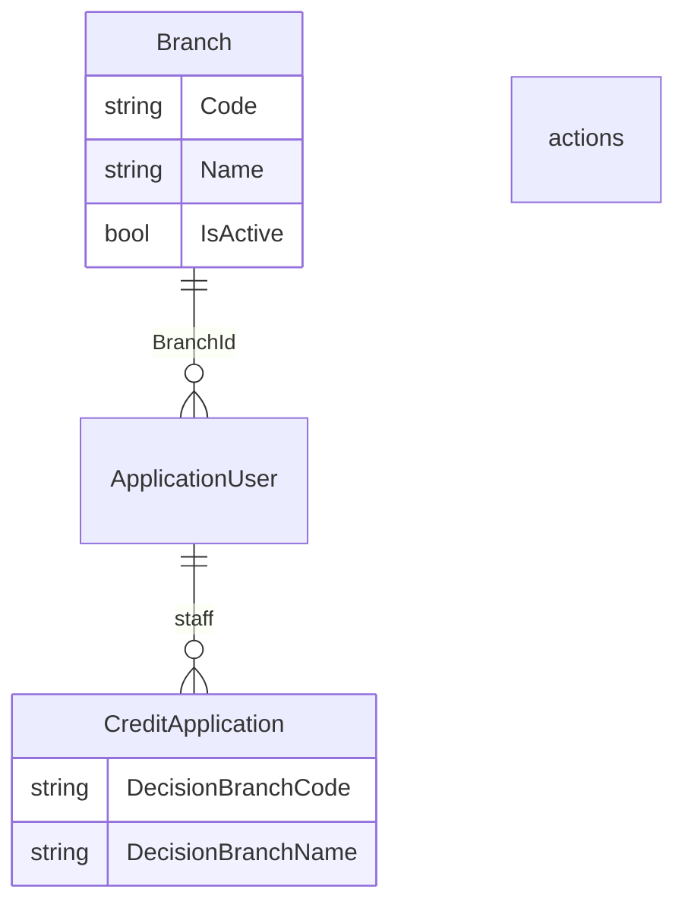
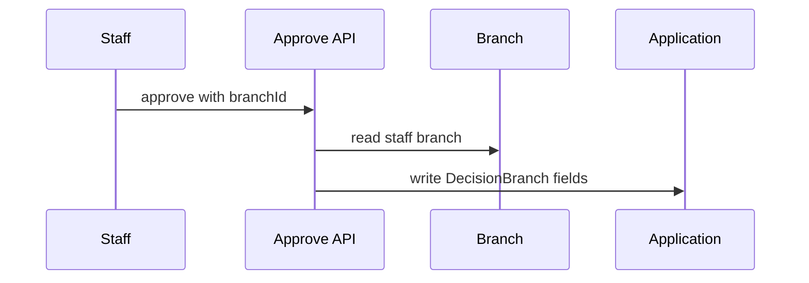

# 27 — Branch model

[← Previous](26-credit-application-documents.md) · [Contents](00-index.md) · [Next →](28-branch-rbac-superadmin.md)

Related: [06 JWT / RBAC](06-jwt-rbac.md) · staff management

## What is this?

**Branch**: A physical / organizational unit of the bank. Staff belong to a branch; on approve/reject, branch info is **snapshotted** onto the application (if staff move later, the decision record stays correct).

**Analogy:** A photo at decision time — staff transfer later does not change the stored branch name on the application.



## Role in BankApp

- Table `Branches` (Code, Name, City, IsActive, MaxApprovalAmount — optional branch DoA ceiling; details in [30](30-approve-gate-authority.md)).
- `ApplicationUser.BranchId` — set by demo staff seed.
- Approve/reject → `DecisionBranchCode` / `DecisionBranchName` on the application.
- API: `GET /api/Branches`; visible on staff list / profile / application detail.
- Managers can assign branch when editing staff.

## When added?

Roadmap “branch model” lab slice (2026-10-29).

## Core concepts

| Concept | Meaning |
|--------|--------|
| **Snapshot** | Copy of code/name at decision time (not a live FK) |
| **BranchId** | Staff’s current branch FK |
| **Seed sync** | Fill demo branches + staff BranchId without wipe |



## Commands

```powershell
# Migration already in repo; WebApi applies MigrateAsync on startup
cd infra
docker compose --env-file .env up -d --build webapi client
# Seed: IST-01, ANK-01, BER-01; staff@ → IST-01, manager@ → ANK-01, …
```

```powershell
# Branch list (JWT staff)
curl -s -H "Authorization: Bearer <TOKEN>" http://localhost:8080/api/Branches
```

## Classes, methods, packages

| Name | Role |
|------|-----|
| `Branch` | Entity |
| `BranchSeed` | Demo branches |
| `GetListBranchRequest` | List query |
| `Approve` / `Reject` handler | Decision branch snapshot |
| `BranchesController` | `GET /api/Branches` |

## Where in the repo?

```
src/Domain/Entities/Branch.cs
src/Persistence/Seed/BranchSeed.cs
src/Application/Modules/Identity/Features/Branches/
src/WebApi/Modules/Identity/Controllers/BranchesController.cs
client/src/pages/StaffPage.tsx
client/src/pages/ApplicationDetailPage.tsx
```

## Mini flow

Seed branches → staff `BranchId` → staff approves → application gets `DecisionBranch*` → detail UI shows “Decision branch”.

## Beginner lab

1. Login as `staff.tr@bank.local` — branch on profile.
2. `GET /api/Branches` — three demo branches.
3. Approve Pending → detail shows decision branch.
4. SQL: `DecisionBranchCode` stays if staff `BranchId` changes later.

## Common mistakes

- Mixing **BranchId** (live FK) with **DecisionBranch*** (snapshot).
- Empty decision branch — re-run seed / `EnsureDemoStaffBranches`.
- `GET /api/Branches` without JWT → 401.

## Where it helps

### Health checklist

| Check | How | Good sign |
|---------|-------|-------------|
| Table | SQL `Branches` | 3 demo rows |
| Staff | Staff list | Branch column populated |
| Snapshot | Approve Pending | Detail shows IST-01 · … |
| API | GET /api/Branches | JSON array |

### Disaster / recovery

| Situation | Path |
|-------|-----|
| Empty BranchId | Re-run seed (WebApi restart); EnsureDemoStaffBranches |
| No migration | WebApi log / `dotnet ef database update` |
| Wrong branch | Manager staff edit → pick branch |
