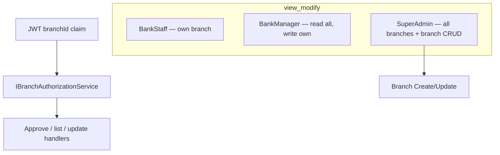
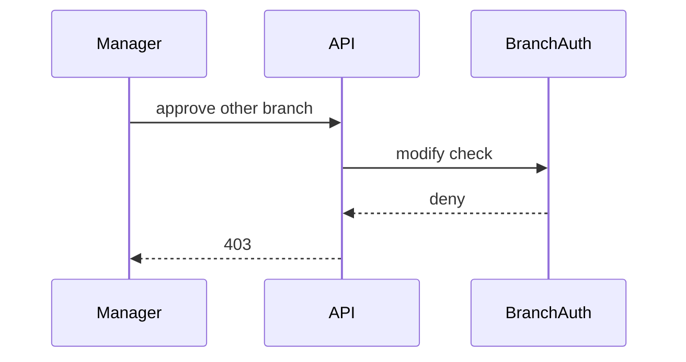

# 28 — Branch RBAC + SuperAdmin

[← Previous](27-branch-model.md) · [Contents](00-index.md) · [Next →](29-decision-letter-templates.md)

Related: [06 JWT / RBAC](06-jwt-rbac.md) · [27 Branch model](27-branch-model.md)

## What is this?

**Branch-scoped authorization**: Staff only see and change customers/applications in their own branch; managers can **read** other branches but not write; **SuperAdmin** has full access in every branch plus branch CRUD.

**Analogy:** Store chain — staff open only their till; regional manager looks through the window at other stores but cannot open their till; SuperAdmin opens every till.



## Role in BankApp

| Role | View | Mutate (approve/update…) | Branch CRUD |
|------|------|--------------------------|-------------|
| BankStaff | Own branch | Own branch | No |
| BankManager | All branches (list default: own) | Own branch | No |
| SuperAdmin | All + `?branchId=` | All | Yes |
| Customer | Own record | Own record | No |

### Staff management (StaffUsers)

| Actor | Target | Permission |
|-------|--------|------------|
| SuperAdmin | Everyone | Update / active-inactive / manager role |
| BankManager | Own account | Profile fields; **cannot change active-inactive or IsManager** |
| BankManager | Same branch, non-manager staff | Update + active-inactive; **cannot assign IsManager** |
| BankManager | Other-branch staff | List **readable**; Edit / Deactivate **hidden** (API 403) |
| BankManager | Another BankManager / SuperAdmin | **Forbidden** |

On create, `IsManager=true` only for SuperAdmin. UI: `StaffPage` actions + create checkbox follow the same rules; manager branch select is locked. Navbar: staff/manager show a `branchCode · branchName` chip (`AppLayout`).

- `Customer.BranchId` / `CreditApplication.BranchId` (copied from customer on create).
- JWT `branchId` claim; `IBranchAuthorizationService`.
- Seed: NYC-01, CHI-01; `superadmin@bank.local`; fake documents on pending applications.

## When added?

Roadmap branch RBAC slice (2026-10-29 / 10-30).

## Core concepts

| Concept | Meaning |
|--------|--------|
| **View vs modify** | Manager can see another branch; cannot approve/reject |
| **List filter** | Staff forced to own branch; Manager default own; SuperAdmin null = all |
| **SuperAdmin bypass** | `AuthorizationBehavior` passes all `ISecuredRequest` roles |
| **AccessDenied audit** | Cross-branch denial written to Seq |



## Commands

Rebuild + migrate + seed (no wipe needed; BranchId backfill comes from seed):

```powershell
cd infra
docker compose --env-file .env up -d --build webapi client
```

Verify — SuperAdmin login + branch list:

```powershell
# Login
curl.exe -s -X POST http://localhost:8080/api/Auth/Login -H "Content-Type: application/json" -d "{\"email\":\"superadmin@bank.local\",\"password\":\"Demo123!\"}"
# With token: GET /api/Branches ; POST /api/Branches (CRUD)
```

Staff cannot approve another branch’s application → 403.

Lab password (all demo accounts): `Demo123!` — Staff/Manager/Customer × `tr` / `de` / `en` email suffixes.

## Classes, methods, packages

- `GeneralOperationClaims.SuperAdmin`
- `IBranchAuthorizationService` / `BranchAuthorizationService`
- `ICurrentUserService.IsSuperAdmin` / `BranchId`
- `JwtHelper.CreateToken(..., branchId)`
- Branch CRUD: `CreateBranchRequest` / `UpdateBranchRequest`
- Staff RBAC: `StaffUserBusinessRules.EnsureBankManagerMayMutateTargetAsync`, `OnlySuperAdminMayAssignManagerRole`, `OnlySuperAdminMayCreateManager`
- Seed: `BranchSeed`, `CustomerBranchAssignmentSeed`, `ApplicationBranchAssignmentSeed`, `CreditApplicationDocumentSeed`

## Where in the repo?

- `src/Application/Services/Auth/BranchAuthorizationService.cs`
- `src/WebApi/Services/CurrentUserService.cs`
- `src/WebApi/Modules/Identity/Controllers/BranchesController.cs`
- `src/Persistence/Seed/*Branch*`
- `client/src/pages/BranchesPage.tsx`, `BranchFilter.tsx`, `StaffPage.tsx`
- `StaffUserBusinessRules` / Update+Create StaffUser handlers
- Migration: `AddCustomerAndApplicationBranchId`

## Mini flow

1. `staff.nyc@` login → NYC branchId in JWT → NYC applications only.
2. `manager.nyc@` reads CHI list with `?branchId=` → approve hidden in UI; API 403.
3. `superadmin@` updates CHI-01 on Branches page; approves any application.
4. `manager.nyc@` deactivates same-branch staff on Staff page; no Edit/Inactive/Role on another manager row; “Manager” create checkbox hidden. SuperAdmin can do both.

## Beginner lab

1. `staff.nyc@` — NYC applications only.
2. `manager.nyc@` — read CHI; approve 403 or hidden.
3. `superadmin@` — `/branches` CRUD.
4. Seq `AccessDenied` on intentional cross-branch approve.

## Common mistakes

- Missing **branchId** claim after login — check seed.
- Manager **write** on other branches — read-only cross-branch.
- **IsManager** assign as manager — SuperAdmin only.
- `?branchId=` on list — SuperAdmin null = all branches.

## Where it helps

### Health checklist

- [ ] SuperAdmin login + `/branches` CRUD
- [ ] Staff NYC / CHI isolation
- [ ] Manager cross-branch read-only
- [ ] Manager cannot update another manager / assign IsManager; SuperAdmin can
- [ ] Demo PDF/JPEG visible on pending application
- [ ] Seq `AccessDenied` (wrong-branch write attempt)

### Disaster / recovery (light → heavy)

WebApi recreate → seed backfill; if needed volume wipe (data loss).
