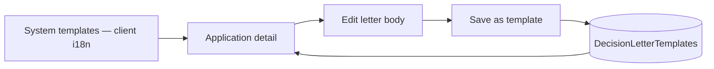

# 29 — Decision letter templates (user CRUD)

[← Previous](28-branch-rbac-superadmin.md) · [Contents](00-index.md) · [Next →](30-approve-gate-authority.md)

## What is this?

**Personal templates** for the letter sent to the customer after approve/reject. System defaults stay in client i18n; staff can save their own text and pick it again.



## Role in BankApp

On application detail, staff:

1. Auto-fill system template from UI language
2. Pick one of TR / EN / DE system templates
3. Save edited text to their account via “save as template”
4. Reuse saved template on later decisions

## When added?

Right after the branch RBAC / SuperAdmin slice (Phase 6 UX).

## Core concepts

| Concept | Meaning |
|--------|--------|
| Kind | `Approve` or `Reject` |
| Locale | Template language (`tr` / `en` / `de`) — can differ from UI language |
| System template | `client` i18n (`applications.templates.*`) |
| User template | DB table `DecisionLetterTemplates`, per user |
| Placeholders | `customerName`, `applicationNumber`, `amount`, `term`, `rate`, `reason` |

## Commands

After migration is applied, list templates while API is up (JWT required):

```powershell
# Login (same lab password for all)
curl.exe -s -X POST http://localhost:8080/api/Auth/Login `
  -H "Content-Type: application/json" `
  -d "{\"email\":\"staff.tr@bank.local\",\"password\":\"Demo123!\"}"
```

Verify: response includes `accessToken`. Then:

```powershell
curl.exe -s http://localhost:8080/api/DecisionLetterTemplates `
  -H "Authorization: Bearer <token>"
```

Expected: JSON array (may be empty on first use).

## Classes, methods, packages

- Entity: `DecisionLetterTemplate`
- Repo: `IDecisionLetterTemplateRepository` / `DecisionLetterTemplateRepository`
- MediatR: `Create` / `Update` / `Delete` / `GetList` DecisionLetterTemplate*
- Controller: `DecisionLetterTemplatesController`
- Client: `decisionTemplatesApi.ts`, template picker on `ApplicationDetailPage`

## Where in the repo?

- `src/Domain/Entities/DecisionLetterTemplate.cs`
- `src/Application/Modules/Identity/Features/DecisionLetterTemplates/`
- `src/WebApi/Modules/Identity/Controllers/DecisionLetterTemplatesController.cs`
- `client/src/api/decisionTemplatesApi.ts`
- `client/src/pages/ApplicationDetailPage.tsx`

## Mini flow

Staff opens Pending application → system template fills in UI language → edits text → “Save as template” → on next application picks own template from select → Approve/Reject.

## Where it helps

- [ ] Changing UI language refreshes letter (when text is not dirty)
- [ ] Deleting saved template resets select to `system`
- [ ] Other users’ templates do not appear in the list

Lab: if migration is missing, API may 500 — ensure `AddDecisionLetterTemplates` / `AddDecisionTemplateNameAndDocAudit` are applied (`docker compose up -d --build webapi` or `dotnet ef database update`).

## Related UX (same slice)

- Document approve gate: `CreditDocuments:ApproveGateMode` (`None` / `Soft` / `Hard`) — see [30](30-approve-gate-authority.md)
- Approval authority (DoA): `ApprovalAuthority` — see [30](30-approve-gate-authority.md)
- Client: `GET /api/CreditDocuments/config` → `approveGateMode`, `maxApprovalAmount`
- Staff list preset: “Pending + missing documents” → `Pending` + `missingRequiredDocumentsOnly`
- Decision audit: `DecisionBy` · `DecisionBranch*` · `DecisionTemplateName`
- Document upload → `CreditApplicationDocumentUploaded` SignalR toast + red badge on list/detail
