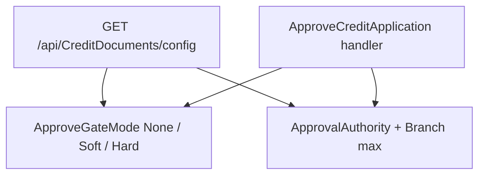

# 30 — Document approve gate + authority ceiling (DoA)

[← Previous](29-decision-letter-templates.md) · [Contents](00-index.md) · [Next →](31-elk-elasticsearch.md)

## What is this?

Three related config areas:

1. **ApproveGateMode** — for missing identity/income docs: `None` / `Soft` / `Hard`
2. **ApprovalAuthority** — max approve amount by staff position
3. **Branch.MaxApprovalAmount + MaxApprovalCurrencyCode** — optional branch ceiling (currency-labelled); effective = `min(position, branch)` only when **same currency**



## Role in BankApp

In lab, Development uses Soft gate + DoA off; prod-like base uses Hard + DoA on. Code always includes both paths; environment picks via `appsettings`. Branch ceiling is managed on SuperAdmin branch screen; `UnlimitedRoles` bypass both ceilings.

## When added?

Right after the soft boolean gate (Phase 6 UX / security).

## Core concepts

| Concept | Meaning |
|--------|--------|
| Soft | Warning + confirm; API still approves |
| Hard | API + UI block |
| DoA | Delegation of authority — position + branch limit |
| AppliedMax | `min(PositionMax, BranchMax)` (when set + currency matches); no match → `0` |
| CurrencyCode | `ApprovalAuthority:CurrencyCode` (position); branch has its own `MaxApprovalCurrencyCode` |
| UnlimitedRoles | BankManager / SuperAdmin — bypass position and branch ceilings |

## Commands

View config (staff JWT):

```powershell
# After login, with token
curl.exe -s http://localhost:8080/api/CreditDocuments/config `
  -H "Authorization: Bearer <token>"
```

Verify: `approveGateMode`, `approvalAuthorityEnabled`, `authorityCurrencyCode`, `maxApprovalAmount`, `positionMaxApprovalAmount` / `positionCurrencyCode`, `branchMaxApprovalAmount` / `branchCurrencyCode`. Optional `?currencyCode=EUR` filters by application currency.

To turn Soft into Hard in Development, change `ApproveGateMode` in `appsettings.Development.json` and restart API.

## Classes, methods, packages

- `ApproveDocumentGateMode`, `CreditDocumentsOptions`
- `ApprovalAuthorityOptions`, `ApprovalAuthorityEvaluator`
- `CreditApplicationBusinessRules.RequiredDocumentsShouldExistWhenHardGate`
- `CreditApplicationBusinessRules.ApprovedAmountShouldBeWithinApprovalAuthority`
- `ApproveCreditApplicationRequestHandler`
- `CreditDocumentsController.GetConfig`
- `Branch.MaxApprovalAmount` / `MaxApprovalCurrencyCode`, branch Create/Update/GetList

## Where in the repo?

- `src/Application/.../CreditApplicationDocuments/`
- `src/Application/.../ApprovalAuthority/`
- `src/Domain/Entities/Branch.cs`
- `src/WebApi/appsettings.json` / `appsettings.Development.json`
- `client/src/api/creditDocumentsConfigApi.ts`
- `client/src/pages/ApplicationDetailPage.tsx`
- `client/src/pages/BranchesPage.tsx`
- BRD/FRD: `docs/requirements/`

## Mini flow

Staff opens detail → `GET config` → Soft: confirm when docs missing; Hard: button locked → if DoA on, amount checked against `min(position, branch)` (UI shows breakdown) → Approve handler applies same rules on server.

## Where it helps

- [ ] Development Soft: approve without docs passes after confirm
- [ ] Hard override: approve without docs fails business rule
- [ ] DoA Enabled + CreditAnalyst low limit: high amount rejected
- [ ] Branch ceiling lower than position: effective = branch; UI breakdown correct (+ currency symbol)
- [ ] Currency chosen/visible on branch form/table
- [ ] Application currency differs from branch/position: that source shows “not available in this currency”; AppliedMax=0
- [ ] Manager role: `maxApprovalAmount` null (branch ceiling bypass)

Lab: no FX; single-currency labelled limits.
