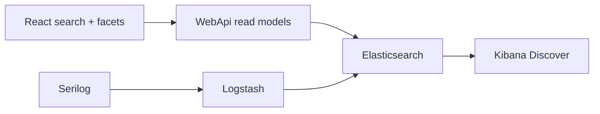
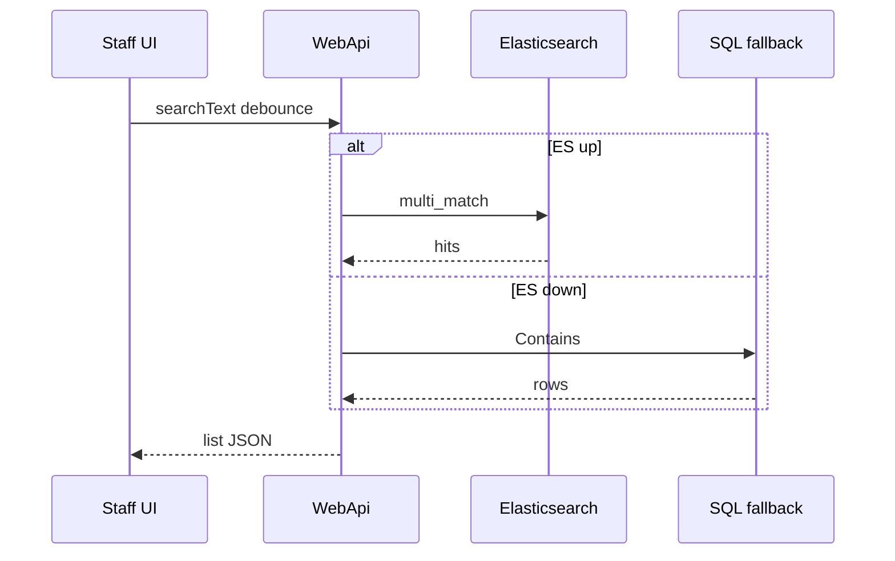

# 31 — ELK (Elasticsearch + Logstash + Kibana)

[← Previous](30-approve-gate-authority.md) · [Contents](00-index.md) · [Next →](32-admin-tailwind-dashboard.md)

## What is this?

**ELK** is a three-part observability / search stack:

| Part | Role |
|------|------|
| **Elasticsearch** | Indexes JSON documents; full-text + filter queries |
| **Logstash** | Ingests data (HTTP/TCP/Beats), transforms, writes to ES |
| **Kibana** | Index discovery, Discover, dashboard UI |

In the BankApp lab, ELK serves **five jobs**:

1. **Credit application search** (product read-model → ES; React live search box)
2. **Staff list search** (`bankapp-staff`; branch / text / manager filter; SQL fallback)
3. **Customer list** (`bankapp-customers`; branch / text; branch facet counts)
4. **Credit types** (`bankapp-credit-types`; text / locale / category / currency / risk + facets)
5. **Application logs** (Serilog → Logstash HTTP → `bankapp-logs-*`; searchable in Kibana)

**Seq was not removed.** Seq is fast lab UX for .NET structured logs; ELK is the search engine + Kibana. Both run side by side.

**Security (lab):** Compose keeps Elasticsearch `xpack.security.enabled=false`. Optional `elasticsearch_password` lives in Vault `secret/bankapp/observability`; production TLS + roles are a later slice.

**Analogy:** Seq = quick diary; Elasticsearch = library catalogue; Kibana = catalogue terminal.



## Role in BankApp

- Type-to-search on application list (`searchText`, ~300 ms debounce)
- **Staff page:** `search` + `BranchFilter` + manager/active chips; SuperAdmin all branches
- Staff application list: branch scoped; Manager/SuperAdmin: broader filters
- **Manager/SuperAdmin facet panel (applications):** status / branch / currency / missing docs / amount range (`GET …/facets`)
- List amount/currency filter (`amountMin`/`amountMax`/`currencyCode`)
- If ES is down: SQL `Contains` / GroupBy fallback
- Compose: `elasticsearch` :9200, `logstash` :8081/:50000, `kibana` :5601

## When added?

Phase 6 — after Soft/Hard gate + DoA (roadmap: staff GET search).

## Core concepts

| Concept | Meaning |
|--------|--------|
| Index | Table-like document collection (`bankapp-credit-applications`, `bankapp-staff`, `bankapp-customers`, `bankapp-credit-types`, `bankapp-logs-YYYY.MM.dd`) |
| Document | Single JSON record (application or log event) |
| Mapping | Field types (text / keyword / date…) — in lab, keyword/boolean/number on index create |
| Query | `multi_match`, `term`, `bool` filter, `range` (amount) |
| Aggregation | `terms` (status/branch/currency) + `range` (requestedAmount buckets) |
| Facet | Filter with counts; click applies to list query |
| Pipeline | Logstash input → filter → output |
| Discover | Browse logs/search with index pattern in Kibana |

### Seq vs Elasticsearch (for logs)

| | **Seq** | **Elasticsearch + Kibana** |
|--|---------|----------------------------|
| Purpose | .NET structured logs, fast debug | General search, dashboards, many sources |
| Setup | Lightweight | Heavier (RAM) |
| Daily DX | Serilog sink, nice UI | Powerful but ops cost |
| BankApp lab | **Primary log UX** | Logs **also** searchable in Kibana (optional depth) |

**Takeaway:** Do **not** replace Seq with ES; **extend** log search with Kibana. Some prod teams keep ELK only — in lab, knowing both is more educational.



## Commands

### Start the stack

```powershell
cd infra
copy .env.example .env   # if missing
docker compose --env-file .env up -d elasticsearch logstash kibana
```

Then: `docker compose --env-file .env ps` → elasticsearch/kibana should be healthy.  
If RAM is tight, try `ELASTIC_JAVA_OPTS=-Xms256m -Xmx256m` in `.env`.

### Elasticsearch health

```powershell
curl.exe -s http://localhost:9200
curl.exe -s http://localhost:9200/_cluster/health?pretty
```

Expected: `status` green/yellow (yellow normal on single node).

### Index list

```powershell
curl.exe -s http://localhost:9200/_cat/indices?v
```

After WebApi starts you should see `bankapp-credit-applications`, `bankapp-staff`, `bankapp-customers`, `bankapp-credit-types`, and (as logs arrive) `bankapp-logs-*`.

### Test Logstash (TCP json_lines)

```powershell
# Single JSON line (Logstash :50000)
echo '{"message":"lab-tcp-test","level":"Information"}' | curl.exe -s telnet://127.0.0.1:50000
```

On Windows, alternative for TCP: run WebApi with Logstash up and check Seq + Kibana Discover.

### Kibana

Browser: http://localhost:5601

1. Stack Management → Data Views → `bankapp-logs-*` (timestamp field)
2. Discover → filter logs
3. Second data view: `bankapp-credit-applications` (product search index)
4. Lens / Dashboard: pie or bar by `status` (time range: Last 1 year)

Screen (Kibana — application status chart / Discover):


### WebApi + search

```powershell
# Full compose or local API + ES
curl.exe -s "http://localhost:8080/api/CreditApplications?PageIndex=0&PageSize=10&searchText=APP" `
  -H "Authorization: Bearer <token>"
```

### Staff ES filter (SuperAdmin / Manager)

```powershell
curl.exe -s "http://localhost:8080/api/StaffUsers?PageIndex=0&PageSize=10&search=manager&isManager=true&branchId=<guid>" `
  -H "Authorization: Bearer <superadmin-or-manager-token>"
```

Verify: branch / text / `isManager` narrowing; SQL fallback if ES missing. UI: Staff page search + branch select + role chips; edit modal.

### Manager facet aggregations

Run with manager JWT. What it does: returns ES `terms`/`range` counts for active filter context (`source: Elasticsearch` or SQL fallback).

```powershell
curl.exe -s "http://localhost:8080/api/CreditApplications/facets" `
  -H "Authorization: Bearer <manager-or-superadmin-token>"
```

Verify: JSON has `statuses`, `branches`, `currencies`, `missingRequiredDocuments`, `amountBuckets`.  
To narrow list: same params on `GET /api/CreditApplications?amountMin=0&amountMax=50000&currencyCode=USD`.

## Classes, methods, packages

- `ElasticsearchOptions`, `LogstashOptions`
- `ICreditApplicationSearchService` / `ElasticCreditApplicationSearchService` / `Null…`
- `IStaffUserSearchService` / `ElasticStaffUserSearchService` / `NullStaffUserSearchService` (`StaffIndex`)
- `ICustomerSearchService` / `ElasticCustomerSearchService` (`CustomersIndex`) + `GET /api/Customers/facets`
- `ICreditTypeSearchService` / `ElasticCreditTypeSearchService` (`CreditTypesIndex`) + `GET /api/CreditTypes/facets`
- `GetFacetsAsync`, `CreditApplicationAmountBuckets`, `GetCreditApplicationFacetsRequest`
- `GetListCreditApplicationRequest.SearchText` / `AmountMin` / `AmountMax` / `CurrencyCode`
- `GetListStaffUserRequest.Search` / `BranchId` / `IsManager`
- NuGet: `Elastic.Clients.Elasticsearch`, `Serilog.Sinks.Http`, `Serilog.Sinks.Elasticsearch` (direct ES when Logstash off)
- Client: search + filter + facets on `ApplicationsPage` / `StaffPage` / `CustomersPage` / `CreditTypesPage`

## Where in the repo?

- `infra/docker-compose.yml` — elasticsearch, logstash, kibana
- `infra/logstash/pipeline/logstash.conf`
- `infra/logstash/config/logstash.yml`
- `src/WebApi/Modules/Credit/Search/`
- `src/WebApi/Modules/Identity/Search/`
- `src/Application/Services/Search/`
- `src/Application/Modules/Credit/Features/CreditApplications/Queries/GetFacets/`
- `src/Core/Logging/SerilogHostBuilderExtensions.cs`
- `client/src/pages/ApplicationsPage.tsx`, `StaffPage.tsx`, `CustomersPage.tsx`, `CreditTypesPage.tsx`

## Mini flow

1. Compose ES+Logstash+Kibana
2. WebApi start → credit + staff + customers + credit-types `ReindexAllAsync`
3. Type on application list → after 300 ms `searchText` → ES `multi_match` (else SQL)
4. Staff: branch / search / manager filter → `bankapp-staff` (else SQL); Edit → modal
5. Customer: search + BranchFilter → `bankapp-customers`; Manager branch facets
6. Credit type: search + currency/risk (+ locale/category) → `bankapp-credit-types`; Manager facets
7. Manager facet chip → `GET /facets` aggregations → list narrows
8. Serilog → Logstash HTTP → `bankapp-logs-*` → Kibana Discover

## Where it helps

- [ ] `curl localhost:9200` responds
- [ ] Kibana opens; log data view can be created
- [ ] Application list search box refreshes results while typing
- [ ] Staff page: branch + text + manager filter; Edit modal opens centered
- [ ] Customer / credit type pages: search + filter; Manager facet counts
- [ ] Manager facet panel shows counts; chips narrow list
- [ ] When ES is down: list + facets + staff/customer/credit types work via SQL fallback
- [ ] Staff does not see applications outside branch; Staff does not see facet panel

### Disaster / recovery (least → most destructive)

1. `docker compose restart elasticsearch`
2. Drop/recreate index: WebApi restart (reindex)
3. Delete volume (**data gone**):
   `docker compose down` then `docker volume rm bankapp-elasticsearch-data` — `-v` also affects all named volumes; watch SQL external volume

Lab note: on Docker Desktop ES sometimes starts slowly (`start_period` 60s+).

## Beginner lab

1. `docker compose up -d elasticsearch kibana` → `curl localhost:9200`.
2. WebApi restart → indices include `bankapp-credit-applications`.
3. Application list search box → results narrow.
4. Stop ES container → list still works (SQL fallback).
5. Kibana data view `bankapp-logs-*` + Discover.

## Common mistakes

- Replacing **Seq** with ELK — run both in lab.
- ES OOM — lower `ELASTIC_JAVA_OPTS`.
- Staff user expecting **facet** panel — manager/SuperAdmin.
- API 500 with no index — wait for healthy ES + reindex.
