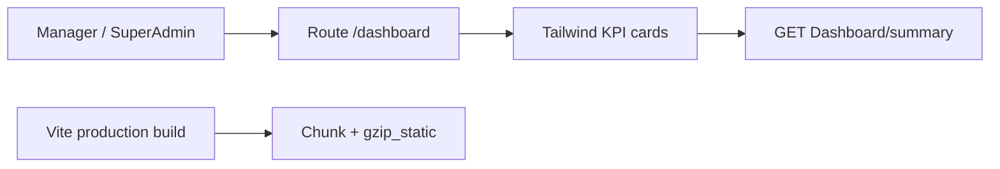
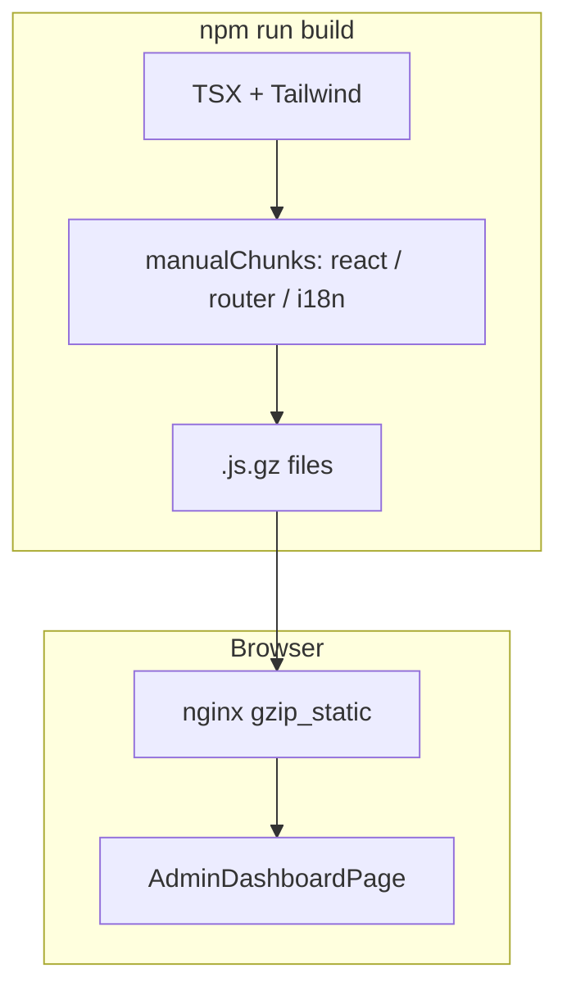

# 32 — Admin home dashboard (Tailwind + bundle compression)

[← Previous](31-elk-elasticsearch.md) · [Contents](00-index.md) · [Next →](33-keycloak-lab.md)

Related: [11 React + Vite](11-react-vite.md) · Dashboard API (Credit module)

## What is this?

**Tailwind CSS** is a utility-first styling library: you apply small ready-made classes (`rounded-xl`, `grid`, `px-4` …); the build bundles only **classes you use**.

**Chunking + gzip** splits JS in the Vite production build (react, router, i18n…) and produces **`.gz`** files nginx can serve — first load gets smaller HTTP responses.

**Analogy:** Tailwind = LEGO bricks; classic large CSS = a prefab model. Chunk/gzip = splitting the shipment box and compressing it.



## Role in BankApp

- Manager / SuperAdmin land on **`/dashboard`** after login (Tailwind KPIs + quick links)
- Reuses existing `GET /api/Dashboard/summary` (no new backend)
- Staff / customer still use the `/applications` home panel
- Compose client image: `manualChunks` + `gzip_static`

Screen: [Bank Manager dashboard](../../screenshots/bank-manager.en.md) · [SuperAdmin gallery](../../screenshots/super-admin.en.md)

## When added?

Phase 6 — after Manager ES facet panel (roadmap: Admin Tailwind dashboard).

## Core concepts

| Concept | Meaning |
|--------|--------|
| Utility class | Single-purpose class (`mt-3`, `flex`, `bg-amber-500`) |
| Preflight | Tailwind reset — **off** in BankApp (legacy `index.css` unchanged) |
| manualChunks | Split vendor packages into separate JS files |
| gzip_static | nginx serves pre-built `.gz` without CPU cost |
| Admin home | Role-based default route (`homePath`) |



## Commands

### Install client dependencies

If TLS corporate proxy issues: `$env:NODE_OPTIONS='--use-system-ca'`

```powershell
cd client
npm install
```

Verify: `package.json` includes `tailwindcss`, `@tailwindcss/vite`, `vite-plugin-compression`.

### Dev server

```powershell
cd client
npm run dev
```

Browser: http://localhost:3000 — log in as manager → `/dashboard`.

### Production build + chunk / gzip check

```powershell
cd client
npm run build
```

Then: under `dist/assets/` you should see `react-vendor-*.js`, `i18n-*.js`, `*.gz` files.

### Rebuild Compose client

```powershell
cd infra
docker compose --env-file .env up -d --build client
```

## Classes, methods, packages

- `AdminDashboardPage`, `HomeRedirect`, `homePath()`
- `getDashboardSummary` / `DashboardSummary`
- npm: `tailwindcss`, `@tailwindcss/vite`, `vite-plugin-compression`
- Vite: `manualChunks` + compression plugin; nginx: `gzip_static on`

## Where in the repo?

- `client/src/pages/AdminDashboardPage.tsx`
- `client/src/styles/tailwind.css`
- `client/src/utils/homePath.ts`
- `client/src/components/HomeRedirect.tsx`
- `client/vite.config.ts`, `client/nginx.conf`
- `client/src/App.tsx`, `AppLayout.tsx`, `LoginPage.tsx`

## Mini flow

1. Manager login → `homePath(true)` → `/dashboard`  
2. Page fetches `getDashboardSummary` → KPI cards  
3. “Pending” link → `/applications?status=Pending`  
4. `npm run build` → vendor chunks + `.gz` → nginx `gzip_static`

Screen (Manager dashboard):


SuperAdmin dashboard:


Credit types management (Manager):


## Beginner lab

1. Log in as `manager.*@bank.local` → address bar shows `/dashboard`.
2. Compare KPI numbers roughly with StatsStrip.
3. Log in as staff → applications home instead of `/dashboard`.
4. Run `npm run build` → check `dist/assets/*.gz` exists.

## Common mistakes

- Enabling Preflight → breaks legacy BankApp CSS  
- Not importing Tailwind **after** `index.css` → styles vanish  
- Claiming “Tailwind missing” without rebuilding the client image  

## Where it helps

- [ ] Manager login opens `/dashboard`  
- [ ] KPI counts match summary  
- [ ] Staff / customer see `/applications` home panel  
- [ ] After `npm run build`, `dist/assets/*.gz` exist  
- [ ] Compose client healthy; manager UI shows Tailwind cards  

### Disaster / recovery (least → most destructive)

1. Local `npm run build` error → `NODE_OPTIONS=--use-system-ca` then `npm install`  
2. Missing styles → `main.tsx`: `tailwind.css` before `index.css`  
3. Stale client image → `docker compose up -d --build client`  
