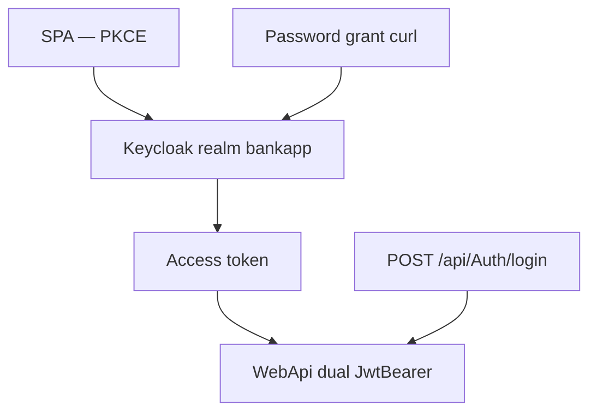
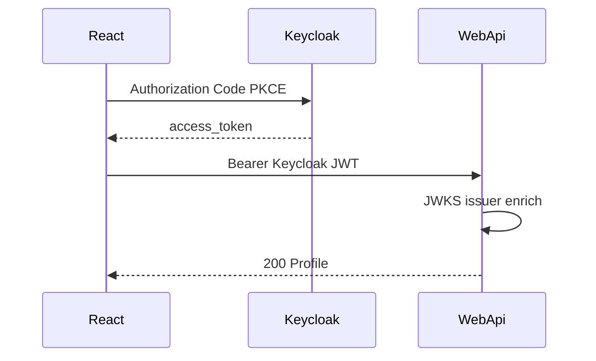

# 33 — Keycloak lab (Compose + dual JWT)

[← Previous](32-admin-tailwind-dashboard.md) · [Contents](00-index.md) · [Next →](34-a11y-portable-kit.md)

Related: [06 JWT / RBAC](06-jwt-rbac.md) · [19 Vault](19-vault-lab.md) · [09 Docker Compose](09-docker-compose.md)

## What is this?

**Keycloak** is an open-source **identity and access management** (IAM) server: it defines users / roles / clients, and issues **JWT access tokens** via OpenID Connect.

**Analogy:** One ID desk (Keycloak) issuing cards; the door guard (WebApi) accepts both Keycloak cards and legacy BankApp cards when dual mode is on.



## Role in BankApp

**Phase 1 — Compose + realm**

- Keycloak `http://localhost:8180`
- Realm `bankapp` import (roles + demo users + `bankapp-api`)
- Token via password grant

**Phase 2 — WebApi dual JWT (lab)**

- When `Keycloak:Enabled=true`, WebApi accepts both **local** `TokenOptions` JWT and **Keycloak** access token
- Issuer contains `/realms/bankapp` → Keycloak scheme; else local signature
- `role` → `ClaimTypes.Role`; enrich `NameIdentifier` / `branchId` / `customerId` from SQL by email

**Phase 3 — SPA login (PKCE)**

- React: “Sign in with Keycloak” → Authorization Code + PKCE (`oidc-client-ts`)
- Callback: `/login/callback`; access token uses existing `saveSession` / Bearer / SignalR
- Local email/password form **remains** (lab dual path)

**Social OAuth (identity brokering)**

- Google / GitHub IdP: off without secrets; with secrets → `keycloak-configure-social.sh`
- SPA uses same “Sign in with Keycloak” button; social choice on Keycloak hosted login

## When added?

Roadmap “Keycloak support” — Phase 1 Compose; then Phase 2 dual bearer.

## Core concepts

| Concept | Meaning |
|--------|--------|
| Realm | Isolated tenant (`bankapp`) |
| Client | `bankapp-api` (public + password grant + PKCE SPA) |
| Authority / JWKS | WebApi fetches signing keys from Keycloak |
| Policy scheme | JwtBearer chosen by token issuer |
| Claim enrich | Keycloak `sub` replaced with BankApp user Id |
| PKCE | SPA code flow; `code_challenge` S256 |
| start-dev | Lab mode (not production) |



## Commands

### Start Keycloak

```powershell
cd infra
docker compose --env-file .env up -d keycloak
```

**Check:** `docker compose ps keycloak` healthy; `http://localhost:8180` (admin/admin).

### Password grant token

```powershell
curl.exe -s -X POST "http://localhost:8180/realms/bankapp/protocol/openid-connect/token" `
  -H "Content-Type: application/x-www-form-urlencoded" `
  -d "grant_type=password" `
  -d "client_id=bankapp-api" `
  -d "username=staff.tr@bank.local" `
  -d "password=Demo123!"
```

### Protected API with Keycloak token (Phase 2)

WebApi must have `Keycloak__Enabled=true` in Development or Compose.

```powershell
# $TOKEN = paste access_token field
curl.exe -s "http://localhost:8080/api/Profile" `
  -H "Authorization: Bearer $TOKEN"
```

**Check:** not 401; profile / staff response (`branchId` populated if email matches seed).  
**Note:** Local login token still works on the same endpoints.

### SPA Keycloak login (Phase 3)

1. Client build: `VITE_KEYCLOAK_URL=http://localhost:8180` (Compose args / `client/.env`)
2. `http://localhost:3000/login` → **Sign in with Keycloak**
3. Keycloak: `staff.tr@bank.local` / `Demo123!` (or `manager.tr@`, `customer.tr@`, `superadmin@`)
4. Callback `/login/callback` → dashboard / applications

**Check:** Network shows API requests with Keycloak JWT `Authorization: Bearer`; UI roles from `role` claim.

Screen (SPA — Sign in with Keycloak):


Keycloak Admin Console:


### Re-import realm

```powershell
docker compose --env-file .env stop keycloak
docker compose --env-file .env rm -f keycloak
docker compose --env-file .env up -d keycloak
```

### Social IdP (Google / GitHub)

1. Create Google Cloud / GitHub OAuth app; redirect URIs:
   `http://localhost:8180/realms/bankapp/broker/google/endpoint`
   `http://localhost:8180/realms/bankapp/broker/github/endpoint`
2. Put client id/secret in `infra/.env` (or pass with `-e` in command).
3. Script:

```powershell
cd infra
docker compose --env-file .env exec `
  -e KEYCLOAK_GOOGLE_CLIENT_ID=... `
  -e KEYCLOAK_GOOGLE_CLIENT_SECRET=... `
  -e KEYCLOAK_GITHUB_CLIENT_ID=... `
  -e KEYCLOAK_GITHUB_CLIENT_SECRET=... `
  keycloak /bin/sh /keycloak-configure-social.sh
```

**Check:** Google/GitHub buttons on Keycloak login; after first-broker-login user joins realm. BankApp enrich needs email to match SQL `Users` (lab: prefer seeded user first).

**Alternative:** Admin Console → Realm `bankapp` → Identity providers → Add Google/GitHub.

## Classes, methods, packages

| Name | Role |
|------|------|
| `KeycloakOptions` | Enabled, Authority, ValidIssuers |
| `AddBankAppJwtAuthentication` | Local + Keycloak JwtBearer + `BankApp` policy scheme |
| `KeycloakTokenEnricher` | `role` → Role + SQL enrich |
| `infra/keycloak/bankapp-realm.json` | Realm import |
| `JwtHelper` / Auth login | Local token issuance (unchanged) |
| `oidc-client-ts` / `keycloakOidc.ts` | SPA PKCE redirect + callback |
| `LoginCallbackPage` | `/login/callback` |

## Where in the repo?

- `infra/docker-compose.yml` — `keycloak` + WebApi `Keycloak__*` + client `VITE_KEYCLOAK_*`
- `infra/keycloak/bankapp-realm.json`
- `src/WebApi/Configuration/KeycloakOptions.cs`
- `src/WebApi/Authentication/KeycloakAuthenticationExtensions.cs`
- `src/WebApi/Authentication/KeycloakTokenEnricher.cs`
- `src/WebApi/appsettings*.json`
- `client/src/auth/keycloakOidc.ts`, `LoginPage`, `LoginCallbackPage`

## Mini flow

1. Keycloak up → realm import
2. SPA “Sign in with Keycloak” → PKCE → access_token → `saveSession`
3. WebApi Bearer Keycloak token → scheme selection → JWKS validation → enrich
4. MediatR RBAC `ClaimRoles()` sees BankStaff
5. In parallel: local form → `POST /api/Auth/login` → BankApp JWT

## Where it helps

- [ ] Admin UI + realm `bankapp`
- [ ] Token `role` contains `BankStaff`
- [ ] `/api/Profile` (or staff list) returns 200 with Keycloak token
- [ ] SPA Keycloak button → callback → protected page
- [ ] Local `Auth/login` token still works
- [ ] Keycloak off (`Enabled=false`) → local JWT only

### Disaster / recovery

1. `docker compose restart keycloak`
2. Keycloak recreate (re-import)
3. WebApi log: JWKS / issuer mismatch → `ValidIssuers` + `Authority` (Compose: `http://keycloak:8080/...`)
4. Port: `KEYCLOAK_PORT` (8180)

## Beginner lab

1. `docker compose up -d keycloak` → `http://localhost:8180` admin/admin.
2. Password grant curl (`staff.tr@bank.local` / `Demo123!`).
3. With `Keycloak__Enabled=true`, `GET /api/Profile` with Bearer → 200.
4. SPA `VITE_KEYCLOAK_URL` → Sign in with Keycloak → `/login/callback`.
5. Local form login still works (dual path).

## Common mistakes

- Internal issuer (`http://keycloak:8080/...`) vs browser URL — check `ValidIssuers` + `Authority`.
- Keycloak token when `Enabled=false` — local JWT only.
- Social login without SQL email match — enrich needs seed user.
- JWKS errors — webapi logs + keycloak healthy.
