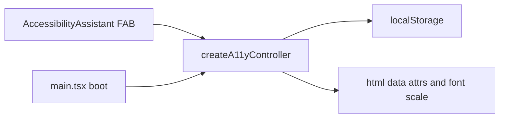
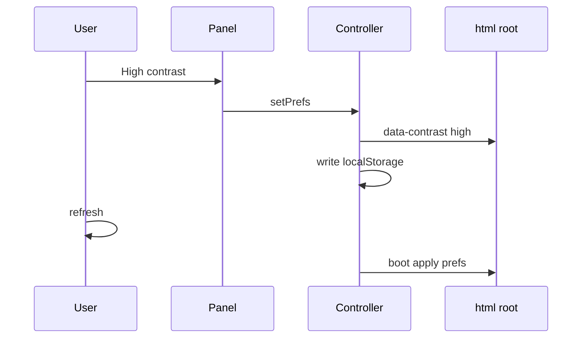

# 34 — Portable accessibility kit (a11y)

[← Previous](33-keycloak-lab.md) · [Contents](00-index.md)

Related: [12 i18n / UX](12-i18n-ux.md) · kit README: [`client/src/a11y/README.md`](../../../client/src/a11y/README.md)

## What is this?

An on-page **accessibility assistant**: theme, font size, contrast, blue filter, hide images, link underlines, reduced motion, color-blind profile, and simple page read-aloud.

The code is **not** a commercial widget; it is a **lab kit** you can copy into another SPA.

**Analogy:** Optician trial mirror — filters and font size; choices saved in your pocket (`localStorage`) and restored on return.



## Role in BankApp

- BankApp SPA: bottom-right FAB + vertical panel
- Prefs in `localStorage` (compatible with legacy `bankapp-*` keys)
- On `html`: `data-theme` / `data-contrast` / `data-a11y-*` + `--font-scale`
- TR / EN / DE labels via `react-i18next`

## When added?

UX lab — after Keycloak SPA; portable kit expanded from older simple toolbar.

## Core concepts

| Concept | Meaning |
|--------|--------|
| **Prefs** | User preference object (`A11yPrefs`) |
| **Controller** | `createA11yController` — read / write / apply |
| **data-\*** | HTML attributes CSS listens to |
| **TTS** | Browser `speechSynthesis` (lab; not a screen reader replacement) |
| **Portable kit** | `core.ts` framework-free; React is UI shell only |



## Commands

No dedicated CLI. To see the panel in development:

```powershell
# Start SPA (API running separately)
cd client
npm run dev
```

In the browser, click bottom-right person icon → open panel. Try theme / A± / filters → refresh page → prefs persist (`Application` → Local Storage).

Porting checklist to another project:

```text
1) Copy a11y/ folder
2) Host CSS: --font-scale + data-theme / data-contrast
3) main/boot: applyA11yPrefs(readA11yPrefs(...))
4) At root: <AccessibilityAssistant labels={...} />
5) Use DEFAULT_A11Y_KEYS (not BankApp legacy)
```

## Classes, methods, packages

| Name | Role |
|------|------|
| `createA11yController` | Preference lifecycle |
| `applyA11yPrefs` / `readA11yPrefs` | DOM + storage |
| `speakPageText` / `stopSpeaking` | Lab TTS |
| `AccessibilityAssistant` | React FAB + panel |
| `AccessibilityToolbar` | BankApp i18n wrapper |
| `BANKAPP_A11Y_KEYS` / `DEFAULT_A11Y_KEYS` | Storage key sets |

No NuGet/npm package — copy the folder.

## Where in the repo?

```
client/src/a11y/core.ts
client/src/a11y/a11y-assistant.css
client/src/a11y/AccessibilityAssistant.tsx
client/src/a11y/index.ts
client/src/a11y/README.md
client/src/components/AccessibilityToolbar.tsx
client/src/main.tsx          # boot
client/src/locales/*/common.json  # a11y.*
```

## Mini flow

User taps FAB → panel opens (`panelOpen`) → “High contrast” → `controller.setPrefs` → `localStorage` + `data-contrast=high` → CSS tokens change → on refresh `main.tsx` boot applies same prefs.

## Where it helps

### Health

- [ ] FAB visible (when not hidden)
- [ ] Theme / font / contrast persist after refresh
- [ ] Blue filter overlay does not block clicks (`pointer-events: none`)
- [ ] TTS starts / stops (supported browser)

### Lab disaster / recovery (least destructive first)

1. **Reset** from panel
2. DevTools → Local Storage → delete `bankapp-theme` / `bankapp-a11y-*` → refresh
3. If assistant was hidden, FAB still shows; click to reopen

## Beginner lab

1. `cd client` → `npm run dev` → bottom-right FAB.
2. Dark theme + font A+ → refresh → prefs persist.
3. Blue filter on → buttons still clickable (`pointer-events: none` on overlay).
4. TTS start/stop (supported browser).
5. Panel Reset → default theme.

## Common mistakes

- Treating TTS as a **screen reader** — lab demo only.
- Porting with **`BANKAPP_A11Y_KEYS`** in a new app — use `DEFAULT_A11Y_KEYS`.
- Missing `--font-scale` in host CSS.
- Skipping `applyA11yPrefs` on boot.
- `data-* +` in Mermaid nodes — breaks diagram; use quoted plain text.
