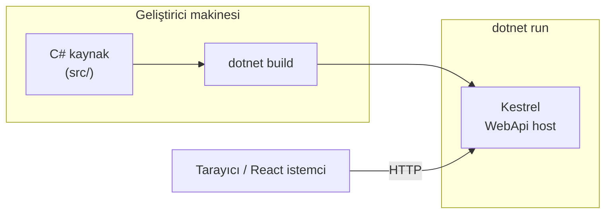
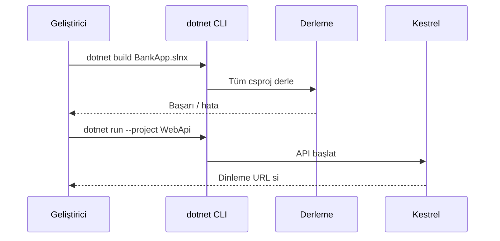

# 01 — .NET ve C# temelleri

[← İçindekiler](00-index.md) · [Sonraki: Clean Architecture →](02-clean-architecture.md)

## Bu nedir?

**.NET**, Microsoft’un uygulama çalıştırma platformudur (runtime + kütüphaneler + SDK).  
**C#**, bu platformda yazdığımız dil. BankApp backend’i **.NET 10** / **C#** ile yazılmıştır.

**Benzetme:** `BankApp.slnx` bir **dosya dolabı**; her `.csproj` çekmcedir. `dotnet build` tüm çekmeceleri kontrol edip derlenmiş çıktıyı üretir; `dotnet run` ise WebApi çekmecesini “açar” ve API’yi dinler.

“SDK” = bilgisayarında `dotnet` komutunu çalıştırmanı sağlayan araç seti.



## Bu projede ne işe yarar?

- Tüm API (`WebApi`), iş kuralları (`Application`), domain (`Domain`), veritabanı erişimi (`Persistence`) C# projeleridir.
- Çözüm dosyası: `BankApp.slnx` (birden fazla `.csproj`’u bir arada yönetir).

## Ne zaman eklendi?

**Faz 1** — projenin ilk gününden beri.

## Temel kavramlar

| Kavram | Anlamı |
|--------|--------|
| **Solution (`.sln` / `.slnx`)** | Birden fazla projeyi gruplayan “çözüm” |
| **Project (`.csproj`)** | Derlenen bir birim (ör. WebApi) |
| **Namespace** | Sınıfları klasör gibi gruplayan isim alanı |
| **Class / Interface** | Tip tanımları; `interface` sözleşmedir, `class` uygulamadır |
| **async / await** | I/O beklerken thread’i bloke etmeden bekleme |
| **NuGet** | .NET paket yöneticisi (`PackageReference`) |
| **TargetFramework** | Örn. `net10.0` — hangi .NET sürümüne derleneceği |



## Komutlar

```powershell
# SDK sürümünü gör
dotnet --version

# Solution’daki projeleri derle
dotnet build BankApp.slnx

# Sadece WebApi’yi çalıştır (Development)
dotnet run --project src/WebApi/WebApi.csproj

# NuGet paketlerini indir (restore)
dotnet restore BankApp.slnx

# Testleri çalıştır
dotnet test BankApp.slnx --configuration Release
```

| Parametre / bayrak | Ne işe yarar? |
|--------------------|----------------|
| `--project` | Hangi `.csproj` çalışacak |
| `--configuration Release` | Optimize üretim derlemesi (CI’da kullanılır) |
| `--no-restore` | CI’da restore ayrı adımsa tekrar restore etme |

## Sınıflar, metotlar, paketler

- Proje dosyası örneği: `src/WebApi/WebApi.csproj` → `<TargetFramework>net10.0</TargetFramework>`
- Giriş noktası: `src/WebApi/Program.cs` — host’u kurar, DI (dependency injection) kaydeder, middleware ekler.
- Ortak altyapı: `src/Core` (pipeline, exception, security yardımcıları).

Yeni başlayan için önemli paket fikirleri (sonraki bölümlerde detay):

- `MediatR` — istek yönlendirme  
- `FluentValidation` — doğrulama  
- `Microsoft.EntityFrameworkCore.*` — veritabanı  

## Repoda nerede?

```
BankApp.slnx
src/WebApi/Program.cs
src/WebApi/WebApi.csproj
src/Application/Application.csproj
src/Domain/Domain.csproj
src/Persistence/Persistence.csproj
src/Core/Core.csproj
```

## Mini akış

1. `dotnet build` → C# kaynakları IL’e derlenir.  
2. `dotnet run --project src/WebApi` → Kestrel web sunucusu ayağa kalkar.  
3. Tarayıcı / React istemci `http://localhost:…` üzerinden API’ye HTTP isteği atar.

Ekran örneği (API dokümantasyonu): [`Api Documents with Scalar.png`](../../assets/screenshots/en/Api%20Documents%20with%20Scalar.png)

## Yeni başlayan lab

1. `dotnet --version` → SDK’nın yüklü olduğunu doğrula (proje `net10.0` hedefler).
2. Repo kökünde `dotnet restore BankApp.slnx` → NuGet paketleri insin.
3. `dotnet build BankApp.slnx` → hata olmadan “Build succeeded”.
4. `dotnet run --project src/WebApi/WebApi.csproj` → konsolda dinleme adresi görünür.
5. Tarayıcıda `/health` veya Scalar/OpenAPI sayfasına git → 200 / doküman açılır.

## Sık yapılan hatalar

- Eski SDK ile derlemek → `global.json` veya SDK güncelle.  
- `dotnet run`’ı `src/WebApi` dışında yanlış klasörden çalıştırmak → `--project` ile tam yolu ver.  
- Restore atlayıp build’de “package not found” görmek → önce `dotnet restore`.  

## Nerede işe yarar?

- [ ] `dotnet build` tüm solution’da yeşil  
- [ ] WebApi lokal çalışıyor ve health yanıt veriyor  
- [ ] CI’daki `dotnet test` ile aynı SDK sürümünü kullanıyorsun  
