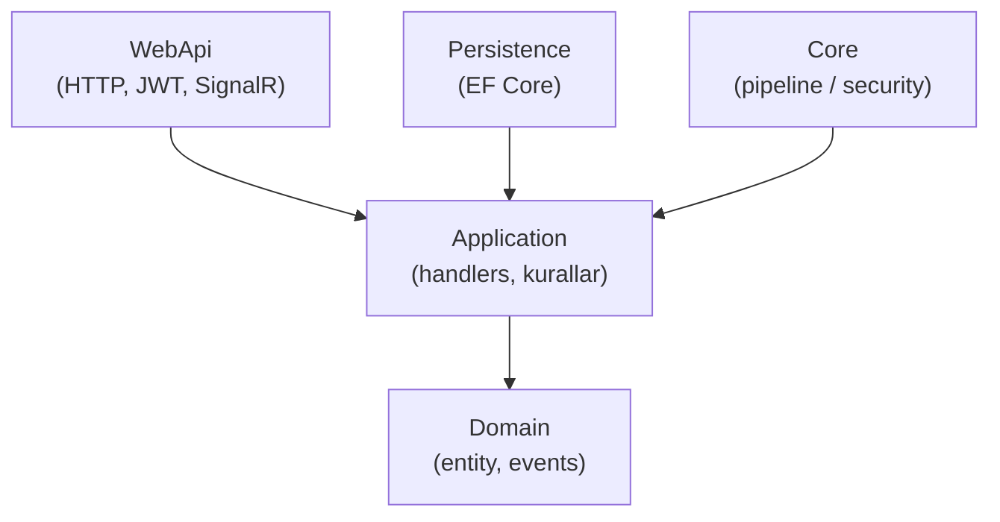
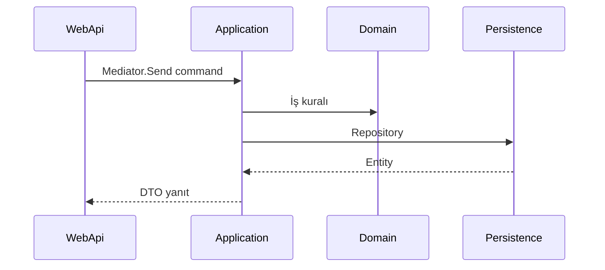

# 02 — Clean Architecture

[← Önceki](01-dotnet-csharp.md) · [İçindekiler](00-index.md) · [Sonraki →](03-ef-core-sql.md)

## Bu nedir?

**Clean Architecture**, kodu katmanlara ayırır: **iş kuralları** merkeze yakın, **UI / DB / framework** dışarıda kalır.  
Bağımlılık okları **içeriye** doğrudur: dış katman içtekini bilir; içtekiler dıştakileri bilmez.

**Benzetme:** Şirket **çekirdek** (Domain) içeride; tezgâh (WebApi) ve arşiv (Persistence) dışarıda. Çekirdek tezgâhın markasını bilmez; tezgâh çekirdeğin kurallarına uyar.



## Bu projede ne işe yarar?

BankApp katmanları:

| Katman | Görev |
|--------|--------|
| **Domain** | Entity, enum/SmartEnum, domain event — framework’ten bağımsız |
| **Application** | Use-case’ler (command/query handler), kurallar, DTO |
| **Persistence** | EF Core, repository, seed |
| **WebApi** | HTTP, JWT, SignalR, hosted service |
| **Core** | Paylaşılan pipeline / exception / security yardımcıları |

## Ne zaman eklendi?

**Faz 1**.

## Temel kavramlar

| Kavram | Anlamı |
|--------|--------|
| **Dependency Inversion** | Üst seviye, soyutlamaya (`interface`) bağlıdır |
| **DTO** | API’ye giden/gelen düz veri nesnesi |
| **Business rule** | “Sadece Pending onaylanır” gibi domain/uygulama kuralı |
| **Repository** | Veri erişimini soyutlayan arayüz |



## Komutlar

Clean Architecture’ın kendisi CLI değildir; katmanlar proje referanslarıyla bağlanır:

```xml
<!-- Application, Domain’e referans verir (örnek fikir) -->
<ProjectReference Include="..\Domain\Domain.csproj" />
```

Yanlış yön: `Domain` → `WebApi` referansı **olmamalı**.

## Sınıflar, metotlar, paketler

- Kayıt: `ApplicationServiceRegistration.cs`, `PersistenceServiceRegistration.cs`
- WebApi `Program.cs` içinde `builder.Services.Add…()` ile katmanlar birleştirilir.
- Modül ayrımı (sonra): `Application/Modules/*`, `WebApi/Modules/*` → [17](17-modular-monolith.md)

## Repoda nerede?

```
src/Domain/
src/Application/
src/Persistence/
src/WebApi/
src/Core/
```

## Mini akış

**Onay butonu** → `WebApi` controller → `Application` handler → `Domain` aggregate metodu → `Persistence` `SaveChanges` → (ileride) Outbox / SignalR.

## Yeni başlayan lab

1. `src/Domain/Domain.csproj` aç → **hiç** `WebApi` referansı olmamalı.
2. `src/Application/Application.csproj` → yalnızca `Domain` (+ gerekirse `Core`) referansına bak.
3. Bir command handler bul (`Features/.../Commands/`) → SQL/HTTP kodu yok, repository arayüzü var.
4. `src/WebApi/Program.cs` içinde `AddApplication` + `AddPersistence` kayıtlarını izle.
5. Yanlış yön referans eklemeyi dene (Domain→WebApi) → derleyici engeller.

## Sık yapılan hatalar

- `Domain` içine EF veya HTTP koymak → katman ihlali.  
- Controller’da doğrudan `DbContext` kullanmak → handler’a taşı.  
- DTO’ları Domain entity ile karıştırmak → API katmanına özel DTO kullan.  

## Nerede işe yarar?

- [ ] Bağımlılık grafı daima içe doğru  
- [ ] Yeni özellik için önce Application/Domain düşünüyorsun  
- [ ] Persistence değişince WebApi kodu minimum etkileniyor  
