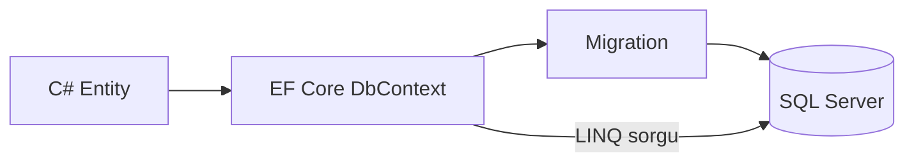
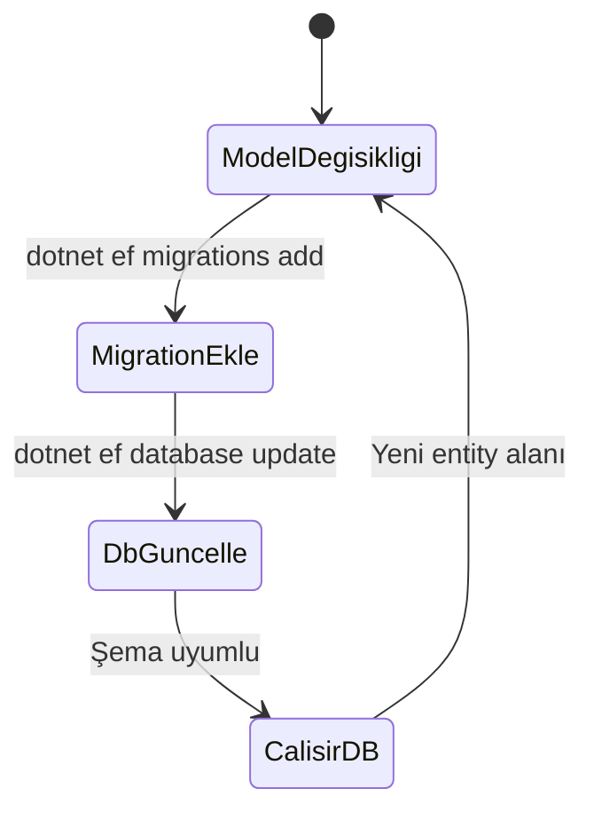

# 03 — EF Core ve SQL Server

[← Önceki](02-clean-architecture.md) · [İçindekiler](00-index.md) · [Sonraki →](04-cqrs-mediatr.md)

## Bu nedir?

**Entity Framework Core (EF Core)**, C# nesnelerini SQL tablolarına map’leyen ORM’dir.  
**SQL Server**, ilişkisel veritabanıdır. BankApp’te ana kalıcılık buradadır.

**Benzetme:** EF Core bir **tercüman**; C# entity konuşur, SQL tablosu dinler. Migration’lar da “sözlük güncellemesi” — şema değişince yeni sürüm kaydı oluşur.



## Bu projede ne işe yarar?

- Müşteri, kredi tipi, başvuru, outbox, saga satırları SQL’de tutulur.
- **TPT** (Table Per Type): bireysel / kurumsal müşteri ayrı tablolarda, ortak taban.
- Migration + seed (Bogus + sabit katalog) ile lab verisi üretilir.

## Ne zaman eklendi?

**Faz 1** (DB); Compose ile SQL **Faz 3**.

## Temel kavramlar

| Kavram | Anlamı |
|--------|--------|
| **DbContext** | Oturum + change tracking |
| **DbSet\<T\>** | Bir entity koleksiyonu (tablo gibi) |
| **Migration** | Şema değişikliğinin versiyonu |
| **Include** | İlişkili veriyi eager load |
| **Soft delete** | Satırı silmek yerine `DeletedDate` vb. işaretlemek |
| **TPT** | Kalıtım için ayrı tablolar |



## Komutlar

```powershell
# Migration ekle (Persistence projesinden / Design-time factory ile)
dotnet ef migrations add Isim --project src/Persistence --startup-project src/WebApi

# Veritabanını güncelle
dotnet ef database update --project src/Persistence --startup-project src/WebApi
```

| Bayrak | Anlamı |
|--------|--------|
| `--project` | Migration’ların bulunduğu proje |
| `--startup-project` | Connection string / DI’nın okunduğu host |

Docker lab’de port genelde `11433` → container içi `1433` (`infra/docker-compose.yml`).

## Sınıflar, metotlar, paketler

| Paket | Rol |
|-------|-----|
| `Microsoft.EntityFrameworkCore` | Temel API |
| `Microsoft.EntityFrameworkCore.SqlServer` | SQL provider |
| `Microsoft.EntityFrameworkCore.Design` / `Tools` | Migration CLI |

- Context: `Persistence/Contexts/BankingDbContext.cs`
- Config: `Persistence/EntityConfigurations/*`
- Repo: `Persistence/Repositories/*` implementing `Application/Services/Repositories/*`
- Önemli metotlar: `GetAsync`, `AddAsync`, `UpdateAsync`, `SaveChangesAsync`

## Repoda nerede?

```
src/Persistence/Contexts/BankingDbContext.cs
src/Persistence/EntityConfigurations/
src/Persistence/Repositories/
src/Domain/Entities/
infra/docker-compose.yml   # sqlserver servisi
```

## Mini akış

Handler `ICreditApplicationRepository.GetAsync(...)` çağırır → EF SQL üretir → satır belleğe gelir → `Approve(...)` → `UpdateAsync` → `SaveChangesAsync` transaction commit.

Ekran (Compose — SQL container):


## Yeni başlayan lab

1. Compose’ta SQL healthy (`infra`, `compose ps`).
2. `dotnet ef database update --project src/Persistence --startup-project src/WebApi` (connection string host’tan veya lab’den).
3. SSMS / Azure Data Studio ile `localhost,11433` → `CreditApplications` tablosuna bak.
4. Uygulamada bir başvuru listele → satır DB ile eşleşiyor mu?
5. `BankingDbContext.cs` içinde bir `DbSet` bul → karşılık gelen entity’yi `Domain/Entities`’te oku.

## Sık yapılan hatalar

- `--startup-project` vermemek → connection/DI bulunamaz.  
- Lab portunu `1433` sanmak → host’ta genelde `11433`.  
- Migration oluşturup `update` etmemek → “column invalid” çalışma zamanı hatası.  

## Nerede işe yarar?

- [ ] `database update` hatasız  
- [ ] Seed sonrası tablolarda demo veri var  
- [ ] Handler değişikliği SQL’i EF üzerinden üretiyor (ham SQL zorunlu değil)  
