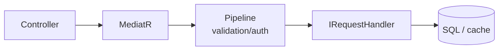
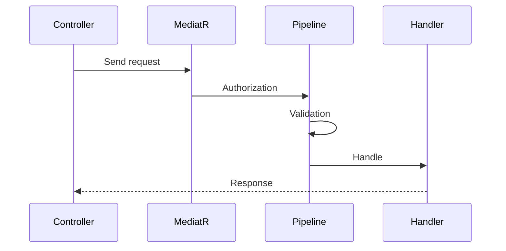

# 04 — CQRS ve MediatR

[← Önceki](03-ef-core-sql.md) · [İçindekiler](00-index.md) · [Sonraki →](05-validation-smartenum.md)

## Bu nedir?

**CQRS** (Command Query Responsibility Segregation): **yazma** (Command) ile **okuma** (Query) isteklerini ayırma fikri.  
**MediatR**: Controller’ın handler’ı doğrudan new’lemesi yerine “şu request’i işle” diye aracıya vermesi.

**Benzetme:** MediatR banka **danışma masasıdır**; müşteri (controller) “onay isteği” der, masa doğru memura (handler) yönlendirir, önce güvenlik ve kontrol (pipeline) çalışır.



## Bu projede ne işe yarar?

- `ApproveCreditApplicationRequest` → Handler onaylar.
- `GetListCreditApplicationRequest` → Handler listeler.
- Pipeline: validation, authorization, logging, caching (`IPipelineBehavior`).

## Ne zaman eklendi?

**Faz 1**.

## Temel kavramlar

| Kavram | Anlamı |
|--------|--------|
| **IRequest\<TResponse\>** | MediatR istek sözleşmesi |
| **IRequestHandler\<,\>** | İsteği işleyen sınıf |
| **IPipelineBehavior** | Handler’dan önce/sonra çalışan middleware |
| **Command** | Durumu değiştiren istek |
| **Query** | Durumu değiştirmeyen okuma |



## Komutlar

MediatR paket ekleme (zaten ekli; öğrenme için):

```powershell
dotnet add src/Application package MediatR
```

Çalışma zamanı CLI değil; DI kaydı:

```csharp
services.AddMediatR(cfg => cfg.RegisterServicesFromAssembly(...));
```

(`ApplicationServiceRegistration` içinde benzer kayıt vardır.)

## Sınıflar, metotlar, paketler

| İsim | Rol |
|------|-----|
| `IMediator.Send(request)` | İsteği handler’a iletir |
| `ApproveCreditApplicationRequest` | Onay command |
| `ApproveCreditApplicationRequestHandler.Handle` | Asıl iş |
| `RequestValidationBehavior` | FluentValidation çalıştırır |
| `AuthorizationBehavior` | `ISecuredRequest` rollerini kontrol eder |
| `LoggingBehavior` | Süre / hata logu |

Paket: `MediatR` (Application + Core pipeline).

## Repoda nerede?

```
src/Application/Modules/**/Features/**/Commands/
src/Application/Modules/**/Features/**/Queries/
src/Core/Application/Pipelines/
src/WebApi/Modules/**/Controllers/
```

## Mini akış

`POST /api/CreditApplications/{id}/approve`  
→ Controller `mediator.Send(new Approve…Request { … })`  
→ Authorization → Validation → Logging → Handler  
→ Response DTO.

## Yeni başlayan lab

1. `src/WebApi/Modules` altında bir controller aç → `IMediator` enjekte edildiğini gör.
2. Aynı feature’ın `Application/.../Commands` handler’ını bul.
3. Breakpoint veya log ile `Send` → pipeline sırasını izle.
4. Scalar’da bir POST dene → handler’a düşen request body’yi karşılaştır.
5. Query handler (`Queries/`) ile command handler farkını not et (yan etki yok).

## Sık yapılan hatalar

- Controller’da iş kuralı yazmak → handler’a taşı.  
- Query içinde `SaveChanges` çağırmak → command sorumluluğu.  
- Pipeline davranışı ekleyip DI’da kaydetmemek → hiç çalışmaz.  

## Nerede işe yarar?

- [ ] Yeni endpoint = yeni Request + Handler çifti  
- [ ] Validation/rol tek yerde (pipeline)  
- [ ] Controller ince kalıyor  
