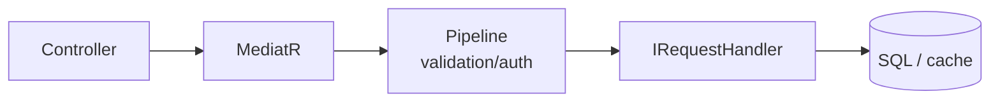

# 04 — CQRS ve MediatR

[← Önceki](03-ef-core-sql.md) · [İçindekiler](00-index.md) · [Sonraki →](05-validation-smartenum.md)

## Bu nedir?

**CQRS** (Command Query Responsibility Segregation): **yazma** (Command) ile **okuma** (Query) isteklerini ayırma fikri.  
**MediatR**: Controller’ın handler’ı doğrudan new’lemesi yerine “şu request’i işle” diye aracıya vermesi.



## Bu projede ne işe yarar?

- `ApproveCreditApplicationRequest` → Handler onaylar.
- `GetListCreditApplicationRequest` → Handler listeler.
- Pipeline: validation, authorization, logging, caching (`IPipelineBehavior`).

## Ne zaman eklendi?

**Faz 1**.

## Temel kavramlar

| Kavram | Anlamı |
|--------|--------|
| **IRequest\<TResponse\>** | MediatR istek sözleşmesi |
| **IRequestHandler\<,\>** | İsteği işleyen sınıf |
| **IPipelineBehavior** | Handler’dan önce/sonra çalışan middleware |
| **Command** | Durumu değiştiren istek |
| **Query** | Durumu değiştirmeyen okuma |

## Komutlar

MediatR paket ekleme (zaten ekli; öğrenme için):

```powershell
dotnet add src/Application package MediatR
```

Çalışma zamanı CLI değil; DI kaydı:

```csharp
services.AddMediatR(cfg => cfg.RegisterServicesFromAssembly(...));
```

(`ApplicationServiceRegistration` içinde benzer kayıt vardır.)

## Sınıflar, metotlar, paketler

| İsim | Rol |
|------|-----|
| `IMediator.Send(request)` | İsteği handler’a iletir |
| `ApproveCreditApplicationRequest` | Onay command |
| `ApproveCreditApplicationRequestHandler.Handle` | Asıl iş |
| `RequestValidationBehavior` | FluentValidation çalıştırır |
| `AuthorizationBehavior` | `ISecuredRequest` rollerini kontrol eder |
| `LoggingBehavior` | Süre / hata logu |

Paket: `MediatR` (Application + Core pipeline).

## Repoda nerede?

```
src/Application/Modules/**/Features/**/Commands/
src/Application/Modules/**/Features/**/Queries/
src/Core/Application/Pipelines/
src/WebApi/Modules/**/Controllers/
```

## Mini akış

`POST /api/CreditApplications/{id}/approve`  
→ Controller `mediator.Send(new Approve…Request { … })`  
→ Authorization → Validation → Logging → Handler  
→ Response DTO.
